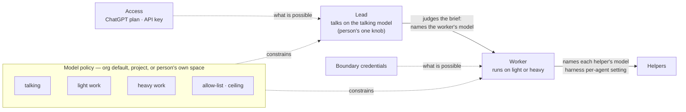

# Model selection by policy

Who picks which model, and from what. Spec: *Model selection*.

The policy says what is preferred; access says what is possible; each layer takes the preferred model its access reaches. An agent's defaults are the fallback where no policy says.
