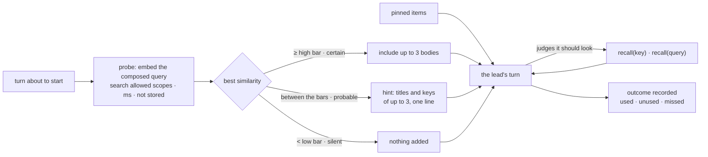

# What decides a recall

Each turn's decision. Spec: *Memory and knowledge › What decides a recall*.

The probe is automatic and cheap; the decision on the middle tier is the lead's; used, unused and missed outcomes tune the bars per organisation.
