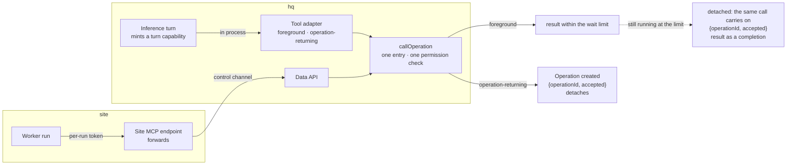

# Where the conversation's tools live

Two routes to one entry. Spec: *Tool execution contract*.

No new gateway. A foreground tool answers in the turn; an operation-returning tool creates an operation and detaches, its completion arriving later in the mailbox.
