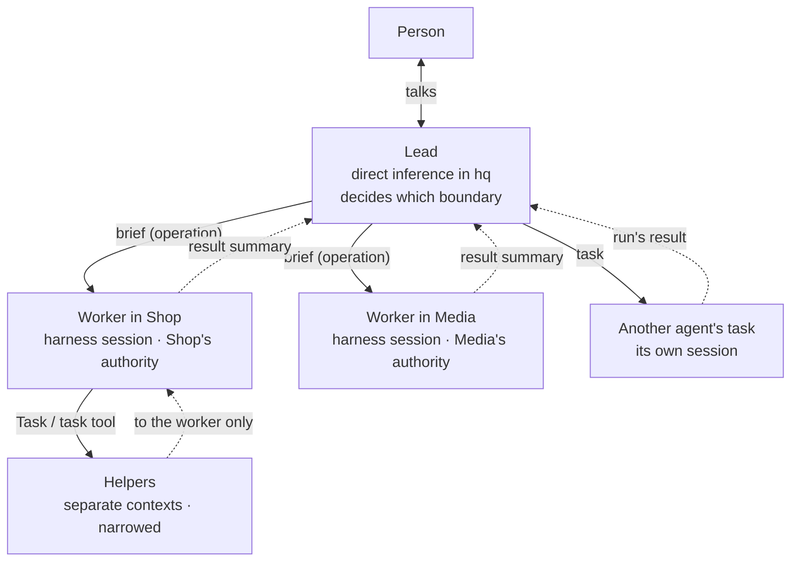

# Lead, worker, helper

Three layers, each with one job. Spec: *Workers*.

Solid arrows are briefs; dotted arrows are results. A helper never reports to the lead. Authority never crosses from inside a harness: only the lead commissions, through one standing worker per boundary, which runs one brief at a time.
