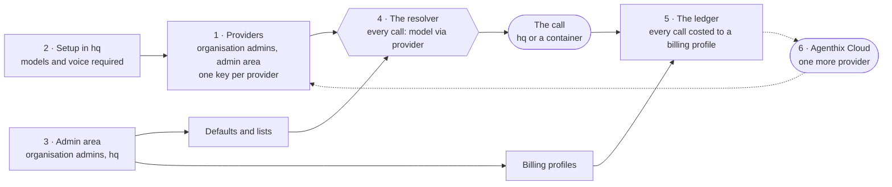

# Models from one place — spec

**Status:** Draft. The high-level design, agreed with the owner part by part on 2026-10-23. Each part below has its
own file under [`spec/`](spec/). Four areas were deep-dived, because their shape is hard to change after release or not
yet designed: the first-run tunnel (part 2, since removed: setup stays in hq), the ledger and the contract with Agenthix Cloud
(parts 5 and 6), personal projects (part 4), and what happens when something fails (parts 1, 4 and 6). The rest of
each part's detail is settled in the implementation plan from the decisions here. A deep dive may still change a part's
shape, and every change is carried back here.

## Purpose and outcome

Every model, speech-to-text and text-to-speech call in an organisation is supplied, chosen and costed from one place.
Keys are managed by the organisation's admins, in one place beside every other choice about models, never entered by
people or projects. One resolver decides the
model and the provider for every call. Every call is costed to a billing profile. The shape works unchanged when
Agenthix Cloud, the hosted service, supplies models and voice: it is one more provider.

## The problem

- **Keys are everywhere.** People, projects and the organisation each enter their own; nobody can say from the
  settings which key a call will use.
- **Five deciders, three rules.** Conversations, task runs, handed-off work and hq's own calls each choose a model and
  a key differently; an organisation with only an OpenRouter key cannot run tasks.
- **An agent has no models of its own** beyond a single default, and fixed light and heavy tiers decide work that
  people actually direct in the conversation.
- **Nothing is costed.** Token counts are kept for some calls and priced only when shown; summaries, titles and voice
  are not counted at all.
- **First setup lets models be skipped**, and voice can be left out entirely.

## Terms

| Term | Meaning |
|---|---|
| **Provider** | One service the organisation reaches AI through and is billed by, with what hq presents to use it. Of three types: an **LLM** provider (models), an **STT** provider (speech to text), a **TTS** provider (text to speech). Agenthix Cloud is one provider of all three. A model's *maker* (DeepSeek, reached through OpenRouter) is not a provider |
| **Fleet admin** | The role on an hq account that looks after machines and sites in the Fleet Console. Machines only |
| **Organisation admin** | The role that manages people, agents, providers, model choices and billing profiles, in hq's admin area |
| **Model via provider** | Every model choice names the provider that serves it: *Claude Sonnet 5 · via Anthropic* |
| **Billing profile** | What a place's AI cost belongs to, inside one organisation: *Fernhill*, *Client X*. Not a *billing account*, which is the hosted service's term for the entity that pays |
| **Unclaimed** | hq running with no accounts yet, waiting for the installer's setup link |
| **Actual / estimated** | A cost measured by the provider that bills it (Agenthix Cloud), or worked out by hq from list prices (the organisation's own keys) |

## The design at a glance

## The parts, in dependency order

| # | Part | What it decides | Deep dive |
|---|---|---|---|
| 1 | **Providers and their custody** | At most one key per provider for the organisation, managed by organisation admins on *Providers* in the admin area. One write module with three named ways in; no key is ever read back. User and project keys go | [`spec/providers.md`](spec/providers.md) |
| 2 | **Setup** | One setup in hq from the installer's link: the first account, then models and voice (required), then the organisation | [`spec/setup.md`](spec/setup.md) |
| 3 | **The organisation's admin area** | *Manage organisation*, a separate area of hq for organisation admins only, reached by *Manage* on the organisation's page; providers, models, billing profiles and usage live there | [`spec/admin-area.md`](spec/admin-area.md) |
| 4 | **Model routing** | One resolver for every call; the organisation's defaults for models and voice, each agent's own, allow and ban lists; the provider comes with the choice | [`spec/routing.md`](spec/routing.md) |
| 5 | **Billing and costing** | Every call costed to a billing profile; an append-only ledger; actual and estimated; billing profiles and the usage report | [`spec/billing.md`](spec/billing.md) |
| 6 | **Agenthix Cloud as a provider** | The contract hq and the hosted service build to: a token scoped to AI, its catalogue, voice tokens, its gateway, and the actual cost it reports by call id. hq's calls are built when the hosted side is ready | [`spec/cloud-provider.md`](spec/cloud-provider.md) |

**How they depend on each other.** Providers (1) must exist before anything is chosen; setup (2) is how the first ones
arrive. The admin area (3) is the frame the pages of 4 and 5 live in. Routing (4) decides what a call is;
billing (5) records what it cost. Cloud (6) is a provider of 1, a choice of 4 and a source of actual costs for 5.

## Decisions that bind every part

- **Voice is not optional.** Every organisation has a working LLM, STT and TTS provider from setup; every agent has a
  voice. Voice that stops working is an outage, said as one, never a setting someone chose.
- **Providers, model choices and billing profiles are the organisation admin's, in one place.** Which accounts the
  organisation reaches AI through, which models people get, and who a cost belongs to are one subject for one
  person. The fleet admin's job is machines only.
- **The Fleet Console stays apart from hq** (ADR-0107, ADR-0109): a takeover of hq never reaches a machine.
- **No profiles or sets of providers.** The provider is chosen at runtime with the model.
- **A person's own place** is their space and every personal project they make. Personal projects can never have
  members or be shared. A person's own Claude subscription works across their own place, and nowhere else; the organisation holds no
  Claude subscription, since a subscription belongs to one person. Every project, personal ones included, has its
  own storage.
- **A feature not ready ships behind its own flag** (ADR-0116), named once in `@agenthix/core`, on in development and
  off in production. Usage reporting to Agenthix Cloud is the first, `usageBilling`.
- **Keys enter only through the provider store:** the admin area's *Providers* page or setup, `agenthix provider add`
  on hq's machine, or the hosted service's controller, each checked with the vendor. Reading a key from hq's
  environment at start is removed.
- **Clean slate.** Old keys, policies and settings are dropped, never converted.

## Decision records

| Record | Change |
|---|---|
| New | Providers are the organisation admin's, written only through one module by three named actors |
| New | Setup requires models and voice before the organisation is defined |
| New | Every call is costed to a billing profile in an append-only ledger |
| New | The organisation's admin area is separate from the organisation's page |
| Amended | ADR-0134: hq's key rolls over automatically every 90 days, and its client id stays the thumbprint of its first key, each key named by `kid`; Agenthix Cloud is connected from hq, in setup and from *Providers*, by an organisation admin |
| Amended | ADR-0116: the flag list returns, with `usageBilling` |

## Not in this unit

- Sets of providers for one place (per-client keys); remote configuration of feature flags; spend limits;
  signing in with ChatGPT.
- The hosted service's own side: metering, invoices, payment and caps.

## Open questions

None. Every question raised in the high-level design was settled with the owner on 2026-10-23; the deep dives
may raise new ones, which are settled before anything is built.
