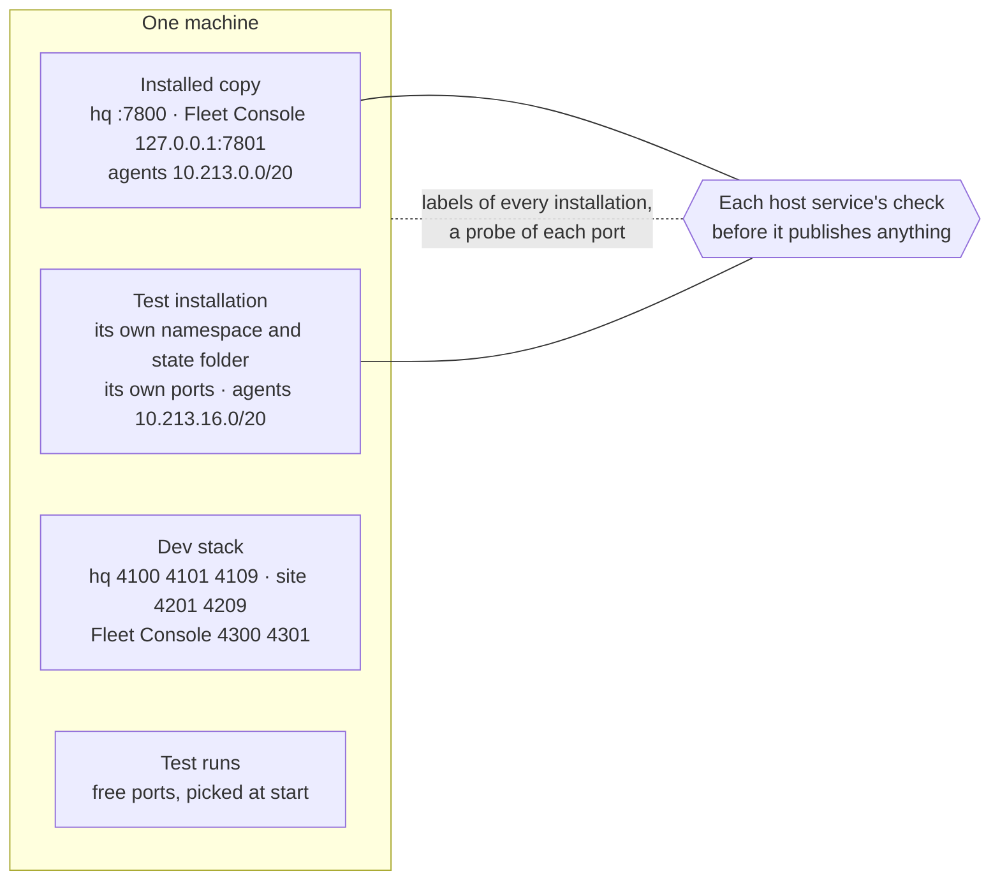

# One port plan — spec

**Status:** Draft, agreed with the owner rule by rule on 2026-10-24. **Kind:** initiative. **Issue:** tracked outside
this repository.

## Purpose and outcome

Dev, every test and any number of installations run side by side on one machine without a port or address clash.
Ports that only our own code uses follow one convention that is easy to remember. The few ports an installation opens
on the machine are the machine admin's choice: a quiet default, recorded at install and kept, checked before it is
used, and when it cannot be used, a refusal that names who holds it. The same rules bind every product of the line.

## The problem

Ports and address ranges are chosen today by habit, written down nowhere, and clash:

| # | Problem | Where |
|---|---|---|
| T1 | An installed hq's default address, `http://localhost:4100`, is dev's hq web port, so a default install and dev cannot run together | `host/src/install/address.ts:46`, `hq/vite.config.ts:10` |
| T2 | The Fleet Console is published at a fixed `127.0.0.1:4300`: no second installation fits on a machine, and the install test and the host container tests refuse while one runs | `host/src/compose/console.ts:19` |
| T3 | The cross-app suite, hq's browser tests and the guide's screenshots run hq on dev's own ports, so none of them runs while dev runs | `tests/cross-app/harness/env.ts:99`, `hq/playwright.config.ts:8` |
| T4 | `install` refuses wherever another host service's hq runs; a test that needs a second installation writes its namespace file by hand | `host/src/install/install.ts:98-103` |
| T5 | Every installation's agents share one address block, `10.213.0.0/16`, and each installation's firewall rules are written for all of it, so two installations' rules would cover each other's agents | `host/src/compose/projects.ts:55`, `host/src/protections/machine.ts:62` |
| T6 | `install` never checks that its ports are free; a taken port fails inside `docker compose up`, after state was written. After a reboot, a container whose port another program took fails to start and nothing says why | `host/src/install/install.ts` |
| T7 | The numbers are literals in dozens of files, with no source of truth, and some are already wrong (`hq/.env.server.example` says the client is on 4110) | scripts, configs, harnesses, documents |

## Terms

- **Published port:** a port opened on the machine itself, so that a browser, a phone or a proxy can reach it. Only
  published ports can clash. Ports inside containers never do: each installation's containers are on private networks
  of their own.
- **Installation:** one host service and everything it runs: its container, its state folder, its namespace, its
  published ports and its address ranges. Today's single install on a machine is one installation.
- **Namespace:** the name every container, volume, network and label of an installation starts with; today always
  the default.
- **Address block:** a range of IPv4 addresses written as a start and a size, such as `10.213.0.0/20`. An address is
  32 bits, four numbers of 8 bits each; the number after the slash counts how many bits from the left are fixed, and
  the free bits are the addresses inside, so a `/20` holds 2<sup>12</sup> = 4,096 addresses. Each extra fixed bit
  halves the block.

## One machine, after



## The rules

### Rule 1 · Our own convention: inside containers and in dev

Each of our services owns a hundred, and the last two digits say what listens: **41 hq, 42 site, 43 Fleet Console;
00 the web page, 01 the server, 09 the database.**

|  | x00 · web page | x01 · server | x09 · database |
|---|---|---|---|
| **41 · hq** | 4100 | 4101 | 4109 |
| **42 · site** | — | 4201 | 4209 |
| **43 · Fleet Console** | 4300, console-web | 4301 | — |

- The numbers are the same inside every installation's containers and in dev, so what runs in dev is what runs inside
  an install.
- Databases inside containers keep PostgreSQL's own 5432; in dev, where they listen on the machine, a database takes
  its service's x09.
- hq and the site keep today's numbers. The Fleet Console's server moves from 4300 to 4301, and console-web's dev
  server takes 4300, leaving Vite's default 5173, which many projects use.
- Tailscale serve, for reaching dev from other devices, stays on 4443 and 4444: it listens only on the tailnet
  address.

**Every port inside an installation's containers:**

| Container | Listens on, inside | Reached by | Published as |
|---|---|---|---|
| hq web (Caddy) | 4100: hq's browser app and the forwarder to hq's server | browsers, through the published port; the front door | hq's port, 7800 by default |
| hq server | 4101; a control socket (a file) | hq web; the site, over the hq link network; the host service, through the socket | not published |
| hq database | 5432 | hq's server | not published |
| site server | 4201; a control socket | hq's server; agent containers, for models | not published |
| site database | 5432 | the site's server | not published |
| Fleet Console | **4301** (was 4300): its server, which also serves console-web's built pages; a control socket; on a machine Agenthix Cloud runs, the remote-access port | fleet admins' browsers, through the published port; Agenthix Cloud | the console's port, 7801 by default, on 127.0.0.1; the remote-access port as Agenthix Cloud names it |
| Front door (Caddy), when on | 80 and 443 | anyone reaching an https address | 80 and 443 |
| Host service | none: sockets only | its command line, the Fleet Console | not published |
| Agent containers | 4096 on the container's own loopback address (the OpenCode server); an agent's own preview, on whatever port its app uses | only from inside the container: the site reaches both through `docker exec` | not published |

### Rule 2 · Tests take free ports when they start

The cross-app suite and the guide's screenshots ask the operating system for free ports (by binding port 0) and pass
them to the hq, site and fakes they start. hq's browser tests start no hq of their own: they run against one already
running, dev's by default or another named by `E2E_CLIENT_URL` and `E2E_SERVER_URL`, so running them beside dev means
testing dev's hq, not a second one; only what they start themselves, the stand-in model, takes a free port. Nobody
types a test's address, so nothing needs remembering, and no run clashes with dev or with another run. Because free
ports no longer keep two cross-app runs apart, and both would use dev's test databases (ADR-0035), one cross-app run
at a time holds them. Tests that are real installations publish chosen ports like any installation (Rule 3). This
answers T3.

### Rule 3 · An installation publishes two ports, chosen by the machine admin

| Published | Default | Chosen with | Changed later with |
|---|---|---|---|
| hq | **7800**; with no address given, hq is at `http://localhost:7800` | the port in hq's address, or `--hq-port` | `agenthix hq address` |
| Fleet Console | **7801**, on 127.0.0.1 only | `--console-port` | `agenthix console port <port>`, new |
| Front door | 80 and 443 | turning it on | — |
| Remote access, on a machine Agenthix Cloud runs | — | Agenthix Cloud's request | Agenthix Cloud |

**Why 7800 and 7801:**

1. **Between 1024 and 32767.** A lower port needs extra privileges on Linux. Higher ports are where operating systems
   hand out ports for outgoing connections (Linux 32768–60999, Windows and macOS 49152–65535), so a service there can
   find its port taken at random.
2. **The quietest hundred in the registered range.** The public registry of known port uses lists one obscure use in
   7800–7899 (7831) and nothing at 7800 or 7801. The busy places are avoided: 3000–3999 (Node, Grafana, Rails, MySQL,
   remote desktop), 4200 (Angular), 4443 and 4444, 5000 and 7000 (macOS's AirPlay receiver holds both by default),
   5173 (Vite), 5432 (PostgreSQL), 5900 (VNC), 6000–6063 (X11), 6379 (Redis), 6443 (Kubernetes), 7400–7402 (DDS),
   7700–7799 (game servers, 7777), 8000–8099 and 8443 (web frameworks and proxies), 9000–9999.
3. **Far from our own 41xx–43xx**, so an installed copy and dev always run together, and an installed hq (78xx) is
   never mistaken for dev's (41xx).
4. **One pair to remember:** hq on 7800, its console next door on 7801.
5. **Only a default.** The admin may choose any port from 1024 to 32767, or 80 or 443 for hq. The choice is
   recorded in the installation's state and kept across every upgrade.

An hq address and `--hq-port` that disagree are refused: *"HQ's address is on port 7500, but --hq-port says 7600.
Give one of them."* A site publishes no ports, so any number of sites on a machine never clash on ports. This answers
T1 and T2.

### Rule 4 · Check before publishing, and say who holds it

| When | What happens |
|---|---|
| `install`, `restore`, a move received, `console install`, `hq address`, `console port`, `front-door on`, turning remote access on, and before an upgrade swaps containers | The host service checks each port it is about to publish: in range (Rule 3, point 5); not another installation's (any container of another namespace, running or stopped, whose ports label lists it); not held now (a bind probe on the address it would bind, as the front door's probe does today in `host/src/frontDoor/probes.ts`). When a bind fails, Docker's published ports name a container if one holds it; otherwise the holder is a program outside Docker, or a block of ports Windows reserves for its virtual networking. Every problem goes into one refusal, in the existing `Refusal` shape, naming the port, its holder and the flag that chooses another, and ending "Nothing was changed." Only then is anything fetched, written or started |
| While the installation runs | Nothing: it holds its ports, and a program arriving later is the one that fails |
| After a reboot, when another program took a port first | The host service notices the container that could not start and says why in `agenthix status` and in the Fleet Console: *"hq cannot start: port 7800 is held by …; free it, or move hq with agenthix hq address."* When the console's own port was taken, `agenthix status` on the machine still says so |
| Dev scripts | Each checks its ports before starting and refuses naming the holder. Vite refuses instead of moving to the next port (`strictPort`). One environment variable per port moves it on a machine where it is taken |

A refusal reads, for example: *"Port 7801, for the Fleet Console, is held by a program on this machine, not by a
container. Choose another with --console-port. Nothing was changed."* This answers T6.

### Rule 5 · Several installations on one machine, for testing

- **Each installation is one host service with its own namespace and state folder.** The namespace is set at the host
  service's first start by the environment variable `INSTALL_NAMESPACE` on its `docker run`, and is the default when
  not given. Its container must be named `<namespace>-host`, the name it finds itself by to upgrade, back up and
  uninstall; a mismatch is refused at the first start, naming the name it needs.
- **What it chose is recorded** in `<state>/installation.json`, which replaces `namespace.json`:
  `{ namespace, ports: { hq, console }, agentRange, recordedAt }`; and as labels on every container it runs,
  `<namespace>.ports` and `<namespace>.agent-range`, which another installation's check reads.
- **"Another HQ runs on this machine" is no longer a refusal.** A clash of ports or address blocks is (Rule 4).
- **Supported for people stays one hq and one site per machine** (ADR-0108, unchanged). The user guide shows only that.
  Test installations — the install test, the host container tests, the mobile app's test hq — are written in the
  running-locally skill and in `docs/architecture/deployment.md`:

  ```sh
  docker run -d --name mobiletest-host --restart unless-stopped \
    -v /var/run/docker.sock:/var/run/docker.sock -v ~/.agenthix-mobiletest:/state \
    -v mobiletest-host-figures:/run/host-figures -e INSTALL_NAMESPACE=mobiletest \
    --network host --cap-add NET_ADMIN \
    --label com.docker.compose.project=mobiletest-host ghcr.io/solution84-com/agenthix-host:<version>
  docker exec -it mobiletest-host agenthix install --address http://<machine's address>:7500 --console-port 7520
  ```

- **What keeps the choice:** an upgrade, a re-run of `install` and the host service's own update read it back and
  never choose again. `hq address` and `console port` change one port, after the check. A move or a restore chooses
  on the receiving machine: ports belong to a machine, not to the organisation's data. Uninstalling removes the
  state folder and the labels with it.

This answers T4.

### Rule 6 · Address blocks: picked free, recorded, one agent slice per installation

| Block | For | How |
|---|---|---|
| `10.214.0.0/16` | An installation's own networks (console, hq, site, edge, hq link) | Unchanged: a free `/24` each, picked automatically (`host/src/compose/subnets.ts`) |
| `10.213.0.0/16` | Installations' agents | **A `/20` slice per installation**, below |
| `10.212.0.0/16` | Dev's site | Written into `site/.env.server.example` |
| `10.211.0.0/16` | Tests | Fixed per test, outside the installations' blocks (the protections test's `10.213.250.0/29` moves) |

**The agent slice.** A `/20` fixes the first two numbers and the first 4 bits of the third, leaving 12 bits free:
4,096 addresses, covering 16 values of the third number (`10.213.0.0`–`10.213.15.255`, then `10.213.16.0`–
`10.213.31.255`, and so on). So `10.213.0.0/16` holds 16 slices: **up to 16 installations with a site per machine**.
Within its slice the site gives each agent container a `/29` (8 addresses), so **at most 512 agent containers at once
per site**.

The slice is picked when an installation's site is first installed: the first of the 16 that overlaps no Docker
network, no address of the machine and no other installation's `<namespace>.agent-range` label. It is recorded
(Rule 5), given to the site as `AGENT_NETWORK_RANGE`, which the site already reads, and the firewall rules are written
for the slice alone, so each installation's rules cover only its own agents. When no slice is free, the install is
refused before anything is written, as `installSubnets` refuses today when no `/24` is left.

| Slice | Addresses in a slice | Agent containers at once, per site | Slices in `10.213.0.0/16` | Installations with a site, per machine |
|---|---|---|---|---|
| `/16` (today: one for all) | 65,536 | 8,192 | 1 | 1 |
| `/18` | 16,384 | 2,048 | 4 | 4 |
| **`/20`, chosen** | **4,096** | **512** | **16** | **16** |
| `/22` | 1,024 | 128 | 64 | 51 * |
| `/24` | 256 | 32 | 256 | 51 * |

\* Capped by the installations' own networks: five `/24`s each from the 256 in `10.214.0.0/16`.

**Why `/20`:** 512 agent containers at once is more than one machine's CPU and memory run; sixteen installations
leaves room for test installations beside the real one; smaller slices buy installations nobody needs, larger ones
limit test installations for no gain. An installation without a site, such as a Fleet Console alone, takes no slice.
This answers T5.

### Rule 7 · One source of truth

One file in `core`, plain data with no imports, holds the convention (Rule 1), the published defaults and the bounds
for a chosen port (Rule 3), and the address blocks and slice size (Rule 6).

- The host service takes its defaults from it, so they ship in its image.
- hq's Vite and Playwright configurations, the cross-app harness and console-web's Vite configuration import it.
- A shell helper in `scripts/dev/` prints it as `NAME=value` lines for the dev scripts (Node 24 runs the TypeScript
  file as it is).
- A unit test in `core` checks it: no port used twice, every default within 1024–32767 and away from the dev ports,
  no two address blocks overlapping.
- `docs/architecture/ports.md` is the table people read, and a test keeps it equal to the file. Every other document
  links there instead of writing numbers, except the user guide, which keeps 7800 and 7801 where a person needs them.

This answers T7.

### Rule 8 · The rules bind the whole product line

Nothing is reserved for another product; every product follows these rules. Another product's dev services each own
a hundred of their own under the same convention, clear of the platform's 41, 42 and 43, 4443–4444 and 7800–7801; its
tests take free ports; the hqs a hosted service deploys are installations under Rule 3. Agenthix Cloud's own services
run on its own infrastructure and need no default on anyone's machine. The mobile app listens on nothing, and its test
hq is an installation, reached at `http://<machine's address>:<its hq port>`. Each product records its own hundreds in
its own repository; this repository names only the platform's.

## What changes, by module

| Module | Changes |
|---|---|
| **core** | The ports file, its test, and the test keeping `docs/architecture/ports.md` equal to it |
| **host** | `installation.json` in place of `namespace.json`, with `INSTALL_NAMESPACE` at first start and the container-name check; `--hq-port` and `--console-port` on `install`, `restore`, `console install` and a move received; a new `console port` command; hq's and the console's published ports from the installation (`address.ts`, `compose/projects.ts`, `compose/console.ts`; `CONSOLE_ADDRESS` becomes per installation; the console listens on 4301 inside); labels on every container; the check (Rule 4), replacing the one-hq refusal and run again before an upgrade swaps containers; a container that could not start for a taken port reported in status and the Fleet Console; the agent slice for the site and the firewall rules; status and command-line words naming the installation's own addresses |
| **site** | No code change: it already reads `AGENT_NETWORK_RANGE`. `.env.server.example` carries dev's block |
| **hq** | Vite's and the server's ports from the ports file and the environment, Vite with `strictPort`; Playwright and the guide's screenshot workflow on free ports. hq's own code is unchanged |
| **console, console-web** | The console's default port 4301; console-web's dev server on 4300, its proxy target from the file; words naming hq's port read the installation's |
| **tests and scripts** | The cross-app harness on free ports; the install test as a test installation (its namespace by `INSTALL_NAMESPACE`, its ports chosen); the host container tests on ports of their own and on `10.211.0.0/16`; the dev scripts reading the ports file and checking before they start |
| **docs** | `docs/architecture/ports.md`; `deployment.md` and `host-management.md` on installations, published ports, the check and test installations; the user guide's 4100 and 4300 become 7800 and 7801, with how to choose others; the running-locally skill, `AGENTS.md` files and `docs/CONTRIBUTING.md` link to the ports document; the stale `HQ_ORIGIN` in `hq/.env.server.example` fixed |

## Decisions

- **Installations, not machines, own the mechanism.** Several may run on one machine, each wholly apart; the host
  service refuses only a real clash. This also leaves room, later, for isolating sites into installations of their
  own. Recorded in a new decision record, *An installation owns its published ports and address blocks*, which points
  to ADR-0108 for what is supported.
- **The business rule stands:** supported and tested as a product is at most one hq and one site per machine
  (ADR-0108, unchanged). Several installations per machine are for testing and are not in the user guide.
- **Ports are the machine's decision** (Rules 1–4), **the agent slice is a `/20`** (Rule 6), and **the rules bind the
  whole product line** (Rule 8).
- ADR-0035 (test data isolation by database name, not by port) stands.

## Versioning and old state

The host service's stored state (`installation.json`) and its command line change shape, so
[`docs/architecture/versioning.md`](../../architecture/versioning.md) applies. Before the first release candidate
nothing carries old state forward: an installation made before this unit is uninstalled and installed again; its
`namespace.json` and its fixed ports are not read.

## Done when

- An installation publishes only ports its machine admin chose or accepted, recorded at install and kept across
  upgrades; it refuses another installation's port, a held port or one outside 1024–32767, naming the holder, before
  changing anything; and after a reboot it says which container could not start and why.
- On one machine at once: an installed copy, the dev stack, the cross-app suite, hq's browser tests, the install test,
  the host container tests and a test installation reached from a phone, with no port or firewall clash, proved by
  running them together.
- Each installation's agents are in a slice of their own, and its firewall rules cover only that slice.
- Every port number in this repository comes from the ports file; its tests pass; the documents link to it.

## Not in this unit

- The other products' own changes under Rule 8, made in their repositories.
- Changing an installation's agent slice after install, or a slice size per installation: nothing needs it.
- Several installations per machine as a supported configuration for people.

## Open questions

None.
