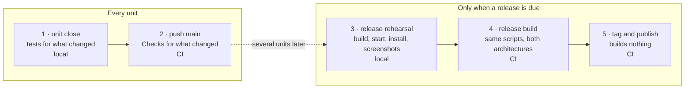
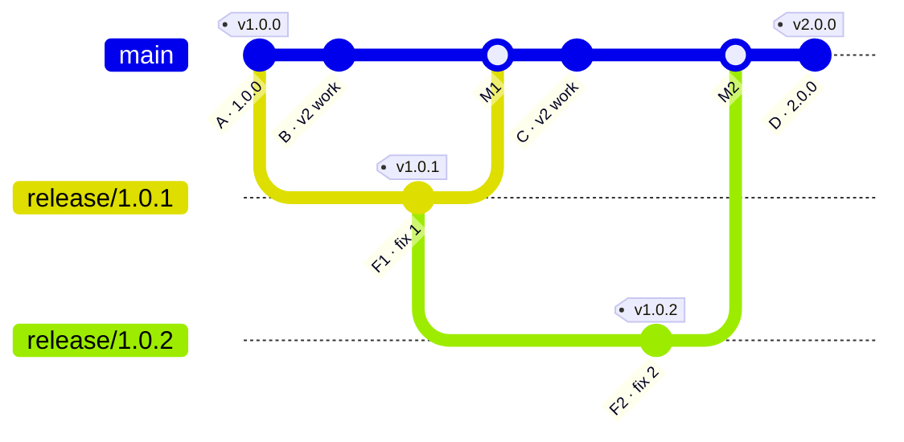

# Release cycle — spec

**Status:** Approved by the owner on 2026-10-24, the points marked *(default)* included. **Kind:** initiative.
**Issue:** tracked outside this repository.

## Purpose and outcome

The same code is built and proved once, locally first and then on GitHub's runners, and what was proved is what is
published. A push to `main` checks only what the change reaches. A release costs one run of the release bar, not
three, and a patch to one part rebuilds that part alone. The product keeps one version, its protocol versions, its
release bar and what every install trusts.

## The problem

Measured on the runs of `v0.1.0-alpha.2` (2026-10-22). A runner-minute is one minute of one job on a GitHub runner,
as GitHub counts them.

| # | Step today | What it repeats | Cost |
|---|---|---|---|
| T1 | A unit's close: the full regression on the dev machine | The image start test builds all six images; the install test builds all six again (`scripts/install-test/run.sh`) | 12 local image builds |
| T2 | Push to `main` | *Checks* for every module, whatever changed | 23 runner-min |
| T3 | The version commit on `release/<v>` | Writes the version into every `package.json`, which every Dockerfile copies, so every image's input changes | — |
| T4 | Push of the release branch | *Checks*, the release build (12 image builds), the install test (6 more, at `dev`), the screenshots | 83 runner-min |
| T5 | Push of the merge commit to the release branch | All of T4 again, usually on an identical tree | 83 runner-min |
| T6 | The tag | All 12 images built a third time, then signed and published | 43 runner-min |
| T7 | `main` fast-forwards to the tag | *Checks* again, on a commit already checked | 23 runner-min |
| T8 | — | The install test proves images built at `dev`, not the ones published | a gap |

About **232 runner-minutes and 48 CI image builds per release with no fix**, and the release bar again for every fix
pushed. Three causes:

1. **The version is built into every image**: in `package.json`, as `--build-arg VERSION`, as the OCI label
   `org.opencontainers.image.version`, and compiled into hq (`APP_VERSION`), the host service (`HOST_SERVICE_VERSION`)
   and the Fleet Console (`CONSOLE_VERSION`). Nothing built before the version is set can be the release.
2. **A result belongs to a commit, not to the code.** The same tree on another commit or branch is proved again.
3. **Everything runs every time.** Only a change to documentation alone skips anything.

## Terms

- **Image part:** one of the six images a release publishes: `hq-server`, `hq-web`, `site-server`, `agent`, `host`,
  `console`.
- **Content key:** a hash that names what an image part is built from (Rule 2). Same key, same image.
- **Release build:** building every image part whose key is new, for one architecture, and proving it: start test,
  install test, screenshots.
- **Release rehearsal:** the release build on the dev machine, for its own architecture, run before anything is pushed.
- **Line:** the releases of one `major.minor`: `1.3.0`, `1.3.1`, `1.3.2` are one line.

## The cycle, after

| Step | Where | Estimate |
|---|---|---|
| 1 · Unit close | dev machine | the suites the change reaches; 0–6 local image builds |
| 2 · Push to `main` | CI | 8–23 runner-min |
| 3 · Release rehearsal | dev machine | the parts with a new key, built and proved for its architecture |
| 4 · Release build | CI | 0–38 runner-min of builds, ~22 for the install test and screenshots |
| 5 · Tag and publish | CI | ~7 runner-min |

One release: **~45–67 runner-min and 0–12 CI image builds**, run once. A patch to one part: **~25 runner-min, 2
builds**. Estimated from the measured job times; the unit measures them (*Done when*).

## The rules

### Rule 1 · The version is a name given at publish, never built in

- **Every `package.json` and lock file stays at `0.0.0`.** `scripts/check-versions.mjs` and the *Checks* job
  `versions` are removed. No commit sets a version.
- **The tag `v<version>` is the one place a version is written.** The publish workflow checks its form, as today.
- **No version and no commit inside an image.** The Dockerfiles take no `VERSION` or `COMMIT` build argument and
  write no version or revision label; each image carries one label, its content key
  (`org.opencontainers.image.version` is no longer set on a platform image). Two builds of the same content must not
  differ by a label.
- **The version and commit go on the multi-platform index** the tag makes, as the annotations
  `org.opencontainers.image.version` and `.revision`; `docker buildx imagetools create` writes them there today. The
  tag's check that an image carries its version reads the index annotation instead of the image label.
- **The core package** is given its version when the tag packs it (`npm pkg set version=<v>`, as its name is set
  today), then checked with `npm run check:package` and published.
- **hq and the Fleet Console read their version from their environment** when they start: hq `APP_VERSION`
  (unchanged in `hq/src/server/buildInfo.ts`), the Fleet Console `CONSOLE_VERSION`, which `console/scripts/build.mjs`
  no longer replaces at build. Absent, the version is `dev`, as for a local build today. **The host service writes it**
  into each compose project it starts: it already picks each image by `imageRef(part, version)`
  (`host/src/compose/projects.ts`, `console.ts`), and the same version goes into the environment.
- **The host service learns its own version from the reference it was started from.** `host/scripts/build.mjs` no
  longer replaces `HOST_SERVICE_VERSION`. At start, the host service inspects its own container (it already does, to
  record its settings) and reads the image reference: a reference in the trusted registry whose tag is a published
  version (`ghcr.io/…/agenthix-host:0.1.1`, with or without `@sha256:…`) makes that its version, and it checks its own
  image's signature for that version before it serves; any other reference (a local build, an image started by bare
  digest) makes it `dev`. The install command in the guide is unchanged: its `docker run` already names the version
  in the image's tag. *(default 1)*
- **The host service's switch to a new version of itself** starts its successor from `<image>:<to>@<digest>`, so the
  successor reads the same version, and stops checking the new image's version label (`host/src/launcher/start.ts`,
  `swap.ts`): the signature it already checks for version `to` is what binds the image to that version.
- **A development build may switch to another image built on the machine**, so the whole switch, and putting the old
  one back, can be run on a dev machine. It skips what only a published version has: the signature and the "only
  forward" comparison. The launcher checks the new container by its image instead: it runs the new image and answers
  on its owner socket. A published host service still switches only forward, to an image signed for the newer
  version; a development build already runs unsigned images built on the machine, so this opens nothing new.
- **Every container of a release part the host service starts carries the version as a label**,
  `<namespace>.version=<version>` beside the labels it already writes (nothing for a development build), so `docker
  inspect` on any running part shows it. A container's labels are not part of its image, so this changes no content
  key. The databases carry none: their image is the pinned Postgres in every release, and a changed label would make
  compose recreate them at each upgrade.
- **`agenthix status` says, for HQ and the site, the release their image was first built for:** "hq-server 0.2.3,
  unchanged since 0.2.1". The host service finds it in the registry's tags, as it already lists them for upgrades
  (`host/src/upgrades/versions.ts`): the oldest release tag of the same line whose index holds the same platform
  digest as the image it runs. It is worked out once per version and kept in its state folder; while the registry
  cannot be read, the line is left out.

A container's version is therefore always backed by the signature the host service checked for it, as it is today;
the number travels beside the image rather than inside it. Someone who starts a published image by bare digest gets a
host service in development mode: that person already controls the machine's Docker, so nothing they could not do
before is opened.

### Rule 2 · Each image part is built once per content

- **One list of the image parts**, `scripts/images/parts.json`: per part its Dockerfile, target, the repository paths
  it reads, and its base images by digest, plus a **rebuild epoch** (a whole number). The release workflows,
  `scripts/images/start-test-all.sh` and `scripts/install-test/run.sh` read it; the three lists today go.
- **Its content key** is a SHA-256 over: the Dockerfile's path and target, the Git object ID of `.dockerignore`, of
  the Dockerfile, and of each input path at the commit (`git rev-parse <commit>:<path>`, which changes exactly when a
  file under it changes), its base image digests, and the rebuild epoch. `node scripts/images/keys.mjs [<commit>]`
  prints the six keys; it reads Git only and takes milliseconds.
- **Inputs, from the Dockerfiles' `COPY` lines:**

  | Part | Inputs |
  |---|---|
  | `hq-server`, `hq-web` | `core/` `ui/` `hq/` (one input set, so hq's pages always move with its server) |
  | `site-server` | `core/` `site/` |
  | `agent` | `core/src/` `site/docker/` `site/opencode-plugin/` |
  | `host` | `core/` `host/` |
  | `console` | `core/` `ui/` `console-web/` `console/` `docs/guide/running-agenthix/` |

- **A test holds the list to the Dockerfiles:** it parses every `COPY` (not `COPY --from`) and fails when a source
  path is not under one of its part's inputs. The host's existing workflow test holds the part names to
  `PUBLISHED_PARTS`.
- **Every `FROM` names a digest**, moved by Dependabot's `docker` ecosystem in a pull request. A moved base changes
  the keys of the parts built on it. *(default 2)*
- **The rebuild epoch** is moved to take security updates into images whose code has not changed (the agent image's
  system packages, for example): by hand, or by a monthly scheduled workflow that opens a pull request.
  *(default 2)*
- **Built images are kept by key.** The CI release build pushes each image by digest and tags it
  `build-<key>-<arch>`; before building a part it asks the registry for that tag
  (`docker buildx imagetools inspect`) and reuses it when present and attested (Rule 6). The host service's version
  list keeps only release-version tags (`host/src/upgrades/versions.ts`), so a `build-…` tag is never offered as a
  version. Locally, the start test keeps its images as `imgtest/<part>:dev` with the key in a label, and builds only
  parts whose key differs.

### Rule 3 · The same scripts prove a release locally and in CI

- **`scripts/release/prove.sh`** runs the release build: compute the keys, build each part whose key has no image,
  start each one (`scripts/images/start-test.sh`), run the install test from those images
  (`scripts/install-test/run.sh`), and take the guide's screenshots. Each of those three is the script CI runs too, so
  the two cannot drift.
- **On the dev machine it is the release rehearsal**, for the dev machine's own architecture only: building hq for
  the other architecture would mean emulation, many times slower. *(default 3)*
- **In CI it is the release build** (`release-build.yml`): the same steps, one runner per architecture for the image
  builds and start tests (no emulation, as today), the install test and the screenshots on amd64. CI adds only what a
  dev machine cannot show: the other architecture, a clean machine, and the signing at the tag.
- **The install test installs the images the release ships**: in CI the candidate's images pulled by digest; locally
  the start test's images. It no longer builds its own (closes T8). The host service runs them in development mode,
  as today; the signature path is checked at the tag, exactly as a host service will check it.
- **The release build runs when started by hand** on a commit of `main` (`workflow_dispatch` with the commit), and
  on every push to a `release/**` branch (a patch). It leaves a **candidate record**: the commit, its tree, and per
  part the key and the two platform digests. *(default 4)*

### Rule 4 · Checks run for what a change reaches, once per tree

- **The dependency map is derived:** a module depends on each module its `package.json` names as `file:../<module>`.
  Today: `ui`, `hq`, `site`, `host`, `console`, `console-web` depend on `core`; `hq` and `console-web` also on `ui`.
- **A change under a module selects its jobs and every module that depends on it**, transitively; `hq` and `site`
  bring their integration suites. A change under `docs/guide/` selects `hq` (it checks screenshot names) and
  `console` (its Help). Documentation alone selects nothing, as today. **Any other path** — the root's files,
  `.github/`, `scripts/`, `tests/cross-app/`, a path the map has never seen — **selects everything.** `secure-page`
  always runs.
- **`node scripts/affected.mjs <base>`** prints the selection with the reason for each job; *Checks*' job `changes`
  runs it and writes it to the run's summary page.
- **The one required check, *All checks passed*, passes only when** `changes` succeeded, every selected job
  succeeded, and every job not selected was skipped. A selected job that was skipped or cancelled fails it.
- **Once per tree.** On a push, `changes` looks for an earlier pass of the same tree (`git rev-parse HEAD^{tree}`): on
  this commit in another branch's run, or on a parent whose tree is identical. It asks GitHub's check-runs API for
  *All checks passed* on that commit. A pass found selects nothing, and the summary names the commit that proved it.

### Rule 5 · A release is a tag on `main`; a release branch only for a patch

- **A release:** the owner picks a commit of `main`; the release rehearsal passes on it; the release build is started
  on it and passes; the owner tags it `v<version>` and pushes the tag. No version commit, no merge commit, nothing to
  fast-forward.
- **The tag only publishes** (`publish-images.yml`, whose path and tag form every install trusts, unchanged). It
  refuses unless *Checks* and the release build passed for the tagged commit, then: verifies each image's build
  attestation and recomputes its key at the tagged commit (Rule 6); per part, makes the multi-platform index over the
  two candidate digests with the version and commit annotations and tags it `:<version>`; signs it and checks it as a
  host service will; packs, checks and publishes core; makes the release page with the release record (Rule 7).
- **A failure after the tag** is handled as today: the tag and whatever the attempt published are deleted, the fix is
  made, and the same version is tagged again. With no build at the tag, only the registry, signing or the package
  registry can fail there, and a retry promotes the same digests.
- **A release branch is cut only for a patch while `main` has moved on**, and always from the newest tag of its line:
  `release/1.0.1` from `v1.0.0`, `release/1.0.2` from `v1.0.1`. On it: the fix, the release rehearsal, the release
  build (its push starts it), the tag on its last commit; then it is merged into `main` with `--no-ff` and deleted.
  The merge puts the tagged commit in `main`'s history; `main` itself is not that release. When `main` has not moved
  since the release, there is no branch: the fix goes on `main` and the release is tagged there.
- **`main` never flows into a patch branch.** Where `main` has rewritten the code the fix touches, the fix is ported to
  `main` by hand, with `git cherry-pick -x`, instead of merged. A fix needed on two lines is made on the older line
  first and ported to the newer.
- **A patch holds fixes only:** no breaking change, no new protocol major, and from `0.1.0-rc.1` no database
  migration (a migration made beside `main`'s would be applied in a different order on each line).
- **Tags are permanent.** A tag ruleset on the repository stops `v*` tags being moved or deleted, with the
  repository admin's bypass kept for a publish that failed part-way.
- **At most two lines are maintained:** fixes, security fixes included, go to the newest minor of the current major and
  the newest minor of the one before it. Two majors back gets nothing; its users upgrade. Before `1.0.0`, only the
  newest release gets fixes: under `0.x` every minor may break, so there is no earlier major. This matches the rule
  that protocol peers one major apart still talk (ADR-0136).

Each lane ends where its branch is deleted. Mermaid draws `release/1.0.2` out of `release/1.0.1`'s lane; it is cut
from the tag `v1.0.1`.

### Rule 6 · Proof of origin before signing

Today the run that signs is the run that built. After, the release build builds and the tag signs, so the tag checks
where each image came from first.

- **The release build attests each image** it pushes, after its start test passes: `cosign attest --type custom`,
  keyless, with a statement of part, architecture, content key and commit. The certificate names
  `release-build.yml` and the ref it ran on. The workflow has `packages: write` and `id-token: write`; it is started
  by hand or by a push to `release/**`, both of which need write access, never by a pull request.
- **The tag verifies it**: `cosign verify-attestation` with the identity
  `…/.github/workflows/release-build.yml@refs/heads/(main|release/…)` and GitHub's issuer, then recomputes the part's
  key at the tagged commit and refuses unless it equals the attested key. A digest built from other content cannot be
  promoted under the tag, whoever pushed it.
- **The tag signs as today**, as `publish-images.yml` at `refs/tags/v<version>`, the per-version index. Each release
  signs its own index, so a reused platform image is signed again for the new version, and an index pointed at under
  another version's tag is still refused (the host service asks for that version's signature).
- **cosign rather than GitHub's artifact attestations:** those need GitHub Enterprise Cloud in a private repository,
  and this repository is private until its first public release. Once public, GitHub's build provenance may be added
  beside it.

A release made of reused and new images is the same software as one built whole at the tagged commit, because a part
is reused only when everything it is built from is unchanged; it needs no compatibility test of its own beyond the bar
it passes there.

### Rule 7 · The release record

A JSON file attached to the release page: the version, commit and tree; per part its key, index digest and two
platform digests; core's name, version and integrity hash; the Postgres digest the host service pins
(`POSTGRES_IMAGE`). It records what was published, for people and for rebuilding a release. A host service keeps
finding a version by its tag and its signature; it does not read the record. *(default 5)*

The registry keeps every image a record names: its cleanup removes only untagged images and `build-…` tags older than
90 days that no release record names. *(default 5)*

### Rule 8 · A unit's close tests what it reaches

- **`scripts/affected.mjs main`** gives the unit's selection; its regression runs those suites, plus cross-app when
  `hq`, `site` or `core` is reached, hq's browser tests when `hq` or `ui` is reached, and the image start test for each
  part whose key changed, with the install test when any did.
- **The full regression still runs** for a unit that changes core's protocol shapes, a database migration, a
  Dockerfile, the host service or the install, and on the release rehearsal of every release. *(default 6)*

## What does not change

One product version under Semantic Versioning; the four protocol versions and their rule (ADR-0136); the stored
formats; the release bar (*Checks*, image start, install test, screenshots, for the tagged commit); every image built
and started on amd64 and arm64 and signed before it is published; what a host service trusts (`publish-images.yml`
at `refs/tags/v<version>`, `host/src/images/published.ts`); "a published version is never published again".

## What changes, by area

| Area | Change |
|---|---|
| Records | A new ADR replacing ADR-0137: *a release is a proven build given a name*. ADR-0117 amended in place: an image's version is carried by its published index and its signature, and given to the container by the host service |
| `docs/architecture/versioning.md` | *The product version* rewritten for Rule 1; a new section *An image's content key*; *Where the rule is enforced* loses `check-versions.mjs`, gains `parts.json`, its test and the tag's annotation check |
| `AGENTS.md` | *Git*: the release steps for Rule 5; *When to run the tests*: Rule 8 |
| `docs/architecture/deployment.md` | How a release publishes its images; how the host service learns its version |
| `.github/workflows/` | `checks.yml` (Rule 4); `release-build.yml` dispatchable and on `release/**`, with keys, reuse, attestation and the candidate record, replacing `release-branch-build.yml`; `publish-images.yml` promotes instead of building; `install-test.yml` from the candidate's images; `guide-screenshots.yml` from the release build; a tag ruleset |
| Dockerfiles | No version or commit argument or label; a content-key label; every `FROM` by digest |
| `host/` | Its own version from its start reference; the version into each compose project's environment; the switch starts its successor by `<image>:<to>@<digest>` and drops the label check; `scripts/build.mjs` stops replacing `HOST_SERVICE_VERSION` |
| `console/` | `scripts/build.mjs` stops replacing `CONSOLE_VERSION` |
| `scripts/` | `images/parts.json`, `images/keys.mjs`, `affected.mjs`, `release/prove.sh`; `start-test-all.sh` and `install-test/run.sh` read the parts list; `start-test.sh` drops its version check; `check-versions.mjs` removed |
| Every `package.json` and lock file | At `0.0.0` |

## Versioning and old state

Before `0.1.0-rc.1` nothing installed is carried forward: an alpha install is reinstalled, not upgraded across this
change, and no code reads the old labels. The host protocol and the stored formats do not change. The release that
first follows this unit is cut by its new rules, and its record is the first.

## Done when

- Every rule above is on `main`, and the records and documents in *What changes* say it.
- The full regression passes, and the release rehearsal passes on the dev machine.
- One release is cut through it on this unit's branch before it merges (an exception the owner made for this unit, which changes the flow), and its runner-minutes, image builds and wall time are recorded against T1–T7.
- A test fails when a Dockerfile copies a path outside its part's inputs, when *All checks passed* would pass with a
  selected job skipped, and when the tag would promote a digest whose attested key differs from the tagged commit's.

## Not in this unit

- Layer caching between CI builds (BuildKit's GitHub Actions cache). Reuse by key removes most rebuilds; a cache is a
  later saving if hq's own build time remains the cost.
- A host service that reads the release record to resolve a version.
- GitHub's artifact attestations, until the repository is public.

## Decided defaults

Recommendations taken while the design was written, approved with it on 2026-10-24.

1. **How the host service learns its own version** — from the image reference it was started from, verified by that
   version's signature (Rule 1). The alternative, an environment variable on its `docker run`, makes a person write the
   version twice, and a forgotten one would leave a published host service in development mode.
2. **Base images pinned by digest, moved by Dependabot, with a rebuild epoch for security updates** — yes, a monthly
   scheduled pull request for the epoch.
3. **The release rehearsal builds only the dev machine's architecture** — yes; CI covers the other.
4. **The CI release build is started by hand when a release is due** (and by a push to a patch branch), not on every
   push to `main` — yes.
5. **The release record is a record only**, and `build-…` images are kept 90 days unless a record names them — yes.
6. **The kinds of change that still take the full regression at a unit's close** — core's protocol shapes, a
   database migration, a Dockerfile, the host service, the install.
