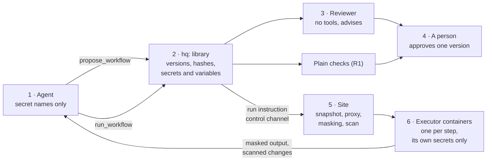

# Workflows — spec

**Status:** Draft. Designed with the owner on 2026-10-24 on the design boards (kept under [`boards/`](boards/) as the
build baseline), then put through a security design review whose every finding is folded in. Each part has its own
file under [`spec/`](spec/).

## Purpose and outcome

An agent can use any integration's secrets — a deploy key, a database password, a GitHub token — without a secret ever
entering its container, so prompt injection can't make it leak one. A value is used only by a **workflow**: a script
the agent writes and proposes, a person approves word for word, and anyone in the place, agents included, then runs as
often as needed. Git and GitHub are the first integration built this way, and GitHub works properly: several GitHub
accounts per organisation, clients' organisations included, with each run's token narrowed to one repository and the
permissions its workflow declares.

## The problem

- **Any value that reaches an agent's container can be read by whoever steers the agent.** Instructions hidden in a
  README, an issue or a web page are followed; a command the agent runs can print a value and send it out, since the
  agent's container has ordinary outbound internet.
- **GitHub's token reaches it today.** git's credential helper, which any command in the container can call, asks the
  site for an installation token with the run's token, and receives one with every permission the App holds.
- **So integrations wait.** Every integration built the same way has the same hole. Hiding a value from the prompt
  isn't enough: the agent doesn't need to see it to run a command that prints it.
- **GitHub itself is half-working.** Back up fails on a selected-repositories installation and leaves a stray
  repository; a new installation doesn't show until Refresh is pressed; the App can only be installed on the account
  that owns it; secrets typed into hq go straight to GitHub with no record; registering and installing are on two
  pages.

## The rule

**No secret value ever enters an agent's container.** An agent works with secret names only. A value is used only by an
approved workflow version, in a container of its own, never the agent's.

## Terms

| Term | Meaning |
|---|---|
| **Workflow** | A named, versioned script kept in a place's library: steps, the secrets each step names, the variables, parameters, hosts, GitHub permissions and time limit. Protected by design, so it needs no adjective. GitHub's own are always called **GitHub workflows** |
| **Version** | One frozen copy of a workflow's files and settings, identified by a SHA-256 hash. A person approves one version |
| **Place** | Where a workflow, a secret or a variable belongs: a project, or a person's own storage (ADR-0060) |
| **Executor** | Not an agent, and has no model: it carries out an approved version's steps exactly as written. A role beside the lead, worker and helper of `docs/concepts/conversations` |
| **Executor container** | One container per step, from the executor image (`agenthix-executor`), started and removed by the site |
| **Secret** | A value that must never be seen: encrypted, never shown, given to a step as a file only if that step names it |
| **Variable** | A plain setting, visible to people and agents, given to every step of a workflow that names it as an environment variable |
| **Reviewer** | A built-in agent with no tools and no secrets that reads each proposed version and advises; it never approves |
| **Plain checks** | Rules with no model (R1) that flag risky patterns in a version and decide whether its card may offer Approve |
| **GitHub account** | A GitHub organisation, or a person's GitHub account, where the organisation's GitHub App is installed (GitHub calls it an *installation*) |
| **Mint gate** | The one check every GitHub installation token passes before hq asks GitHub for it |

## The design at a glance

1. **Agent** — writes and proposes workflows, and runs approved ones; holds names only (part 1).
2. **hq** — keeps the library, every version and run, and the secrets and variables; decides who may approve and
   that the version run is the approved one (parts 1, 3).
3. **Reviewer** — reads every proposed version before a person sees it (part 1).
4. **Approver** — a project's administrator, or the person for their own storage (part 1).
5. **Site** — receives the run, rechecks the hash, snapshots the workspace, runs the egress proxy, masks output and
   scans changed files before anything returns (part 2).
6. **Executor containers** — a fresh, hardened container per step, with only that step's secrets (part 2).

## The parts

| Part | What it settles |
|---|---|
| 1. [The library, review and approval](spec/library.md) | What a workflow and a version are, the hash, parameters, On/Off, the plain checks, the reviewer, who approves, the agent's tools, rerun limits |
| 2. [Running](spec/running.md) | The run sequence, the executor image and containers, the snapshot and the approved files, the egress proxy, steps and progress, masking, the changed-file scan, write-back |
| 3. [Secrets and variables](spec/secrets.md) | The eight principles, the store, the two kinds, rotation, revoking, the record of use |
| 4. [GitHub](spec/github.md) | The mint gate, the App and its permission ceiling, several GitHub accounts, which places can connect, connecting a repository, the starter workflows, secrets for GitHub Actions |
| 5. [Screens](spec/screens.md) | Where it lives, the Workflows section, a workflow, approving, a run, Secrets and variables, the GitHub page, a project's GitHub section, connecting, a connected workspace |
| 6. [Security](spec/security.md) | Each attack and what stops it, what it doesn't protect against, the checks the build must make |

## The worked example

Sam's project has a secret `STAGING_DEPLOY_KEY`, typed in by Sam, an administrator, and a variable `STAGING_HOST`. Its
repository gives it `GITHUB_TOKEN` without anyone typing anything: hq mints one for each run.

1. The agent needs to deploy to staging. There is no such workflow, so it writes `deploy-staging` and proposes it.
2. The plain checks find nothing; the reviewer says *low risk: uses the key only as ssh's key file to `STAGING_HOST`;
   prints nothing secret*. The version gives a secret to steps, so Sam opens the full review, reads it and approves.
3. From then on the agent runs `deploy-staging` whenever its work is ready, with no one asked. So can Sam.
4. Next month the agent adds a step that restarts a worker. That is version 2: reviewed and approved the same way.
   Version 1 keeps running until then.

## Not in this unit

- **Other integrations.** Each is a source of secrets plus a set of workflows; this unit builds the mechanism and
  GitHub. Slack, a database, a cloud provider come as their own work.
- **Limiting the agent's own outbound network.** Unchanged: with no secret inside the agent's container there is
  nothing secret to send, but it can still send the workspace's files. That is a separate decision.
- **Triggers** (on a schedule, on a push). A workflow is started by a person or by an agent. Automation already starts
  agents on a schedule, and an agent can run a workflow.
- **Workflows shared between projects.** A workflow belongs to one place; copying one is proposing it again.

## Decision records

Two records carry the decisions this design binds others to, and supersede parts of adr-0037 (sections 3, 4, 6, 7 and 8):

- **adr-0147** — a secret is used only by a workflow a person approved, run by the platform.
- **adr-0148** — an agent runs approved workflows and reads their masked output.

Both are on the unit's branch and reach `main` with it; a decision changed during the build is corrected there before
the merge.
