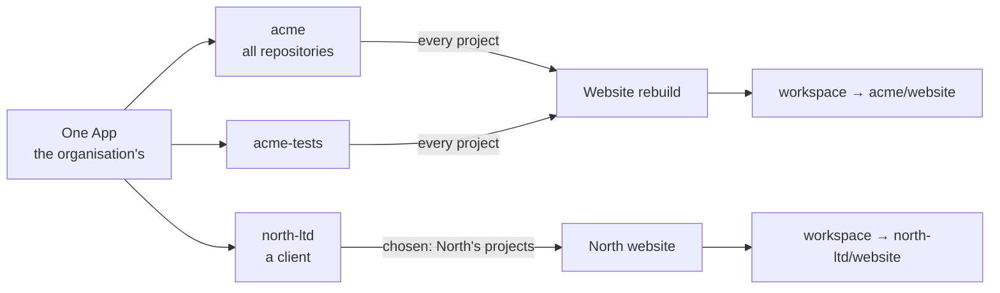

# Part 4 · GitHub

Git and GitHub become the first integration built on workflows, and the GitHub integration's own gaps are closed: the
App can be installed on several GitHub accounts, clients' included; each run's token reaches one repository with only
the permissions its workflow declares; connecting a repository checks before it creates. Boards: *9 · GitHub through
workflows*, *G0* to *G3*.

## What changes for the agent

| Today | After |
|---|---|
| git inside the agent's container pushes to `github.com`; its credential helper asks the site with the run token; hq mints an installation token with every permission; **the token lands in the agent's container** | The agent commits locally, as now. To share, it runs the approved `push`. hq mints `GITHUB_TOKEN` for that run only. A step with no secret bundles the commits; a step with the token pushes the bundle from a clean repository. **The agent's container never holds a token** |

Removed in this unit: the credential helper (`agenthix-git-credential`) from the agent image, the site's git
credential endpoint, and hq's `resolve_git_credential` operation. A plain `git push` in the agent's container fails with
a message naming the `push` workflow.

## The mint gate

Every installation token hq mints — for a workflow run, or for hq's own git work such as connecting a repository —
goes through one check. Nothing else in hq asks GitHub for an installation token.

1. **The repository comes from the run's workspace:** its own connection, looked up by workspace id — never from a URL,
   or anything the caller sends.
2. **The workspace belongs to the run's place**, and that place may connect to the repository's GitHub account: the
   account is allowed, and its *which places can connect* rule still includes the place. Checked at every mint, so
   narrowing the rule takes effect at once.
3. **Accounts and repositories are matched by GitHub's ids** (installation id, repository id), never by login or name,
   which can be renamed and taken. A connection stores both ids.
4. **No exception by agent.** No agent, the built-in one included, gets past the check.
5. **The token is the run's own:** minted fresh, never cached or shared, with exactly the workflow's declared
   permissions and `repository_ids` for that one repository. hq revokes it when the run ends, fails or is stopped.
6. **A mint always names its permissions.** GitHub gives a token asked for with no `permissions` every permission the
   App holds, so the gate refuses a request without an explicit set, never defaulting one.

Worked: a test project's `push` would need a token for `acme/website`, but its workspace's repository is
`acme-tests/trial-site`; the token can only ever be for `acme-tests/trial-site`, because the gate takes the repository
from the workspace and nothing else.

## Permissions: what each run gets, and the ceiling

- **A workflow declares the GitHub permissions it needs** (`github: { contents: write }`); they are part of the version,
  shown and flagged on the approval card. A token from `push` can write code and can't touch secrets, pull requests or
  settings.
- **The App's permissions are a ceiling, and it is the organisation's.** The App is registered with Agenthix's starting
  list; an owner changes it in the App's settings on GitHub, since GitHub offers no API for it. hq reads the App's real
  permissions, and each GitHub account's accepted ones, from GitHub.
- **A workflow that needs more than the ceiling** is caught when proposed. Its card names the permission and how to add
  it: *"This needs Issues: write. Add it in the App's settings on GitHub (link); each GitHub account using it then
  accepts it there."* It can be approved meanwhile, and runs once its account has the permission.

Agenthix's starting list: contents, pull requests, secrets, workflows, actions (to start a GitHub workflow),
environments (an environment's secrets, for `set-github-secrets`), administration (to create a repository) — write;
metadata — read.

## Several GitHub accounts

| | Today | After |
|---|---|---|
| Where the App can be installed | Only the account that owns it (`public: false`) | Any account whose owner installs it: the organisation's other GitHub organisations, an agency's clients' |
| When hq uses an installation | As soon as it appears | Only once an organisation administrator allows it |
| Which account a workspace uses | Any, per connection | The project's default, or another the project may connect to |
| Where that holds | — | On screen, and at every mint |

How a workspace gets its account:

| | Step | Who, and where |
|---|---|---|
| 1 | Register the App, once, with the starting permissions | An organisation administrator, on *Manage organisation › Settings › GitHub*; GitHub creates the App |
| 2 | Install the App on a GitHub account, on all repositories or some | An owner of that account, on GitHub: the organisation for its own, a client for theirs (install link) |
| 3 | Allow it, and say which places can connect: every shared project, or chosen ones; and which people, none by default | An organisation administrator, on the GitHub page |
| 4 | Set the project's default account | A project administrator, in the project's GitHub section |
| 5 | Connect a workspace's repository: the default account, or another the project may connect to | A project administrator, in the workspace |
| 6 | Run workflows: each token from the workspace's account, for its repository, with what the workflow declares | Agents and people |

- **A person's own work is chosen by person** in the connect rule: their own storage and their personal projects, both
  never part of *Every project*. None can connect unless an administrator chooses that person, so a member can't link a
  client's repository into their own work and approve workflows there, and one person's choice never reaches another's.
- **A new installation must be allowed first.** The App is public, so anyone can install it; a new one shows as
  *wants to connect* and isn't used until an administrator allows it.
- **No Refresh button.** After GitHub sends the person back, hq asks GitHub every few seconds for up to a minute until
  the new installation appears, showing *Waiting for GitHub…*.
- **Each installation says what it can reach** — all repositories, or how many selected — and so what it can do: create
  a repository, or link only.

### A client connects

1. The organisation sends an **install link** from the GitHub page, with a ready-to-send note.
2. An owner of the client's GitHub organisation opens it on GitHub, sees the App and what it may do, and chooses all
   repositories or some. They need no Agenthix account, and nobody needs their password.
3. hq shows *north-ltd wants to connect*; an administrator allows it and chooses the projects.
4. Agents work on the client's code through workflows, with tokens that reach only the repositories the client allowed,
   only from those projects.
5. **The client stays in control:** they change what the App reaches, or remove it, in their own GitHub settings, and
   access stops at once.

## Connecting a repository

From a workspace, from Files' *Back up to GitHub*, or when making a workspace — one flow, with the same checks.

- **A new repository** (created private, with the workspace's files pushed) or **an existing one** (checked out into an
  empty workspace; into one with files, pushed if the repository is empty or shares their history, refused plainly if
  not, never overwritten). A workspace with history of its own keeps its branches: only its `main` is pushed, and its
  files are committed only while `main` is checked out; any other branch reaches GitHub through **push**.
- **The account starts at the project's default** and can be changed to any other the project may connect to; others
  aren't listed.
- **Checked before anything is created:** that the installation covers new repositories, and that the name is free. A
  clash offers *use the existing one*.
- **A selected-repositories installation can't take a new repository** (a repository the App creates isn't part of the
  selection). It isn't offered for a new one, and the screen says how to fix it: set *Repository access* to *All
  repositories* in that account's GitHub App settings, or create the repository on GitHub, add it to the selection,
  and connect it as existing. It says only an owner of that account can change it.
- **If a later step fails anyway,** hq deletes the repository it just created and says so; if it can't, it records and
  names it.
- **When connected,** the starter workflows are proposed at once, so an administrator who connected it reviews and
  approves them in the same sitting. Each gives a step `GITHUB_TOKEN`, so the card rule (part 1) asks for the full
  review of each one.

## The starter workflows

Shipped as proposals, reviewed and approved like any other. Each needs the hosts `github.com:443` and
`api.github.com:443`. The repository's address always comes from hq, never from the workspace's `remote.origin.url`.

| Workflow | Parameters | Permissions | Does |
|---|---|---|---|
| `push` | `branch` (pattern) | contents: write | Step 1, no secret: `git bundle` of the branch from the workspace. Step 2, the token: `push-bundle` pushes it from a clean repository to `refs/heads/<branch>`. Never `--force`, never a protected branch |
| `pull` | `branch` (pattern) | contents: read | Step 1, the token: fetches into a clean repository and writes a bundle to `/run/out`. Step 2, no secret: `git pull --ff-only` from the bundle into the workspace |
| `open-pull-request` | `branch`, `base` (patterns), `title`, `body` (text) | pull requests: write, contents: read (`gh pr create` reads the default branch first) | `gh pr create --repo <owner/repo> --head … --base …`, title and body from their files, run from outside the workspace |
| `set-github-secrets` | `names`, chosen at approval; `environment`, a fixed list | environments: write | `gh secret set NAME --env <environment> < /run/secrets/NAME` for each: an environment secret, never a repository one |

`push-bundle` is a small script in the executor image, so the starter workflows stay one line per step.

### Git with a token never runs in the agent's repository

The workspace's `.git` is the agent's: it writes the config and the hooks, and the version's hash doesn't cover them.
Git runs a hook as a program, and its config can name programs too (`core.hooksPath`, `core.fsmonitor`,
`core.sshCommand`, filters, `include.path`, `url.*.insteadOf`). So:

1. **Steps with no secret** work in the workspace as normal, and hand over data only: a bundle.
2. **Steps with the token** work in a new empty repository under `/tmp`, with system and user config off
   (`GIT_CONFIG_NOSYSTEM=1`, `GIT_CONFIG_GLOBAL=/dev/null`) and hooks off (`core.hooksPath=/dev/null`), read the bundle
   as data, and push to the address hq gives.
3. **The plain checks** flag any step that holds a secret and runs `git` in the workspace's repository.
4. **The same for any tool that reads its config from where it runs:** `gh` is given `--repo` and run from outside the
   workspace.

### Secrets for GitHub Actions are kept from code the agent pushes

A repository secret reaches any GitHub workflow that runs on a push or a pull request from the repository, and those run
the repository's code, which the agent can push. So:

- **`set-github-secrets` sets environment secrets only**, on a GitHub Environment whose deployment branches are limited
  to protected branches (required reviewers on it recommended where the GitHub plan allows). The boundary is then the
  repository's branch protection: any branch a protection rule matches, a wildcard rule included, is admitted, and
  whoever can change the rules can widen it. That is the operator's configuration, as with narrow credentials.
- **`push` and `open-pull-request` refuse a protected branch** as their target; hq reads the branch's protection from
  GitHub when the run starts, and doesn't rely on the parameter pattern.
- **The approval card says it plainly:** *"These values reach any GitHub workflow that runs in the production
  environment, on branches that need a reviewed pull request to change."*
- **Repository secrets set on GitHub some other way** stay listed by name as *Outside hq*, with a note that pushed code
  can reach them.

A workflow can start a GitHub workflow (`gh workflow run deploy.yml`, with `actions: write`). Nothing else is built for
GitHub Actions.

## What else is fixed

| | Problem today | After |
|---|---|---|
| P1 | Back up fails on a selected-repositories installation and leaves a stray repository | Checked before creating; not offered; cleaned up on a later failure |
| P2 | A new installation doesn't show until Refresh | hq polls for a minute after GitHub's redirect |
| P3 | Broad permissions, and every token gets all of them | Each run gets only what its workflow declares, for one repository |
| P4 | The agent's container receives a token | No helper, no endpoint, no token |
| P5 | Linking an existing repository into an empty location never tried end to end | Part of the connect flow and the walkthrough |
| P6 | Two places for secrets: "Add a secret" sends straight to GitHub | Removed; one keeper, through `set-github-secrets` |
| P7 | Registering and installing on two admin pages | One page, *Manage organisation › Settings › GitHub*; Infrastructure's GitHub App card links to it |

## Kept as it is

Connecting a repository from hq still runs git on the site with a token (`repoWorkMethods.ts`), with no agent involved —
its token now comes through the mint gate.
