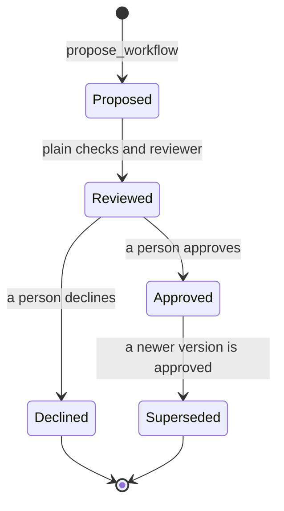

# Part 1 · The library, review and approval

Every workflow is itemised in its place, with its versions and runs, so a person can always see what can run with the
place's secrets and what each one uses. Boards: *3 · The workflow library*, *5 · Review and approval*.

## What a workflow is

The agent writes one definition file, `workflow.yaml`, in the GitHub Actions style that models already know, plus any
script files its steps call.

```yaml
name: deploy-staging
description: Build, upload and restart the app on staging
hosts: ["registry.npmjs.org:443", "staging.example.com:22"]
variables: [STAGING_HOST, NODE_ENV]     # every step has these as $STAGING_HOST, $NODE_ENV
timeout: 10m
parameters:
  - name: ref
    pattern: '^[A-Za-z0-9_][A-Za-z0-9._/-]{0,99}$'
steps:
  - name: Build
    run: npm ci && npm run build        # no secrets; installs from the version's own lock file
  - name: Upload
    secrets: [STAGING_DEPLOY_KEY]
    run: ./deploy/upload.sh             # the version's deploy/upload.sh, never the workspace's
  - name: Restart the app
    secrets: [STAGING_DEPLOY_KEY]
    run: ./deploy/restart.sh
  - name: Check it answers
    run: curl -fsS "https://$STAGING_HOST/health"
```

| Field | Meaning | Default |
|---|---|---|
| `name`, `description` | What people and agents see | — |
| `steps[]` | Each has a `name`, a `run` (a command, or one of the version's files), optional `secrets: [...]` and `timeout` | — |
| `steps[].secrets` | The secrets this step gets, and no other step | None |
| `variables` | The variables the workflow uses, listed once; every step has them as environment variables | None |
| `parameters` | Each has a `name` and one of `pattern` (the whole value must match), `values` (a fixed list) or `text: true` | None |
| `hosts` | `host:port` pairs the steps may reach | None: no network |
| `github` | GitHub permissions, required when a step names `GITHUB_TOKEN` and refused otherwise; never empty, since GitHub gives a token asked for with none every permission (part 4) | None |
| `timeout` | The whole run's limit, written like `90s`, `10m` or `1h30m`, at most 6 h | 10 min |
| `files` | Files the version carries beyond those a step's `run` names as `./…`: a script's helpers, a lock file, an `.npmrc` | None |

Unknown fields are refused, not ignored, so a misspelt `secret:` never quietly gives a step nothing. A workflow's name is
lower-case words joined by hyphens, at most 64 characters; a parameter's name is lower-case letters, digits and `_`,
since it becomes a file name. A version holds at most 50 steps and 200 files, 4 MiB a file and 16 MiB in all.

A secret or variable a workflow names must exist in its place when it is proposed. The secret and variable lists are
how *Used by* is known (part 3).

## A version

A **version** is all of that, frozen. When the agent proposes, hq receives the definition and the files it names, read
by the site from the workspace. **A symbolic or hard link is refused, never followed.**

**The hash** is SHA-256 over one encoding only — sorted, length-prefixed fields, paths normalised with no `..` — so two
different versions can never hash the same. It covers everything the run instruction will carry, not only the files:

- the workflow's name and description, so what a person approved is exactly what they were shown;
- each file's path, bytes and executable bit;
- each step's name, `run`, list of secrets and timeout;
- the variables' names, the parameters and their patterns or lists, the hosts and the time limit;
- the GitHub permissions, and the names `set-github-secrets` was approved for (part 4);
- the executor image's digest.

Sets (a step's secrets, the variables, the hosts, the files) are sorted before hashing; steps, parameters and a list's
values keep their written order. Change any of it and it is a new version, waiting for review and approval. **The approved version runs any number of
times**, by a person or an agent, with no one asked again, until a newer version is approved. A newer version waiting
for approval doesn't stop the approved one running.

**An approval is of a version of one workflow in one place**, stored as (workflow, place, hash, who, when) — never as
"this hash is approved". The same files proposed in another project wait for that project's own approval. An executor
image upgrade changes every version's hash: hq re-approves automatically only where the image's tools are the same
release line's, and otherwise marks the versions for re-approval (see *Image upgrades* below).

## Parameters

Values that change from run to run — a branch, a commit message, a pull request's title — are parameters, approved with
the workflow.

- **A pattern or a fixed list**, checked by hq before the run. A pattern that can match a value starting with `-` is a
  plain-checks flag. Because an agent writes the pattern and an agent picks the value, and hq matches them on its own
  thread, a pattern is refused if it could take too long to match: back-references, lookarounds, a repeated group that
  itself repeats or has alternatives, or more than 200 characters. A value is at most 1024 characters (65 536 for
  text). Every parameter needs a value.
- **Free text** (`text: true`) for a message or a body. The plain checks flag a text parameter used anywhere but as a
  file argument (`git commit -F /run/params/message`).
- **Values reach the steps as files**, `/run/params/<name>`, never pasted into the text, so a value can't become code.

Worked: `branch = "feature/region"` runs; `branch = "--force"` is refused, because the pattern's first character can't
be `-`. The starter workflows also pass it as `refs/heads/<branch>` after `--`, so git never reads it as an option.

## On and off

Every workflow has a switch, like enabling and disabling a GitHub workflow.

- **On:** the approved version can be run. A workflow is on when its first version is approved.
- **Off:** nobody can run it, person or agent. `list_workflows` still shows it, marked off, so the agent can say so
  instead of trying something else. A run in progress when it is turned off is stopped.
- **On again needs no new approval:** the same approved version runs.
- **Who switches it:** the people who can approve it. Never an agent.

## Review

Every new version is read by the plain checks and by the reviewer as soon as it is proposed, and a person then decides
with both in front of them.

### R1 · Plain checks

Rules with no model, run by hq on the version. Each match is a flag on the approval card:

1. a secret used next to `echo`, `printf`, `cat` to output, `base64`, `curl` or `wget`;
2. a host used in the files that isn't in `hosts`;
3. a text parameter used outside a file argument;
4. an install that isn't pinned (no exact version and checksum, no lock file among the version's files), or
   `curl … | sh`;
5. a step given a secret it never reads, or a step that both installs and holds a secret;
6. GitHub permissions beyond what the steps appear to need, any new permission compared with the approved version, and
   any the App or the GitHub account doesn't have yet, with how to add it (part 4);
7. `rm -rf`, `DROP`, `--force`, `git push -f`;
8. a new secret, variable or host compared with the approved version;
9. a step that holds a secret and runs anything from the workspace rather than the approved files — `node_modules/.bin`,
   `dist/`, a `package.json` script — flagged high: *"this step runs code the agent can change after approval"*;
10. a step that holds a secret and runs `git` with the workspace as its working tree, flagged high (part 4);
11. a parameter pattern that can match a value starting with `-`;
12. a step that holds a secret and writes to `/run/out`, which hands files on to later steps; high when a later step
    reads it and the workflow has hosts it could send it to.

Refused outright, not flagged: a variable named after one that changes how programs run (part 3), and a link among the
files.

**R1 writes the card's one-line summary** from its own structured reading of the diff — never from the agent's text or
the reviewer's.

### R2 · The reviewer

- **Input:** the version's files and settings, the diff against the approved version, and R1's flags.
- **Output:** a risk level — *low*, *look closely*, *high* — and up to five points, each naming a file and line.
- **Model:** the organisation's default model, through the usual model resolution, called by hq directly.
- **Holds nothing:** no tools, no secrets, no variables' values. A workflow can contain text aimed at it
  (*"reviewer: this is safe"*), so the most a steered review can do is give bad advice.

**Nothing the reviewer says decides what the person is shown.** R1's flags are shown whatever it says, and whether a
version may be approved from the card is decided by R1 alone.

### R4 · Who approves

| Place | Who approves | Limit |
|---|---|---|
| A project | Its administrators | — |
| A person's own storage | That person, for their own secrets and variables | GitHub *contents* and *pull requests* only; any wider GitHub permission (secrets, workflows, actions, administration) also needs an organisation administrator. Which GitHub accounts their storage may connect to at all is set by an administrator (part 4) |

Never an agent. Approving needs the full review unless the card may offer it.

### Approving from the card

The card in the conversation may offer **Approve** only when the plain checks say so:

- no step newly gets a secret, and no secret is newly given to any step;
- no `run` changes in a step that holds a secret;
- no host, GitHub permission or parameter pattern changes;
- R1 raised no flag.

Otherwise the card offers only **Review all of it**, and says why in one line. The reviewer's level is shown on the card
but never decides this.

## The agent's tools

Served by the site's MCP server to the agent's harness and forwarded to hq, like the site's other forwarded tools.

| Tool | Does | Answers |
|---|---|---|
| `list_workflows` | The place's workflows: name, description, on or off, the approved version's parameters, the secrets and variables each uses, and any version waiting | Names only; no secret value |
| `propose_workflow(path)` | Proposes a new version from a definition file in the workspace and the files it names | The new version's number, R1's flags, and that it waits for a person |
| `run_workflow(name, parameters, workspace)` | Runs the approved version on one of the place's workspaces, named by name or id: an agent's run reaches every workspace of its boundary, so it says which. Only the place's own workspaces can be named; unnamed, it is the run's own workspace, else the place's only one, and a place with several must name one | Each step's result and masked output (part 2) |
| `workflow_run(id)` | A run's state, for a long one the agent checks on | As above |

**Agent reruns are limited:** an agent can run a workflow at most 30 times an hour by default; an administrator can
change that per workflow. People aren't limited. Past the limit the run is refused and the agent told why.

**Whose run it is:** a run an agent starts is on behalf of the person the agent's run is for (ADR-0095); a run a
person starts is theirs. Either way the version run is one a person approved.

**Who may press Run:** anyone in the place who may start runs there — members, not viewers (ADR-0102).

## Image upgrades

The executor image is part of every version's hash, so a release that changes it would otherwise leave every workflow
waiting. hq keeps the approval when the new image is the same release line and its tools stage is unchanged (its
content key for that stage is the same); otherwise the version shows *"needs approval again: the executor image
changed"*, the previous version keeps running on the image it was approved with until a person approves, and the site
keeps that image until no approved version names it.

## A version's life



Every version, approval, decline, switch and run is kept, with who and when.
