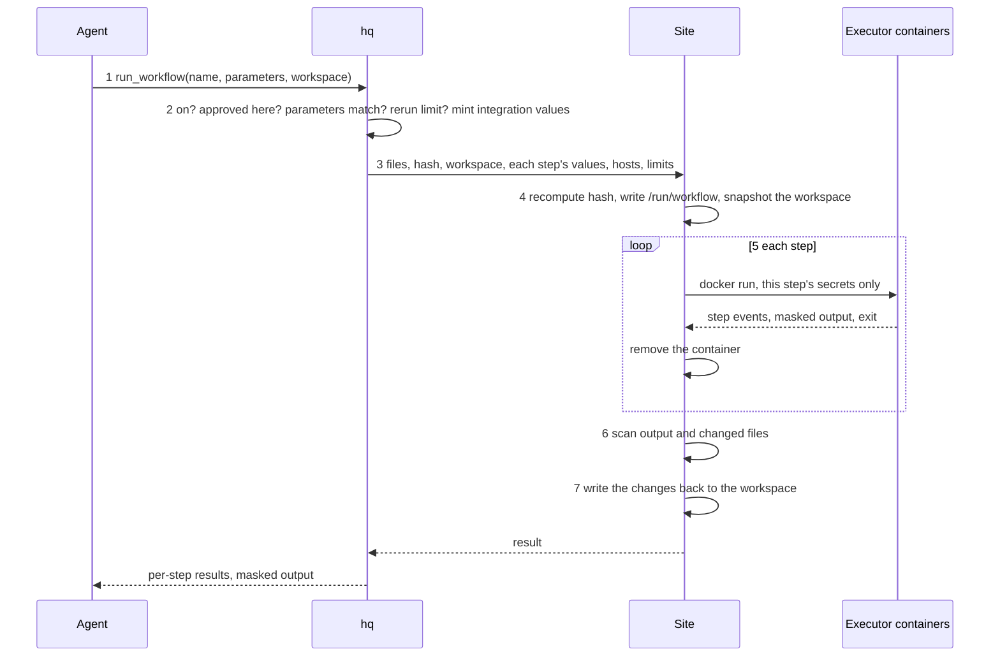
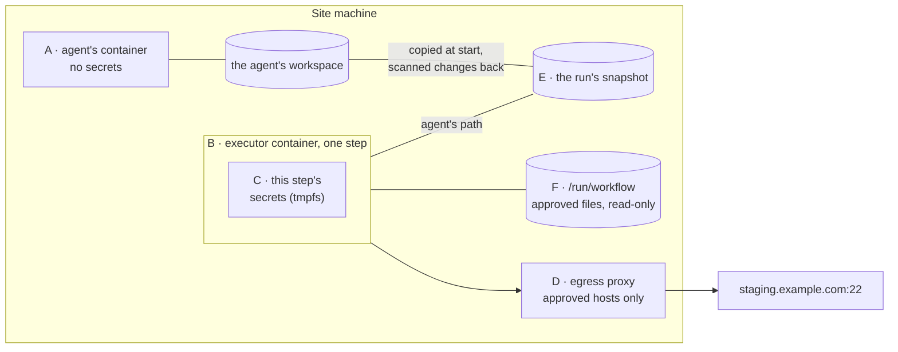

# Part 2 · Running

A workflow is a run like any other, on the workspace the agent names (part 1, *The agent's tools*), except that it can read secrets. It runs the approved
files only, on a snapshot of the workspace the agent can't touch while it runs, and each step runs in a container of its
own with only the secrets it names. Boards: *6 · Running*, *7 · Steps and progress*, *8 · What comes back*.

## From run to result

1. **Asked:** the agent calls `run_workflow`, or a person presses Run.
2. **Checked by hq:** the workflow is on; it has a version approved in this place; every parameter matches; the agent's
   rerun limit isn't reached; every secret it names still exists. Integration values are minted now — for
   `GITHUB_TOKEN`, through the mint gate (part 4).
3. **Sent:** a run instruction to the site holding the place's storage, over the control channel (already encrypted and
   authenticated): the files, their hash, the workspace, each step's secrets, the variables, the parameters, the hosts,
   the limits and the image digest.
4. **Checked again by the site:** it recomputes the hash and refuses if it differs. It writes the files to
   `/run/workflow`, read-only, outside the workspace, and takes the **snapshot**.
5. **Each step, in order:** the site starts a container for the step with only that step's secrets, runs it, and removes
   it. The first step that fails ends the run; the rest are marked skipped.
6. **Scanned:** the output and every file the run changed (below).
7. **Written back**, only if the scan passes, and the result sent to hq. hq revokes the run's minted tokens.

## The workspace snapshot and the approved files

A person approves one exact version, but the workspace is the agent's: it can change any file there, before and during
the run. If a step with a secret ran a script, a lock file, a git hook or a build output from the live workspace, it
would run what the agent wrote, not what was approved. So:

1. **What runs is the approved files.** `run`, and every file a step names, is found in `/run/workflow` and nowhere
   else: `run: ./deploy/upload.sh` means the version's `deploy/upload.sh`.
2. **Nothing changes under a run.** When the run starts, the site copies the run's workspace (copy-on-write where the
   disk allows it). Every step works on this copy, bound at the agent's path so paths work the same, and what one step
   builds the next one sees. The agent's container can't see or change it until the run ends.
3. **Steps that hold a secret see the snapshot read-only**, plus `/run/out`, a scratch folder of the run's own for what
   they hand on. Steps with no secret get the snapshot read-write.
4. **What a secret step runs from the snapshot is flagged** by the plain checks as high (part 1, R1 rule 9). It can be
   approved, never from the card.
5. **Links are never followed.** Wherever the site copies, snapshots, scans or writes back, it refuses to follow a
   symbolic or hard link, and resolves paths relative to an open directory handle, so a link can't point the site at a
   file outside the workspace.
6. **Only the run's workspace**, never the agent's whole storage folder.

**Writing back:** the run's changes are applied to the workspace as a change set. A file the agent also changed during
the run isn't overwritten: the run reports it as a conflict and keeps its own copy beside it (`<file>.workflow-<run>`).

## The containers

- **A · The agent's container** holds no secret once git goes through workflows (part 4). It shares nothing with the
  steps while they run. It now stands between an injected agent and the machine, so it gets the executor's hardening:
  `--cap-drop ALL`, `no-new-privileges`, and a read-only root apart from its own writable folders.
- **B · An executor container** is started by the site with `docker run` for one step, then removed with everything in
  it. No process from one step is still running when the next starts.
- **C · The step's values:** a tmpfs with `/run/secrets/<NAME>` for only the secrets this step names, and
  `/run/params`. The workflow's variables are environment variables. Never on disk.
- **D · The egress proxy**, on the site, is a step's only route out, when hosts were approved:
  - it lets through connections to those `host:port` pairs only, resolving names itself;
  - it tells runs apart by their network, never by source address, and the agent's container can't reach it;
  - it refuses private, loopback and link-local addresses — the site, hq, a cloud's metadata address — unless that exact
    address was approved, and checks again after resolving the name;
  - it answers the step's DNS (`--dns` points at it). Docker's resolver forwards every lookup a step makes to it in full,
    and to nothing else, so it must never forward or recurse: it answers A and AAAA for the exact approved host names
    only, and `NXDOMAIN` for every other name without asking anyone, since an upstream query would carry the name's
    labels — and any data encoded in them — out.
- **E · The snapshot** and **F · the approved files**, above.

### How an executor container is started

| Setting | Value | Why |
|---|---|---|
| Image | the executor image, pinned by digest | The same tools as the agent, so `npm run build` works in both |
| User | uid 1001, not root | Files it writes belong to the agent's user |
| Capabilities | `--cap-drop ALL`, `--security-opt no-new-privileges` | Nothing to escalate with; the Claude login container already starts this way |
| Root filesystem | `--read-only`; a small writable `/tmp` tmpfs, with `HOME`, `XDG_CONFIG_HOME` and `GH_CONFIG_DIR` on it | Nothing it writes outside the workspace outlives the step, and no tool reads its config from the workspace |
| Secrets | files in a tmpfs, this step's only | An environment is inherited by every child process and turns up in crash output |
| Variables | environment variables, the ones the workflow names; the executor sets `PATH`, `HOME` and the like itself | Plain values; names that change how programs run are refused (part 3) |
| Workspace | the snapshot at the agent's path: read-write without a secret, read-only with one | Works on the agent's files, not on files the agent can change under it |
| Approved files | `/run/workflow` read-only; `/run/out` the run's scratch folder | What runs is what was approved |
| Docker socket | never | It would give the container the machine |
| Network | no hosts: `--network none`. Hosts: its own internal network whose only other member is the proxy, `--dns` set to the proxy | No route but the approved ones, DNS included |
| Limits | 1 GB memory, 256 processes, 1 CPU; the step's and run's time limits | A run can't starve the agents |

Start-up costs about half a second per step: the price of a fresh container each time.

### The executor image

| | Agent | Executor |
|---|---|---|
| Image part | `agent` | `executor` |
| Published as | `agenthix-agent` | `agenthix-executor` |
| Dockerfile | `site/docker/agent.Dockerfile` | `site/docker/executor.Dockerfile` |
| The site's setting | `AGENT_IMAGE` | `EXECUTOR_IMAGE` |
| Holds | The tools, the harnesses, the command launcher | The same tools plus `gh` and `push-bundle` (part 4); no harness, no launcher, no credential helper |

The two share one Dockerfile stage for their tools, so they can't drift apart: what the agent can run, a step can run.
The executor is listed in `scripts/images/parts.json` and built, signed and published with the other images
(ADR-0117). git's credential helper leaves the agent image in this unit (part 4).

### Who installs tools

| Where | Who | How |
|---|---|---|
| The executor image | We do, in a release | No organisation can change it |
| A step | The approver, by approving the step | Only from approved hosts, only pinned: an exact version with its checksum, or a lock file **that is one of the version's own files** (`npm ci` with the version's `package-lock.json` and `.npmrc`). Gone with the container |
| The agent's own container | The agent | As today; no secret is there |

An installed package can run its own code while it installs (npm's `postinstall`). A step gets only the secrets it
names, so the step that runs `npm ci` holds none, and the step that holds the deploy key installs nothing.

## Steps and progress

- Steps run in order, each in its own container. The first that fails stops the run; the rest are skipped. A step may
  have its own timeout; the whole run has one too.
- As each step starts and ends, the site sends a **step event** — name, state, time, masked output so far — to hq over
  the control channel, as a run's status reaches hq today. hq updates the run's page and its card in the conversation.
- States: waiting, running, passed, failed, skipped, stopped.
- **Stop**, by anyone who could start it, or by turning the workflow off: the site stops the step's container and
  writes nothing back.

## What comes back

| | The agent | The person |
|---|---|---|
| Exit status and duration | yes | yes |
| Each step's state and time | yes | yes, live |
| Output | masked, the last 200 lines of each step | masked, all of it |
| Files the run changed | once scanned and written back | yes |

### Masking

Before anything leaves the site, every secret value is replaced with `***`, as GitHub Actions masks its logs.

- **Every secret of the place**, not only the run's own: all the project's (or person's) secrets and every token minted
  for it that hasn't expired, so a value one run left behind is still masked when a later run prints it. hq sends the
  site only what it needs to find them — each value's masked forms or keyed hashes of them — never more values in plain
  than the run itself is given.
- **In each form:** as it is; base64 at all three alignments, so a value inside a longer base64 string (an
  `Authorization: Basic …` header) is found; hex in both cases; URL-encoded, as inside a connection string.
- **Across chunks:** live output is held back by the length of the longest secret before it is sent.
- **File secrets line by line:** a 48 KB file (a private key) is matched by each of its lines too.

**Masking catches accidents, not intent.** A workflow written to leak can encode a value so no mask finds it. What stops
that is review (part 1). If masking ever finds a value, the run is flagged *printed a secret* and the administrators are
told to rotate it (part 3).

### The changed-file scan

The run works on a snapshot the agent can't see, so **nothing reaches the agent's workspace until it has been
checked**. When the run ends, the site checks every file the run created or changed in the snapshot, and everything in
`/run/out`, for the same forms as the output:

- **by content**, against the start — not by modification times and sizes, which a program can set back;
- **git's own files too:** a value committed by a step is stored compressed in `.git/objects`; the site reads the run's
  new git objects decompressed and checks those.

Nothing found: the changes are written back. A value found: the run fails and none of its changes are written back; the
person sees which file and which secret; the agent sees only *"the run left a secret in a file, so its changes were
dropped"*.
