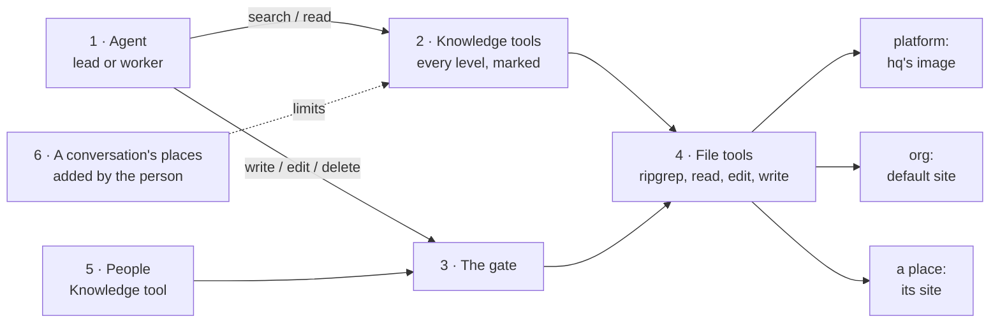

# Agent Knowledge — spec

**Status:** Draft. Designed on the design boards (kept under [`boards/`](boards/) as the build baseline) on 24–25
October 2026. Each part has its own file under [`spec/`](spec/).

## Purpose and outcome

An agent can answer questions about Agenthix itself from a guide that matches the running version, and can find and
follow how its organisation and its project do things, without any of it loaded into its prompt. People can see,
correct and restore what agents know. Knowledge stays inside the places allowed to reach it, and a conversation reaches
only the places its person chose to add.

Done when:

- Asked "look through the files in my space", "where do I add a model key?" or "how do I turn voice on?", an agent
  maps the words to the right place or setting without asking back.
- An agent finds and applies a project's or the organisation's workflow by searching, and changes one step of it when a
  person asks.
- A person browses a place's knowledge in hq, edits a page, sees who changed it, and restores an earlier
  version.
- A conversation cannot read or start work in a place its person did not add.

## The problem

- **Agents don't know the product they live in.** Asked to "look through the files in my space", an agent answered
  that it couldn't find anything called "MySpace". The platform package that reaches every run is empty, and nothing
  from the user guide reaches an agent.
- **Knowledge rests on a prompt line.** A place's `knowledge/` folder is mounted into runs, read and written freely; an
  `INDEX.md` that agents are asked to keep has no fixed form, so hq guesses titles from it and tags have nowhere to go.
- **People can see knowledge but not correct it.** The Knowledge tool's Edit is a placeholder; there is no delete, no
  author and no history.
- **The lead and workers reach it differently.** The lead (in hq) can only search it, folded into `recall`; workers
  (on a site) can only read and write the files. Neither has the other's way in.
- **There is no organisation-wide knowledge**, and nothing shows a person which places a conversation reaches.

## The rule

**Every agent reaches every level of knowledge the same way: one search and one read that say where each answer came
from, and changes only through one gate.** Nothing of knowledge is in the prompt beyond a few lines saying it exists.

## Terms

| Term | Meaning |
|---|---|
| **Platform guide** | The user guide (`docs/guide/`) plus its glossary, built into hq's image: how Agenthix works. The `platform:` level |
| **Knowledge** | A place's own pages, in sections: anything it needs shared across its workspaces, in as much detail as it needs — processes, workflows, decisions, conventions, reference |
| **Level** | Where knowledge belongs: the platform guide, the organisation, a project, or Your space — the person's default personal project. Any other personal project is a project like any other |
| **Page** | One Markdown file of knowledge, with front matter: the unit that is listed, searched, read, changed and versioned |
| **Section** | A folder of pages, laid out as the place likes |
| **Property** | A front-matter field of the place's own (`status`, `date`…), kept as written and shown |
| **The gate** | The one way a page changes: the change applied, the result checked, the previous version kept, who recorded |
| **File tools** | Our own Grep, Read, Write and Edit over any folder, in `@agenthix/core/file-tools`, with the safety guards built in |
| **A conversation's places** | Its own place, and the places its person added to it |
| **Lead, worker** | As in `docs/concepts/conversations`: the agent in a conversation (in hq), and an agent working in one place (on a site) |

## The design at a glance

1. **Agent** — the lead or a worker; starts with five lines saying knowledge exists, and nothing of it (part 3).
2. **Knowledge tools** — `search_knowledge` and `read_knowledge` over every level the agent may see, each answer marked
   with where it came from (part 3).
3. **The gate** — `write_knowledge`, `edit_knowledge`, `delete_knowledge` and every save in hq go through it (part 2).
4. **File tools** — our own Grep (ripgrep), Read, Write and Edit, universal, with the guards (part 3).
5. **People** — browse, edit, move, delete and restore pages in hq's Knowledge tool (part 5).
6. **A conversation's places** — the person adds places; the lead reaches only those (part 4).

## The parts

| Part | What it settles |
|---|---|
| 1. [The platform guide](spec/platform-guide.md) | The guide as the one source, the glossary, the generated tools reference, the build in CI, how hq serves it, staying in step |
| 2. [Knowledge: what a place knows](spec/knowledge.md) | The four levels, what knowledge holds, pages, sections and properties, links, where it is stored, the gate, versions and pruning, the itemiser |
| 3. [How agents find, read and change it](spec/tools.md) | The file tools, the five knowledge tools and their shapes, discovery across levels, the prompt, serving, the protocol change, running a pattern safely |
| 4. [Places and who reaches what](spec/places.md) | Who reads and changes each level, a conversation's places, `suggest_place`, the blast radius |
| 5. [Screens](spec/screens.md) | Browsing knowledge, a page, editing, history and recently deleted, organisation knowledge, correcting by asking, asking about Agenthix, places in a conversation |
| 6. [Limits and proof](spec/limits.md) | What the design stops and what it does not, the tests, what waits |

## The worked example

Sam is in Your space; Website rebuild is added to the conversation.

1. Sam asks "where do I add a model key?". Kernel calls `search_knowledge("model.?key|api.?key|provider")`; the hit
   `platform:your-tools/providers.md:12` gives the answer, with a link to the screen in hq.
2. Sam says "the release process is wrong: staging deploys need Mia's approval now". Kernel finds
   `website-rebuild:processes/release.md:14`, reads around it, and calls `edit_knowledge` with the one sentence. The
   gate checks the page and keeps the previous version; the conversation shows *Updated page · Release process* with
   Undo.
3. Mia opens Knowledge › processes › Release process in the project and sees "Changed 2 hours ago by Kernel, asked by
   Sam"; History shows the change.
4. Sam asks Kernel to set the same process up in Shop. Shop isn't in the conversation, so Kernel shows *Add a place to
   this conversation: Shop*. Sam adds it; Kernel reads Shop's knowledge and starts the work there.

## Not in this unit

- **Ranking by meaning** (embeddings, as memory has). Search is ripgrep; meaning-level search comes when word patterns
  are seen to miss.
- **Server-side caching of search**, and **measuring how knowledge is used**: when there is a question they answer.
- **Attachments in pages.** A page links to Files; pictures inside pages can come later as a section's `assets/`.
- **A "copy to project" action.** Asking an agent covers it.
- **Review of skills agents write.** Skills are instructions, not knowledge; their own work.
- **A runtime of our own.** The file tools are built so it can use them; building it is separate.

## Decision records

Four decisions bind work beyond this unit, recorded when it opened:

- [ADR-0149](../../adr/adr-0149-platform-knowledge-is-the-user-guide.md): **platform knowledge is the user guide**,
  built into hq's image and read through the knowledge tools (part 1).
- [ADR-0150](../../adr/adr-0150-agents-reach-knowledge-only-through-tools-shaped-like-the-native-ones.md): **agents
  reach knowledge only through tools shaped like the native Read, Grep, Write and Edit**, built on universal file tools
  in `@agenthix/core/file-tools` (part 3). It supersedes ADR-0123.
- [ADR-0151](../../adr/adr-0151-every-change-to-knowledge-goes-through-one-gate.md): **every change to knowledge goes
  through one gate** that checks it, keeps the previous version and records who (part 2).
- [ADR-0152](../../adr/adr-0152-a-conversation-reaches-only-its-own-place-and-the-places-its-person-added.md): **a
  conversation reaches only its own place and the places its person added** (part 4).

The change to `core/src/protocol/locationFiles.ts` follows [`docs/architecture/versioning.md`](../../architecture/versioning.md).
