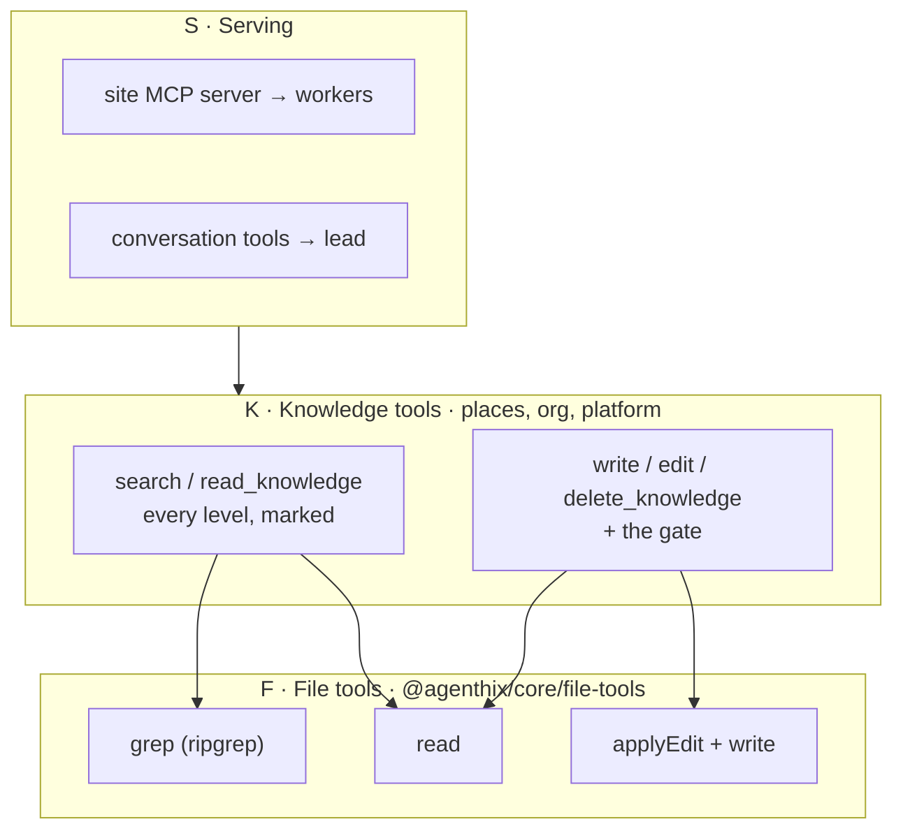

# Part 3 · How agents find, read and change knowledge

One set of five tools for every agent and every level, shaped exactly like the native Read, Grep, Write and Edit that
agents are trained on, and built on universal file tools of our own. Board: *5 · How agents find, read and change
knowledge*.

## Three layers



- **F · File tools.** A new node-only subpath export, `@agenthix/core/file-tools`, beside `./host-crypto`, holding
  grep, read, write and edit over **any folder they are given**, knowing nothing of knowledge or places. It is **lifted
  from the file tools Agenthix already owns** for OpenCode (ADR-0085, `site/opencode-plugin/src/files/`): the
  harness-neutral parts move into `core` unchanged — opening a file and then checking it is the file that was allowed
  (`verifiedFs.ts`), text reading and binary detection (`textFile.ts`), line-numbered reading, writing — and are
  extended for this unit with ripgrep search and Claude Code's shapes. The OpenCode plugin then builds on the same
  module and keeps its OpenCode shape and its matching copied from OpenCode, as ADR-0085 requires; the knowledge tools
  use Claude Code's names and exact matching. The guards (below) live here, so every user gets them.
  - `grep(root, {pattern, path, glob, output_mode, -i, -n, -A, -B, -C, head_limit, offset})` runs ripgrep, the program
    Claude Code's Grep runs (the agent image already sets `USE_BUILTIN_RIPGREP=0`).
  - `read(root, {file, offset, limit})` gives numbered lines and a version (a hash).
  - `applyEdit(text, {old_string, new_string, replace_all})` gives the new text, or why not: exact matching.
  - `write(root, {file, content})` writes beside, then renames in.
- **K · Knowledge tools.** Thin wrappers that pick the root and add what is theirs: search and read fan out across the
  levels; write, edit and delete are the gate (part 2).
- **S · Serving.** hq operations, given to workers through the site's MCP server (forwarded to hq like the other
  tools) and to the lead as conversation tools.

If Agenthix later runs agents in a runtime of its own, its file tools are layer F, on a workspace folder.

## The five tools

| | Native | Ours | Takes, as the native one does | Gives back |
|---|---|---|---|---|
| K1 | Grep | `search_knowledge` | `pattern`, `scope` (optional: a place's key, `org`, `platform`), `path`, `glob`, `output_mode` (`content`, `files_with_matches`, `count`), `-i` (on), `-n`, `-A`/`-B`/`-C`, `head_limit`, `offset` | Matches as Grep gives them, each marked with where it is from. Front matter is searched too (`status:\s*proposed` finds open decisions). At most 8,000 characters a call, saying where to continue. An empty pattern gives each level's sections and tags |
| K2 | Read | `read_knowledge` | `page` (e.g. `website-rebuild:processes/release.md`), `offset`, `limit` (lines) | The page with line numbers, front matter included, up to 2,000 lines; and its version |
| K3 | Write | `write_knowledge` | `page`, `content`: the whole Markdown, front matter included | Done, or refused with the problems. An existing page must have been read: the write carries the version `read_knowledge` gave |
| K4 | Edit | `edit_knowledge` | `page`, `old_string`, `new_string`, `replace_all` | Done, or refused saying why |
| K5 | (`rm`) | `delete_knowledge` | `page` | Done, and how to restore |

- **Levels are names, not parameters.** A page's name starts with its level: a place's key (`website-rebuild:`,
  `personal:`), `org:` or `platform:`. The places come from the worker's capability token, or from the conversation's
  places (part 4); nothing can name a place outside them.
- **Changes**: `platform:` pages are read-only; `org:` changes refuse unless the run or turn acts for an organisation
  admin. Change tools are offered to the lead only when the turn answers a person (as `remember` is), and to workers in
  runs that have write tools.
- **A page name is resolved inside its level's folder only**, refusing `..`, absolute paths and links.
- **Moving** a page is writing it at the new name and deleting the old; hq's Knowledge tool does both as one Move.

Descriptions say "Works like Grep / Read / Write / Edit, on knowledge". `write_knowledge`'s also says what the front
matter must hold, and to change knowledge only when a person asks or corrects it.

## Changing one step of a process

```
search_knowledge(pattern: "staging.*(approv|sign.?off)", -n: true)
  website-rebuild:processes/release.md:14: Staging deploys go out after the checks pass.

read_knowledge(page: "website-rebuild:processes/release.md", offset: 10, limit: 10)

edit_knowledge(page: "website-rebuild:processes/release.md",
               old_string: "Staging deploys go out after the checks pass.",
               new_string: "Staging deploys need Mia's approval before 4pm.")
  Done. Version 7; the previous one is in History.
```

## Discovery across levels

The agent never picks a tool or a level.

| | Rule |
|---|---|
| D1 | `search_knowledge` searches everything the agent may see by default: the conversation's places (or a run's one place), the organisation and the platform guide. `scope` only narrows |
| D2 | Every hit is marked with where it is from, and that mark is the page's name for `read_knowledge` |
| D3 | The most specific wins where pages differ: a place, then the organisation, then the platform guide; results come in that order, the conversation's own place first. Two places that differ are both shown |
| D4 | Links are followed across levels |

The prompt's whole Knowledge section replaces `KNOWLEDGE_GUIDANCE` (`site/src/agents/promptSectionText.ts`) and the
knowledge line of the lead's memory rules (`hq/src/conversations/lead/instructions.ts`):

```
## Knowledge
search_knowledge finds how things are done here and how Agenthix itself works, in one
search, across the places in this conversation. Look there before asking. Where pages
differ, the most specific wins: a place, then the organisation, then the platform guide.
What you learn on your own belongs in memory.
```

`recall` stops searching knowledge (`hq/src/conversations/memory/leadMemoryTools.ts`): memory and knowledge are
reached by different tools.

## Serving and the protocol

hq answers a search by asking the sites holding the places' and the organisation's knowledge and its own copy of the
guide at once, and merges the results within one time limit. A read or a change goes to the one level its name names.

Channel methods in `core/src/protocol/locationFiles.ts`: `searchKnowledge` changes to take Grep's parameters and run
ripgrep; `writeKnowledge`, `editKnowledge`, `deleteKnowledge`, `restoreKnowledge` and `knowledgeVersions` are new.
`listKnowledge` returns properties and problems. A new minor version, under `docs/architecture/versioning.md`.

## Running a pattern safely

A pattern is written by a model that may have read untrusted text, so it is treated as hostile input. The guards are in
layer F.

| | Risk | What stops it |
|---|---|---|
| S1 | A pattern that never finishes (catastrophic backtracking) | ripgrep's regex engine never backtracks; a pattern it can't run (backreferences, look-around) is refused with ripgrep's own message |
| S2 | Heavy or many searches | Pattern at most 500 characters; `rg` as its own process, killed after 2 seconds; `--max-filesize`, `--max-columns`, one thread; at most 30 calls a minute per run or conversation |
| S2b | A pattern or option taking over the command | `rg` started directly, never through a shell; arguments built only from allowed parameters; the pattern after `-e`; links not followed |
| S3 | Reading outside the folder | Every name resolved inside its root only; links refused |
| S4 | Something private in the platform guide | The build takes only the guide's pages and the generated reference; a test fails the build otherwise |
| S5 | A huge result | The caps above, each saying how to continue or narrow |
| S6 | An error giving the system away | A fixed set of messages; details go to the log |
| S7 | A person's words kept in logs | The log records the call, its time and outcome, never the pattern |
| S8 | A tool breaking a turn or a run | Every failure is a normal tool result; a missing guide or an unreachable site says so |

The site's server image and hq's image gain the `ripgrep` package (today only the agent and executor images have it).
