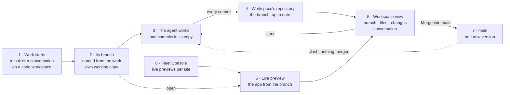

# Live preview — spec

**Status:** Approved by the owner on 1 November 2026, its *Defaults for review* included. Settled on the design boards
the same day. The screens that were agreed are kept under [`boards/`](boards/) and are the build baseline. The
implementation plan is [`plan.md`](plan.md).

## Purpose and outcome

A developer asks an agent to build something and wants to **see it running** while the agent works: open the app, try
it, tell the agent what to change, watch it change. Today an agent's app can only be previewed one at a time per
workspace, and nothing shows what the agent changed, on which branch, or lets a person take the work in when it is good.

**Outcome:**

- In any workspace that is a Git repository, **every task and conversation works on its own branch, in its own
  working copy**. Any number run at once on one workspace without getting in each other's way.
- **The person reviews the work in a full-screen view of the workspace**, laid out like a light IDE: the branch, its
  files, what changed, and the agent's conversation beside them. People read; agents write.
- **Merge into main** takes a branch's work into the workspace's protected `main` as one version.
- **A live preview** runs the app from any branch, or from `main`, beside the conversation that steers it, from
  wherever the person is.
- All of it runs only on machines the organisation runs as its sites
  ([ADR-0167](../../adr/adr-0167-agenthix-acts-only-on-machines-the-organisation-runs.md)).

**Who it is for:** developers first. They know Git, branches and worktrees, so the screens use those words, and say
plainly where Agenthix differs.

## Words used

- **Workspace**: a named folder in a project's (or a person's) storage on a site
  ([ADR-0039](../../adr/adr-0039-files-and-workspaces.md)).
- **Code workspace**: a workspace whose folder is a Git repository. **Any workspace with Git is a code workspace**,
  whatever it holds. The system decides this from the folder, never an agent.
- **`main`**: the branch the workspace's own folder has checked out (usually called `main`; the repository's default
  branch when it is connected to GitHub). It is protected: it only moves forward, and only by a merge or a restore.
- **Version**: one commit on `main`. Because `main` moves only by merges and restores, each version is one finished
  piece of work, numbered from the first (*v1*, *v2*, …).
- **Branch**: a real Git branch in the workspace's repository, with **a working copy of its own**: a separate clone of
  the repository, in a folder of its own, checked out on that branch. Developers know the arrangement as one worktree
  per branch; it is a clone for isolation (*Why a clone and not a worktree*).
- **Ahead / behind**: how many commits a branch has that `main` lacks, and the reverse.
- **Commit helper**: a small container of the site's own, with Git in it, no Docker socket and Git hooks off, in which
  the site runs every Git command on a repository an agent has written.
- **Live preview**: the app running from one branch (or `main`), shown in the workspace view beside the conversation.
- **Live app**: one program running in a live preview, such as a web server, seen at an address of its own.
- **Relay**: the part that carries bytes between a browser and a site; it decides nothing.

---

## The picture



1. **Work starts** on a code workspace: a task given that workspace, or a conversation started in it. Work anywhere
   else (a project's files, media, documents, a workspace without Git) runs exactly as today.
2. **Its branch** is made by HQ, named from the work, with a working copy of its own on the workspace's site.
3. **The agent works** in its copy, as runs do today, and commits as it goes.
4. **Every commit** goes straight back to the workspace's repository, so the branch there is always the real one:
   `git branch`, the workspace view and GitHub (when connected) agree.
5. **The workspace view** shows the chosen branch: its files, its changes against `main`, and the conversation with its
   agent.
6. **A live preview** runs the app from that branch's copy, so what the agent saves shows at once.
7. **Merge into main** takes the branch in as one new version of `main`. A clash merges nothing and goes back to the
   agent.
8. **The Fleet Console** decides which sites run live previews, how many at once, and when an unused one stops.

The work is split in two phases (*Phases*): phase 1 is everything here except the live preview; phase 2 adds it.

---

## 1. The workspace view

Opening a workspace takes the whole screen. HQ's own navigation is hidden. The view replaces the workspace's page in the
project's Workspaces tool, and has an address of its own, so a link opens it directly.

*Boards: [`overview`](boards/overview.html), [`live-preview`](boards/live-preview.html), [`files`](boards/files.html),
[`git`](boards/git.html), [`branch-select`](boards/branch-select.html), [`main-versions`](boards/main-versions.html),
[`merge-into-main`](boards/merge-into-main.html).*

### Layout

```
┌──────────────────────────────────────────────────────────────────────┐
│ 1 ‹ Fernhill Shop / shop-app ▾                                       │
├──────────────┬──────────────────────────────────────┬────────────────┤
│ 2 ⎇ login-page ▾ │ 5                                │ 6 Kernel · Mia │
│ 3 ▶ Live preview ● │  one thing at a time:            │                │
│ 4 ▸ Files    │  the live preview, a file,           │ conversation   │
│   ▾ Git      │  or a file's changes                 │ for this       │
│              │                                      │ branch         │
└──────────────┴──────────────────────────────────────┴────────────────┘
```

1. **Top bar.** *‹ Fernhill Shop* goes back to the project. The **workspace switcher** (*shop-app ▾*) lists the
   project's workspaces, most recently opened first.
2. **The branch select**, at the top of the left panel. It sets the branch for everything below it, and for the middle
   and the conversation. Opened, it lists `main` 🔒 first, then each branch on one line: its name, whose work it is, what
   is working on it (*Kernel is working here*), and how far ahead of and behind `main` it is. Its first line says:
   *Each branch has its own working copy, like a git worktree. Agents make the changes; you review and merge.* Its last
   line says: *A conversation or task on this workspace makes its own branch.* There is no *New branch*.
3. **Live preview**, always first in the panel, with its state (*Running*, *Starting*, *Stopped*). Choosing it shows the
   app in the middle and narrows the left panel to a strip.
4. **Files and Git**, an accordion below it, one open at a time:
   - **Files**: the branch's folder tree, each file marked when the branch added, changed or deleted it. A file opens in
     the middle in HQ's existing file viewer.
   - **Git**, for the chosen branch: whose it is and what is working on it; *6 ahead of main*; **Changes (N)**, the
     changed files (clicking one shows its changes in the middle, in the existing diff view); **Merge into main…**; and
     its commits, folded. With `main` chosen, Git lists its versions instead, newest first, each with *Restore* on hover,
     and a quiet *Deploy…* (*Deploying*); there is no merge.
5. **The middle** shows one thing at a time, with no tabs and no split: the live preview, a file, or a file's changes.
6. **The conversation** with the agent working on this branch, always in view, scrolled to its end, and collapsible.
   - A task's branch shows the task's thread; a conversation's branch shows that conversation.
   - `main` has no conversation of its own. The panel offers *New conversation*, which starts one in this workspace on a
     new branch of its own.

### People read, agents write

**Nothing in the workspace view edits a file.** People change code by telling the agent, or with their own tools
through Git. Editing in a browser without formatting, type checking or compiler warnings is not something developers
would choose. Connecting a person's own editor to a workspace is a separate, later piece of work.

### Switching

- **Workspaces**: the switcher, or the workspace's own address. A branch's copy, its agent and its live preview keep
  running on the site when the person leaves, so coming back is instant. The view remembers, per workspace and per
  person, the branch chosen, the section open and the file shown (in the address, and in the browser's storage for the
  rest).
- **Branches**: instant, because each branch is its own copy and nothing is checked out. The conversation on the right
  changes to that branch's. Switching away from a branch never stops its agent or its live preview.

### Narrow screens

*Boards: [`narrow-overview`](boards/narrow-overview.html), [`narrow-laptop`](boards/narrow-laptop.html),
[`narrow-tablet`](boards/narrow-tablet.html), [`narrow-phone`](boards/narrow-phone.html).*

| Width | What changes |
|---|---|
| Above about 1280 px | As drawn above |
| About 900 to 1280 px | The left panel folds to its strip: the branch, *Live preview* with its state, *Files* and *Git*. Choosing *Files* or *Git* opens its panel over the middle. The conversation stays beside the middle |
| Below about 900 px | The conversation becomes a drawer from the right, opened by a button in the top bar that shows the agent's state (*● Kernel is working*). Open, it starts below the live preview's own bar, so that bar stays in view |
| A phone | One thing at a time, as HQ's mobile layout is today. The conversation is the main view; a switch at the bottom moves between *Conversation*, *Live preview*, *Files* and *Git*, with a dot on *Conversation* while the agent works. The branch select is the header's title |

### A workspace without Git

The same view, with Files only. *Live preview* and *Git* offer **Turn Git on** (*Turning Git on*).

### Who sees what

| Role in the project | Sees | Does |
|---|---|---|
| Viewer | Everything in the view: files, Git, changes, versions, live previews | Nothing: no merge, restore, stop or message |
| Member, Admin | Everything | Merge, restore, start and stop live previews, talk to the branch's agent, turn Git on |

A person's own workspaces follow the same rules for their owner.

---

## 2. Branches and their working copies

### Which work is code work

**The system decides, when a run starts:** work is code work when its workspace is a code workspace. Nothing asks the
person or the agent.

- **A conversation** started in a code workspace (from the workspace view, or with that workspace as where it works) is
  code work.
- **A task** gains an optional **workspace**. A task given a code workspace is code work. Whoever starts the work names
  the workspace: the person on the task's form, or the lead when it makes a task or starts a worker. The lead is told
  the project's workspaces and which are code workspaces.
- **Project conversations stay project-level.** The lead does not work in a workspace itself; it gives code work to a
  task or a worker on that workspace.

### Why a clone and not a worktree

A worktree shares the repository's settings and hooks with every other worktree, so an agent could plant a hook that
runs for others. A clone shares no settings and can be carried to another site as one file. It borrows the
workspace's history read-only (Git's *alternates*) rather than hard-linking it, so it costs little disk, and an agent
cannot rewrite a file that `main`'s history is made of. Developers still meet the arrangement they know: one working
folder per branch.

### Where the copy lives

- **One copy per branch**, in `clones/<copyId>/` beside `files/`, `workspaces/` and `tasks/` in the owner's storage. It
  is inside the folder the project's container already binds
  ([ADR-0079](../../adr/adr-0079-access-to-a-boundary-is-access-to-all-of-it.md)), so the run's container is shared
  across runs as today ([ADR-0074](../../adr/adr-0074-a-container-is-keyed-on-its-boundary-and-its-runner.md)).
- **The run's working folder is the copy**, fixed for the work's life, so the agent's harness can resume its
  conversation.
- **Only what Git tracks is in a copy.** Git-ignored files are not: no `node_modules`, no build output, no `.env`.
  Dependencies are installed again in the copy, from a package cache the site shares between copies; an app's settings
  come from the project's variables and secrets (*Secrets*).
- **The workspace's own folder stays on `main`**, and agents can read it but not write it: it is bound read-only into
  the project's container. That is what makes "nothing reaches `main` without a merge" a rule rather than a habit.

### Branch names

HQ names the branch when the work first runs, from the task's title or from what the person first asked, in lowercase
words joined by hyphens (*Add a login page* → `add-login-page`), cut to 50 characters, with `-2`, `-3` when the name is
taken. A Member or Admin may rename a branch. Renaming the task later leaves the branch's name.

### Commits, and the branch coming back

- **The agent commits as it works**, with a `commit` tool (a message; the commit helper makes the commit) or its own
  `git` in its copy.
- **Every commit goes back to the workspace's repository.** A commit made with the tool goes back at once. One made with
  the agent's own `git` goes back within a minute while the run is going, and when the run ends. Bringing a branch back
  reads the copy's commits in the commit helper, with hooks off and the copy's own Git settings not read, and writes only
  that branch's name in the workspace's repository.
- **When a run ends**, anything left uncommitted is committed (*Work in progress*), so a branch never holds changes that
  are not committed between runs.
- **A follow-up run** (the task again, the person's next message) works in the same copy on the same branch. Its prompt
  says how far behind `main` the branch is. Bringing `main` in is the agent's call.
- **If the site was down** when a commit or a run ended, the branch comes back when the site is back.

### What agents are told

A run on a code workspace is told, in its prompt: its own branch and how far behind `main` it is, and the other
branches (name, whose, how far ahead, whether an agent is working on it). So it can say *Ada's branch already changes
the login form* before it repeats the work.

### Agents can do more with Git than the view shows

The person directs; the agent does it in its own copy with the real `git`: squash, regroup or reword commits, tidy the
history, bring `main` in, rebase onto `main`. The view shows the result, not a button for each Git operation. Two rules
hold:

- **`main` is never rewritten.** Agents cannot write the workspace's folder at all.
- **Every rewrite of a branch keeps a backup first**, as a branch of its own (`backup/<branch>-<date>`), so it can be
  undone.

When an agent switches to or works on a branch, the branch select and the branch's line say so.

---

## 3. Merging into main

**Git stays minimal.** `git` in the commit helper, called through `simple-git` where it helps, and HQ's existing diff
view (`ui/src/files/diff/`) do the work. Agenthix adds only the branch select, Git's panel, *Merge into main* and
*Restore*. There are no line comments, approval rules, checks before merging or branch protection rules; a team that
wants those connects GitHub and uses pull requests. More is added later, from what people ask for.

### Merge into main

*Board: [`merge-into-main`](boards/merge-into-main.html).*

- **Who may merge:** any Member or Admin of the project, on any branch. An agent merges only when a person tells it to
  in the conversation, and as that person: its `merge_into_main` tool puts a confirmation in the conversation (*Kernel
  will merge add-login-page into main as one version* · *Merge* · *Not now*), and the merge happens when the person
  presses *Merge*. HQ cannot tell from an agent's words whether the person asked, so the person's own press is the
  check.
- **The dialog** shows the changed files, a summary prefilled from the work (*Kernel for Mia · Login page*, editable)
  and *goes in as one version: v15*.
- **While an agent is working on the branch, merging still works.** The dialog says: *Kernel is still working on this
  branch. This merges what it has committed so far; it keeps working.* Such a merge is a checkpoint: the agent is not
  stopped and the branch stays open, and the next merge brings in what came after.
- **One version.** The branch's changes since it left `main`, or since its last merge, go in as one squashed commit on
  `main`, with the summary as its message. The commit helper runs it in the workspace's own repository, with hooks off.
  HQ keeps each branch's last merged commit and uses it as the merge base the next time
  (`git merge-tree --write-tree --merge-base`), so a branch merged as a checkpoint and then continued merges again
  without clashing with itself.
- **A clash merges nothing.** The dialog names the files that clash and the version of `main` that changed them, and
  says: *Kernel will bring the branch up to date with main, then tells you in the conversation when it is ready to
  merge. The live preview keeps running meanwhile.* HQ sends the branch's agent that request at once, on behalf of the
  person who pressed *Merge*; for a task, the task runs again.
- **After a merge**, when no agent is working on the branch, the branch closes: its live preview stops, its copy is
  removed, and its conversation or task says it was merged. When an agent is still working, the branch stays as it is.
- **GitHub.** When the workspace is connected to GitHub, *Merge into main* also pushes `main`, and a version pushed to
  GitHub by someone else arrives as a new version. A team that uses pull requests can ask the agent to push the branch
  and open one, through the existing GitHub connection; merging there is GitHub's.

### main's versions, and Restore

*Board: [`main-versions`](boards/main-versions.html).*

- Git with `main` chosen lists its versions, newest first: number, summary, who merged it, how many files, when.
- **Restore** (Member or Admin) makes a **new** version whose files are exactly those of the version restored
  (*v16 · Restored version 12*). Nothing is deleted from the history, so a restore can itself be undone by restoring.

### Deploying

Agenthix does not host the organisation's apps. *Merge into main* is where its job ends. Deploying `main` is done by a
workflow the organisation has approved (holding its servers' secrets,
[ADR-0147](../../adr/adr-0147-a-secret-is-used-only-by-a-workflow-a-person-approved-run-by-the-platform.md)), or by
GitHub Actions when the workspace is connected. *Deploy…* lists the workspace's deploy workflows and runs the one chosen.

### Turning Git on

HQ turns Git on for a workspace when it is needed: *Turn Git on* in the workspace view, or the first live preview on a
workspace without Git.

- **The person sees what happens first:** *shop-app isn't a Git repository yet. Turning Git on keeps its files as they
  are and records them as the first version. From then on agents work on branches, and changes reach the files by
  merging.*
- **The site runs `git init -b main`** in the commit helper and makes the first commit, by that person.
- **`.gitignore`**: when the workspace has none, a standard one for build and dependency folders (`node_modules`,
  `dist`, `build`, `.venv`, `__pycache__`, `.DS_Store`) goes into the first commit.
- **Large files**: files over 50 MB are left out of the first commit and named in the confirmation; they stay on disk,
  untracked, and the view says so.
- **A workspace connected to GitHub** is already a code workspace.
- **Work already under way** on the workspace carries on to the end of its current run; its next run is code work.
- Turning Git off is not offered: every open branch would have nowhere to go back to.

---

## 4. Live preview

*Boards: [`live-preview`](boards/live-preview.html), [`narrow-tablet`](boards/narrow-tablet.html).*

### Opening one

A live preview runs **on a branch**, or on `main`. The person chooses *Live preview* in the left panel; the agent may
also start one when it starts an app.

1. **HQ checks** the person may start it (a Member or Admin) and picks the site (*Sites and capacity*).
2. **The live preview's container starts**, binding only the branch's copy, with the services the app needs.
3. **The app shows in the middle**, the left panel narrows to its strip, and the conversation stays on the right.

**One live preview per branch.** A second person choosing it sees the same one. Steering follows the conversation's own
rule: a task's thread is the team's; a person's conversation is theirs, and others watch.

**`main`'s live preview** runs from a copy of its own, made from `main` when it starts and brought up to date when `main`
moves, because the workspace's own folder is read-only and an app writes build output.

### What stays fixed on screen

- **The live preview's own bar** stays at the top of its area and never scrolls away: its state, *Reload*, the app's
  address, *New tab*, *Stop*, and the site it runs on with how full it is (*preview-box · 2 of 6 open*).
- **The conversation is never covered.** The live preview takes the middle, never the conversation's place. On a tablet
  the conversation's drawer opens below the live preview's bar.

### The app

- **The agent's app tools**: `start_app`, `stop_app`, `list_apps`, `reload_view` and `set_auto_reload`, offered to runs
  on a branch with a live preview, and acting on that live preview's container.
- **An app that listens only on `localhost` works**, as it would on the developer's own machine: the site reaches it
  from inside the live preview's own network, so a development server needs no change.
- **No *Allow* for a live preview's own tools.** Starting a live preview is the permission for its app tools. Only an
  install script and a new service ask, and the question names what it is for.
- **An app's address is its own**: `p-<id>.<preview domain>`, from a random id given when the app first starts on that
  branch, so it stays the same across restarts and cannot be guessed. It is a separate origin from HQ, from the files
  address and from every other app.
- **Opening it:** HQ signs a single-use ticket for one person, one app and one relay; the browser exchanges it for a
  short-lived cookie for that address; the relay carries each request and connection over the site's line; the site
  checks the ticket again on every new stream.
- **Reloading:** by the agent (`reload_view`), automatically (*Auto*), or *Reload*.
- **Services** the app needs (a database, say) are declared in `.agents/services.yaml` and run beside it, on an internal
  network of their own. A new or changed service waits for a person's yes in HQ.
- **Install scripts** of packages are blocked by default; a person's yes in HQ lets a named one run.

### Secrets

**Secrets reach a live preview only through a workflow**
([ADR-0147](../../adr/adr-0147-a-secret-is-used-only-by-a-workflow-a-person-approved-run-by-the-platform.md)).

- *Start live preview* and *Reload live preview* may be workflows a person has approved, naming the project's secrets
  the app needs. The platform runs them and hands the secrets to **the app's own container**. The agent's container
  never holds them, and the output the agent sees is masked, as for any workflow run.
- An app that needs no secrets starts with the agent's `start_app` alone.
- **Accepted risk:** the approved workflow runs the app's code, which the agent keeps changing, so code that sends a
  secret elsewhere can only be caught by the person reading the changes. It is accepted because the people starting live
  previews are developers who review the code they merge. It stops being acceptable if live previews are offered to
  people who cannot read the code; the decision is then revisited.

### While an agent works on the same branch

- The agent works in the copy from the project's container, as for any run. The live preview's container runs the app
  from the **same copy**, so a change the agent saves reaches the running app at once (the app's own reloading, or
  `reload_view`).
- A message in the conversation goes to the branch's work, as any message does today.
- A task running on its own (a schedule, the pulse) on a branch with a live preview is seen live by whoever has it open.

### States

| State | Meaning | Moves on |
|---|---|---|
| Starting | Installing if needed, starting the container | Ready → Running; a failure says why, and nothing is left behind |
| Running | Apps and services may run | Unused for the site's idle time → Stopped; *Stop* → Stopped |
| Paused | The guard paused it, or the site lost HQ's line for 15 seconds | Guard: a person resumes after reading what tripped. Line: by itself |
| Stopped | Container gone; the branch, its copy and its work untouched | *Live preview* starts it again |

**Unused** means no one has it open and no run is going on its branch. A live preview also stops when a person stops
it, a project Admin or a fleet admin stops it, live previews are turned off on its site, the guard ends it, or the
machine runs out of memory. Stopping never loses work: the branch is in the workspace's repository.

---

## 5. Sites and capacity

**Work runs where its workspace is**, as today: the copy is made on the workspace's site and the agent's runs go there.
Only a live preview's container may run elsewhere.

- **A fleet admin switches *Live previews on this site*** in the Fleet Console: on by default for HQ's own site, off for
  every other new site. Turning it off stops every live preview there, after a confirmation that lists them.
- **Live previews at once**: a limit per site, set by the fleet admin (none by default). Lowering it stops nothing; new
  ones wait for room.
- **Stop when unused for**: per site, set by the fleet admin, 2 hours by default.
- **HQ picks the site**: the workspace's own, if it allows live previews and has room; else the allowed site with the
  most room. The person sees where, and how full, and may pick another allowed site. Sites with live previews off are
  never listed.
- **A full site.** *Live preview* says *preview-box has 6 of 6 open* and lists the open ones: whose, which branch, when
  last used. It offers *Stop one of mine*, or another allowed site with room. A person stops their own; a project Admin
  may stop any in the project.
- **On another site**, the live preview cannot share the branch's copy. The branch goes there as a Git bundle (one file
  holding its commits) through the relay, with a single-use ticket and its hash checked, and becomes a copy of the live
  preview's own. While it runs there, the branch's runs go to that site and work in that copy; each commit comes back
  the same way to the workspace's site.
- **Each live preview has its own ceiling** of memory, CPU and processes, as one agent run has. The site's page in the
  Fleet Console shows live previews running, and memory, CPU and disk (copies included) against the machine's total.
  Fleet admins are told when a site passes 80% of its memory or its disk, and when it recovers.
- **A one-machine install works fully:** HQ, the relay, the Fleet Console and the default site on one machine.

| Install | Live preview | Live apps' address |
|---|---|---|
| A server with a domain | Works | `https://p-<id>.<preview domain>`: one wildcard DNS record, then `agenthix front-door on --files <files domain> --previews <preview domain>`. One certificate per app, on first open |
| A laptop running HQ at `http://localhost` | Works | `http://p-<id>.preview.localhost:<HQ's port>`, for that laptop's own browser only |
| Reached by a bare network address | Branches and merging work; no live preview | None: *Live preview* says a domain is needed |

---

## 6. Security

**The trust boundary is HQ and the organisation's sites**
([ADR-0167](../../adr/adr-0167-agenthix-acts-only-on-machines-the-organisation-runs.md)). HQ's checks admit work; the
site checks its own record again.

**Code work in the project's container** is bounded as every run is today
([ADR-0079](../../adr/adr-0079-access-to-a-boundary-is-access-to-all-of-it.md)): the run reaches its owner's storage.
What is new: each code workspace's own folder is read-only to it, and its working folder is its branch's copy.

**The live preview's container** runs the app's own code with network access, so it is held tighter:

| May reach | May not reach |
|---|---|
| The branch's copy (read and write) | The workspace's folder, other copies, any project's or person's storage, the site's data |
| The public internet | Private addresses (10/8, 172.16/12, 192.168/16, link-local, 100.64/10), the machine's own and public addresses, cloud metadata addresses: firewall rules for the live-preview part of the agent address range, on every machine |
| Its own services, on an internal network of their own | Other live previews, HQ's containers, the host service |
| Its site, for its own apps | Docker's socket, any added capability, IPv6 (off on every container the site makes) |

Every command runs through the sandbox launcher. Images are pulled by name from public registries, under a size cap.

**The guard** checks at least every 5 seconds, and on every Docker event, that the container matches its template, that
no process, port or container appears that the live preview did not start, and that no private address is tried. It
stops or pauses within 2 seconds and tells the people who have it open, and the fleet admins, why. A site whose guard
has not reported in a minute starts no live previews.

**Git on what an agent wrote.** A branch's copy, its `.git` folder included, is written by an agent, so the site never
trusts it: every Git command on it runs in the commit helper, with a Git folder of the helper's own, so no hook, setting,
attribute or filter in the repository is read.
Bringing a branch back reads the copy's commits and writes only that branch's name. Merging and restoring run in the
workspace's own repository, which no agent can write.

**Apps and the relay:** single-use tickets, the relay's checks on where a request comes from, host-only cookies of at
most 15 minutes, the app's frame sandboxed, the site checking each stream again.

**Accepted risks**, stated so nobody mistakes them for promises:

- a stolen HQ session can start a live preview and steer an agent, as it can steer any agent today;
- a package's ordinary code runs in the app and in the browser;
- one person's live apps share a site in their browser, and one could set cookies for another (the relay blocks requests
  between them);
- a run can write another branch's copy in its project, as it can write the project's other files;
- an approved live preview workflow can leak a secret through the code the agent writes (*Secrets*).

---

## Phases

One unit, two phases, one merge to `main`.

| Phase | Delivers | Proved by |
|---|---|---|
| **1 · Code work on branches** | Turning Git on; a task's workspace; a copy and branch per task and per code conversation; commits back to the workspace; `main` read-only to agents; what agents are told; the full-screen workspace view (branch select, Files, Git, changes, the conversation, narrow screens, Viewer rules); *Merge into main* (checkpoints and clashes included); versions and *Restore*; *Deploy…*; GitHub push | The owner's walk: two tasks at once on one workspace, each on its own branch; one merged cleanly, one clashing and brought up to date by its agent; a checkpoint merge while an agent works; a restore |
| **2 · Live preview** | The live preview's container, app tools, services and install-script rule; the relay, addresses and tickets; `localhost` apps; secrets through workflows; `main`'s live preview; the Fleet Console's settings and capacity; idle stop; a full site; another site by bundle; the guard | The owner's walk on a one-machine install, on `preview.localhost` and on a preview domain: a live preview on a task's branch, steered while the agent works; a second on another branch at the same time; a full site; one on a second site |

Phase 2 is built on a branch cut from the end of phase 1, so phase 1 stays as it was walked.

## Decision records

Written on the unit's branch as the phases start:

- **Code work on branches**: in a code workspace, every task and code conversation works on a branch with its own copy;
  every commit goes back to the workspace's repository; only a merge or a restore changes `main`; people read and agents
  write.
- **Live apps travel through relays**: an app's address is its own origin, reached through the relay with single-use
  tickets.
- **Install scripts are blocked by default** on the organisation's sites; a person's yes in HQ lets a named one run.
- **Secrets reach a live preview only through an approved workflow**, with the accepted risk above in its *Risks*.

Records changed by this unit get a dated note: ADR-0039 and ADR-0030 (a code task's working folder is its branch's
copy), ADR-0079 (a code workspace's own folder is read-only inside the boundary), ADR-0074 (paths by id hold for
copies).

## Names in code and stored data

Plain names, with no product name: `WorkspaceBranch`, `BranchCopy`, `LivePreview`, `livePreviewsAllowed`,
`livePreviewLimit`, `livePreviewIdleMinutes`. "Room" is not used: the word is kept for collaboration later.

---

## Defaults for review

The boards did not settle these. Each has the answer the spec is written with; the owner may change any.

1. **Commit authors.** The agent's commits name the agent as author, with the person the work is for in a
   `On-behalf-of:` line. A merge, a restore and the first commit are by the person who pressed it (or who told the
   agent to). *Why:* the history says who did what.
2. **Merging needs one person.** No second person approves. *Why:* teams that want reviews connect GitHub.
3. **Viewers read everything and do nothing** (*Who sees what*). *Why:* seeing the work is what a Viewer is for.
4. **Disk is shown, with no cap.** The site's page shows disk used by copies; fleet admins are told past 80%. *Why:*
   many branches of a large repository can fill a machine, and a cap would stop work with no warning.
5. **Removing a workspace that has branches** lists them first: each branch, whose, how far ahead, and any agent working
   or live preview running, which stop. *Why:* nobody loses work they did not know about.
6. **Words:** branches count *commits* ahead and behind (developers' words); `main` counts *versions*.
7. **Branch names** have no prefix (`add-login-page`, not `feature/add-login-page`). *Why:* the branch select is short
   on space, and the name already says what the work is.
8. **How long a copy is kept.** Removed when the branch is merged and no agent works on it, or when its task is done or
   archived or its conversation archived. The branch stays in the repository until it is merged or deleted; reopening
   the work makes a fresh copy. *Why:* each copy takes disk.
9. **Deleting a branch.** A Member or Admin may delete an unmerged branch whose work is over, from its line in the
   branch select; the confirmation says how many commits are lost. *Why:* abandoned work should not pile up.
10. **Several people on one live preview** see the same one; steering follows the conversation (*Opening one*).
11. **What happens on a clash** for a conversation: the agent acts at once on the person's behalf, as the boards show.
    The alternative, waiting for the person's next message, saves model spend while nobody is there.
12. ***Deploy…*** lists the workspace's deploy workflows; with none, it says how to add one.
