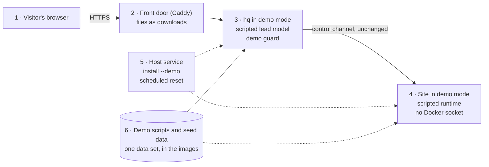

# A live demo of hq — spec

**Status:** Approved by the owner on 11 November 2026, the questions at the end answered. Built unattended; the lead's
own decisions are recorded in the unit's report and its plan's Deviations.

## Purpose and outcome

Someone who finds Agenthix opens a link, is inside a working organisation within seconds, and can talk to its agents,
start a task and watch it run, read its Knowledge, files and boards, and look through its settings, without
installing anything, signing up or paying. Done when:

1. A visitor reaches the sample organisation from one link, with no account to make.
2. Every screen in the user guide shows something real-looking, and the demo's own differences are stated once on the
   screen and in the user guide.
3. A chat reply, a task run and a routine run look and move like real ones, and no model is called and no agent
   container starts, whatever a visitor does.
4. Nothing a visitor does reaches outside the machine, changes who can get in, or lasts past the next reset.
5. It runs on one machine from the normal signed images, installed and reset by the host service.

## Today

Facts from the code on `main` at `34ce18c7`; paths are relative to the repository root.

### 1. A chat message never reaches a site; a run always does

- **A message in a conversation is not a run** (`docs/architecture/README.md`). hq stores the message
  (`hq/src/conversations/coordinator/admission.ts`), takes the turn lock and runs the turn in hq
  (`coordinator/scheduler.ts`, `coordinator/turn.ts`); the lead calls the model itself through the `ModelAdapter`
  (`conversations/contract.ts`), built by `createModelAdapter` (`conversations/model/index.ts`) with a `languageModel`
  override that tests already fill with the AI SDK's mock models (`conversations/model/testSupport.ts`). The reply
  streams to the screen as `conversation:delta` and `conversation:turn` (`core/src/client/conversationSocket.ts`).
  Only the lead's tools that start work — a brief to a worker, a task — go to a site.
- **Task runs, routine runs and task-session chat go to a site.** `TaskRunner.runTask` and the routine scheduler call
  `dispatchService.dispatchTaskRun` / `dispatchChatRun`, which sends `run.dispatch` (`core/src/protocol/runtimeData.ts`).
  The site launches the run (`site/src/agents/runLaunch.ts`), picks a harness with `selectRuntime`
  (`site/src/agents/runtime/selectRuntime.ts`: `claude-sdk` or `opencode`, anything else throws) and streams
  `RunEvent`s (`site/src/agents/runtime/types.ts`) back as `run.stream` and `run.status`. hq maps the run's end to the
  task's run state (`hq/src/agents/taskStatusListener.ts`). hq does not store transcripts, runs or tool calls; it reads
  them from the site (`hq/src/sessions/siteRuntimeStore.ts`).
- **Workflows use no model and no harness**: the site runs their steps in executor containers
  (`site/src/executor/`, `core/src/protocol/workflowRuns.ts`).

### 2. hq without a site is hollow

Zero sites is a supported state, but Knowledge, files, a conversation's shared files, skills, workspaces, run
transcripts and usage are all served by the site, and creating a project needs one (`hq/src/sites/localSite.ts`,
`hq/src/projects/projectService.ts`). A fake inside hq that avoids the site would have to stand in for every one of
those reads.

### 3. Fakes that exist

| Fake | What it is | Where it runs |
|---|---|---|
| `MockLanguageModelV3` helpers | Scripted model streams for the conversation lead | hq unit tests |
| `stand-in-model.mjs` | An OpenAI-compatible endpoint that always answers one sentence | hq e2e, install test |
| `fakeVendor.ts` | An OpenAI-compatible endpoint with scripted text or tool calls | cross-app suite |
| `fakeClaudeQuery.ts` | A scripted Claude SDK `query()` | site unit tests |
| `fakeLead` (`hq/src/conversations/voice/playground/leads.ts`) | Streams a canned reply in 3-word pieces | voice playground, development builds only |
| `voiceClient/models/fakes.ts` | Scripted scores for the on-device voice-activity and end-of-turn models | hq unit tests |
| `fake-providers.mjs` | Provider rows with a fake key, marked working and never checked | the guide's seed |

No harness, speech-to-text or text-to-speech fake ships in an image, and nothing selects a fake in a production build.
Voice's speech-to-text runs in the browser against AssemblyAI or Inworld with a token hq mints; its text-to-speech is
Inworld through hq's socket (`hq/src/voice/`).

### 4. The guide's seed

`hq/e2e/fixtures/seed-guide-data.mjs` writes the sample organisation, Fernhill & Co, straight into hq's and the
site's databases through Prisma: five people (sam is an admin and fleet admin; priya, alex, jordan and kai are
members), two teams, three agents and the built-in one, four projects (one private), task types, a board, a
milestone, 18 tasks with comments, schedules and routines, finished and failed runs with transcripts, encrypted
conversations, notifications, a pending invitation, four providers with a fake key, default models and voices, billing
profiles, usage, workspaces and Knowledge pages. It is safe to run again: it truncates and rewrites.

It needs a booted hq with its default site, the compiled Wasp SDK, `SECRETS_MASTER_KEY`, and databases whose names end
in `_guide`. Its clock is fixed at 2027-04-12. **It seeds no workflows, no skills of its own, no secrets or variables,
no attachment file, and no Knowledge for the private project.**

### 5. Getting in

Sign-in is username and password only (`hq/main.wasp.ts`); Wasp's own sign-up is refused, and accounts come from
invitations, the first-admin link or Cloud sign-in. There is no guest session. Roles are admin and member, with a
separate fleet-admin mark. An admin can change providers and keys, register a GitHub App, connect Cloud, pair and
approve sites, switch features, invite and remove people, make password-reset links, write secrets and delete
projects. **hq's read-only mode** (`hq/src/server/readOnly.ts`) is the precedent for refusing writes by operation
name: it answers queries from a checked list and refuses everything else with one sentence.

### 6. What reaches outside

| What | Controlled by | Unset or empty |
|---|---|---|
| Email | hq sends none; only Cloud does, when connected | — |
| Agenthix Cloud | Connecting is an admin action; `HQ_RUN_BY_CLOUD` | No calls |
| GitHub | An admin registers a GitHub App | No calls |
| Model vendors | `AiProvider` rows; hourly health check | No calls (the seed's rows are never checked) |
| Voice vendors | Provider rows | No voice |
| Web search | The org's Exa key, sent to the site | No search |
| URL fetch for packages | An admin or member pastes an https link (`hq/src/assets/sources/urlFetch.ts`) | — |
| Agent tools (web fetch, shell) | Run inside agent containers on the site | — |
| Google Fonts | Loaded by the browser | — |

### 7. Deployment

`agenthix install` puts hq, its site and the Fleet Console on every hq machine and cannot leave the site out; the
host service mounts the Docker socket into the site (`host/src/compose/projects.ts`). Environment reaches hq and the
site only through the compose projects the host service writes. The front door is Caddy on ports 80 and 443. The host
CLI has backup, restore and erase, but no reseed. hq has no job system: one in-process scheduler fires routines every
minute, and the other sweeps are timers (`hq/src/server/setup.ts`). The Fleet Console listens on `127.0.0.1` only and
refuses any `Host` that is not the loopback, so it cannot be put behind a proxy.

## Design

### Overview

1. **The visitor's browser** opens the demo's address and lands in the organisation.
2. **The front door** is the normal Caddy; it serves the demo's files host as downloads only. Limits per address
   are hq's own (below): stock Caddy has no rate-limit module.
3. **hq** is the normal image with the demo setting on. Everything is real except the model behind the conversation
   lead, which is scripted, and a guard that refuses what a visitor must not do.
4. **The site** is the normal image with the demo setting on. It stores files, Knowledge, workspaces and transcripts as
   usual; every run goes to a scripted runtime, and it has no Docker socket, so no container can start at all.
5. **The host service** installs the pair with the demo setting and resets them on a schedule.
6. **The demo scripts** are one data set that both read: what the lead says and which tools it calls, and what each
   run streams and writes.

### Where the fake sits: in the model and the harness, not in hq's data paths

**Answer to open question 1.** Neither "inside hq with no site" nor "a site that replays" alone: a real site with
**its harness replaced**, and hq with **its lead's model replaced**. Everything between — the control channel, the
dispatch, the run states, the transcript reads, the files — is the real code, so the demo shows the product as it is
and needs no parallel implementation of the site's reads (Today §2). The safety the README wanted from "no
containers" comes from the site having no Docker socket and no harness that runs commands, not from having no site.

**In hq: a scripted language model.** With the demo setting on, `createModelAdapter` is given a scripted
`languageModel` in place of `languageModelFor`, at the seam tests already use. It streams text in small pieces at a
reading pace and emits the tool calls a script names — `start a task`, `brief a worker` — which hq's real tools then
carry out. The provider rows stay as seeded, so the Providers and Models screens look as they would.

**On the site: a scripted runtime.** With the demo setting on, `selectRuntime` returns `ScriptedRuntime` whatever the
agent's runtime is, so hq's runtime names and the protocol do not change. It implements `AgentRuntime` and yields the
script's `RunEvent`s — text, thinking, tool calls with results, a notice — at a set pace, writes the files a script
names into the run's workspace through the site's own storage, and ends with the script's status: completed, failed
or blocked on a limit. A run with no script of its own gets the agent's general script.

**Workflows** are seeded with past runs; starting one in the demo is refused with the demo's sentence, because their
steps need executor containers.

**Voice is in, as a demo voice** (owner, 10 November). Every scripted line the agents can say is recorded once with
Inworld, in the voices the sample organisation uses, and shipped with the scripts as audio clips — about 40, with each agent's closing lines (work came back, done, refused, waiting); a small
script in the repository records them again when a line changes. The visitor does not speak: the voice screen shows
the lines they can say as buttons, and the agent answers each aloud. No vendor is reached and no microphone is used.
The rest of the voice screen is the real one. A reply with no recorded clip is shown as text.

**The voice says it is a demo**, twice: the voice screen carries a label, *Demo voice — scripted lines, nothing you
say is listened to*, and each agent's first spoken line in a voice conversation says so too ("This is a demo voice,
so pick a line below and I'll answer").

### The scripts: one set, keyed by agent

**Answer to open question 5.** One data set, `demo/` at the repository root, built into the hq and site images and read by both, in a
format typed in `@agenthix/core`:

- **Lead scripts**, per agent: a few intents, each with example phrasings, the reply, and the tool calls it makes. A
  visitor's message is matched to the nearest intent by word overlap; one that matches nothing gets the agent's
  fallback, which says this is a demo and offers the suggested prompts.
- **Run scripts**, per agent and task type: the events of a run and the files it writes, with seeded tasks pointing
  at their own.
- **Suggested prompts**, shown under the composer in the demo only, so a visitor knows what the scripts answer.

Keying by agent keeps each agent sounding like itself; one set shared by the seed and the scripts keeps the names of
people, projects and tasks the same in both.

### Getting in: an account per visitor, in the one organisation

**Answer to open question 2.** hq is one organisation per instance (ADR-0042), so one organisation shared by every
visitor; a fresh organisation per visitor would be an install per visitor.

- **Enter the demo.** In demo mode the sign-in page shows one button, *Enter the demo*, above the notice *"This demo
  is shared and wiped every 6 hours; don't type anything personal"* and a countdown to the next wipe ("Next reset in
  2 h 14 min"). The button makes a visitor account (`Visitor 4821`) and signs it in. There is no password to know and
  none to change. At most 5 accounts per address an hour (an IPv6 address counted by its /64), and at most 300 visitors active in
  the last hour; a visitor idle for an hour stops counting. Above either, the
  button says the demo is full and to come back shortly.
- **How the account is made.** The button posts to a route that exists only in demo mode. It checks the caps, then
  makes the account as accepting an invitation does (`hq/src/auth/inviteAccept.ts`): a user, a username identity with
  a long random password nobody is shown, and the **member** role. It signs the account in with `makeBrowserSession`
  (`hq/src/cloud/cloudAccounts.ts`, which already does this for Cloud sign-in), and the browser keeps the session as
  after any sign-in. The same browser stays the same visitor until the reset wipes every visitor account; signing out
  ends that visitor.
- **A visitor views the sample and works in their own space** (owner, 12 November: "the demo needs to be locked down
  like this … just to demonstrate what features are where so user can play around with it without breaking
  things"). The visitor is an organisation **member** and a **viewer** of each of the sample's projects, which are
  private, so nobody joins them as a member (ADR-0102: a viewer reads everything a member reads and changes nothing;
  ADR-0101: nothing changes a project on a viewer's behalf). The product's own roles protect the sample: no demo rule
  is needed for it. The visitor works in **Your space**: they talk to the agents there, an agent makes and runs tasks
  there (scripted, as every run in the demo), and voice works there. Their space and conversations are their own, so
  no visitor sees another's work.
- **Visitors stay out of the sample's people.** People, mentions and the assignment pickers list Fernhill & Co's five
  people and the visitor as *You*, not the other visitors, so the organisation reads the same for everyone.
- **The demo guard is one short list** (`hq/src/demo/guard/refused.ts`) of what a member may still do that a public
  demo must not: reach a service outside the machine (providers and keys, a person's own Claude subscription, a
  web-search key, GitHub, Cloud, connections, a secret's value, a package from a link, speech), change who can get in
  (invitations, reset links, a password, a phone), start a container (a workflow, a live preview), or make a project,
  which every visitor would see. With the storage budget below, that is all. Everything else a member may do happens
  in their own space or is already refused to a member by the product. A refusal is
  said as the product says its own (handler 1, *"The demo can't do this. Nothing was changed."*).
- **Storage**: a file is at most 2 MB, a visitor may store 20 MB and the demo 2 GB until the reset; only signed-in
  actions count. Every file is served as a download, so the demo cannot host pages for others.
- **The guard judges the arguments Wasp will pass** (it deserialises the request as Wasp does and refuses a body
  that would rewrite them).

### Reset

- **Every 6 hours** (00:00, 06:00, 12:00 and 18:00 UTC), and on demand (`agenthix demo reset`), the host service
  stops the demo's hq and site, removes their databases and storage, and starts them again; nothing is backed up. A
  reset missed while the host service was down runs as soon as it is back. Six hours, not one, so a
  visitor has time to try it properly (owner, 11 November); a visitor cannot change the sample, since they only view
  it (above).
- **The warning stays at the top, on the frame line** (owner, 11 November) — handler 4 of hq's message rules
  (ADR-0185, the `handling-errors` skill), which today says HQ is not answering or read-only during a move. In demo
  mode it also carries, at the lowest priority of its states, *"Demo — shared with other visitors · resets in 2 h 14
  min"* with a link to the guide's *Trying the demo* page. In the last 10 minutes it says *"Resets in 8 min — what
  you've done here will be wiped"*. HQ not answering still takes the line first. The design system's *Messages* says
  so.
- **A refusal** follows the same rules: what the product's roles refuse is drawn as the product draws it; what the
  demo guard refuses is the attention dialog (handler 1), *"The demo can't do this. Nothing was changed."*, with no
  Try again, since it is final until the reset. No product screen carries a demo refusal of its own.
- **The seed runs at start.** In demo mode, hq that starts on an empty database seeds the sample organisation instead
  of issuing a first-admin link, and the site that starts empty seeds its own part (runs, transcripts, workspaces,
  files, Knowledge pages); both build from one data set with fixed identifiers, so they agree without talking about
  it. It takes `now` from the clock, so tasks, runs and routines are dated around today, and it seeds what the guide's
  seed leaves empty (Today §4) — a workflow with past runs, a skill of the organisation's own, a secret's name with no
  value, Knowledge for every project, the attachment file. No one in it is a fleet admin. The guide's own seed keeps
  its fixed clock for the screenshots, built from the same data where that is practical.

### The demo setting

**Answer to open question 3.** Not a feature flag and not a separate build: **a setting of the install**, `DEMO_MODE`,
written into hq's and the site's environment by `agenthix install --demo` and read once at start.

- A feature flag is the wrong shape. It is for a feature not yet ready, and in production an organisation's admin
  switches betas on and released flags off on the Features screen. Being a demo is a property of the machine, which
  the host service owns.
- A separate build would be an image nobody else tests. The fakes ship in the normal images and stay inert unless the
  setting is on; an install without it behaves exactly as today.
- The demo's own code, while it is being built, needs no flag of its own: nothing reaches it with the setting off.

### Deployment

`agenthix install --demo` installs hq and its site with `DEMO_MODE` on, leaves the Docker socket out of the site,
leaves the Fleet Console out, turns the nightly backup off, and schedules the reset. The demo scripts and the voice
clips are built into the hq and site images, so they are signed with them; there is nothing to mount.

**Where it runs** (owner, 10 November): `demo.agenthix.com`.

- **It can share a machine with another installation**, the configuration ADR-0108 keeps for testing: the demo
  installs under a namespace of its own (`INSTALL_NAMESPACE`), on ports it chooses, so nothing is shared by name or
  port. Only one front door can hold ports 80 and 443, so one Caddy then serves both addresses
  (`agenthix front-door add-installation`).
- **The address is under `agenthix.com`.** Sign-in pages elsewhere on that domain use `__Host-` cookies, which a
  subdomain can neither read nor set, so the demo cannot reach them. What the demo could do is show a visitor's upload as a page
  on that domain, so the files host (`files.demo.agenthix.com`) serves every file as a download and never as a page.

### No machine-level access

**Owner, 10 November:** the demo gives no one power over the machine from a browser. The machine is managed only over
SSH with the host CLI.

| | The demo |
|---|---|
| **Fleet Console** | Not installed |
| **Fleet admins** | None: the demo seed gives no one the role, and visitors are members |
| **Machine screens in hq** (Sites, Infrastructure, Logs and diagnostics, maintenance) | Not a visitor's: a member never has them |
| **Agent containers** | None: the site has no Docker socket |

### What the demo does not include

- **The Fleet Console**: it holds fleet-admin power and is built to refuse being proxied. The user guide's Fleet
  Console pages say what it does, with their screenshots.
- **Live previews**, an experimental flag, off in production.
- **The mobile app**: pairing a device is refused.

### What visitors are told

The frame line and the entry screen (above), and a page in the user guide, *Trying the demo*: what is scripted, what is refused, what resets,
and that nothing typed into it should be personal.

## Not in this unit

- A demo of Agenthix Cloud's dashboard.
- Usage limits on real models: the demo calls none.

## Answered questions

1. **Decided — voice** (owner, 10 November): in, as a demo voice that says it is one.
2. **Decided — the address and machine** (owner, 10 November): `demo.agenthix.com`.
3. **Decided — reset every 6 hours, with a countdown** (owner asked for longer than an hour and a countdown, 11
   November; 6 hours is the lead's call, in the report).
4. **Decided — the privacy notice** (owner, 11 November): the line on the entry screen and the frame line, and a short
   privacy page saying what is logged (addresses, for rate limiting) and for how long.
