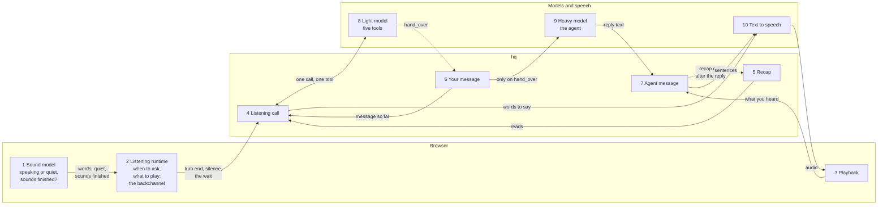

# Adaptive voice listening — spec (archive 1)

> **Archived on 19 Nov 2026, superseded by [`spec.md`](spec.md).** This is the design as it stood through the owner's
> playtests of 17 to 19 Nov 2026, corrected in place lane by lane; the plan's Deviations rows up to 19 Nov, and the
> numbered decisions they cite, refer to this file. It was replaced because the playtests moved the design a long way:
> one light model first listened, hummed and decided; the hums then moved to a call of their own with a recorded
> library, and the tone to one running tone shared by everything the agent said. Each step was right on its own, but
> together they tangled the jobs, so that one feature could not be switched off or tuned without reaching into another
> (the hums only ran with the light model on; the tone lived inside the hum service). The new spec regroups the same
> work into three services (Reasoning, Responsive, Backchannel), an optional Tone layer and the foundation, each module
> with one responsibility and its own switch, and says what is built and what is agreed but not yet built.

**Status:** Design agreed with the owner on 17 Nov 2026 on the unit's design board, reviewed twice by an independent
reviewer, and written here the same day. Nothing is built. Numbers marked *first value* are settings, changed in the
voice playground while the owner tries it. The decisions are listed at the end in the order they were taken; the
records are [ADR-0195](../../adr/adr-0195-a-light-model-listens-while-the-person-speaks-and-gates-the-conversation-model.md)
and [ADR-0196](../../adr/adr-0196-adaptive-voice-switches-the-light-model.md).

## Why

Voice today feels predictable and a little deaf:

1. **Listening sounds are played by timers.** A hum or "right" plays in a 0.3 s pause, after 8 s of speech, at a
   random gap of 10 to 25 s, chosen by punctuation and a word check
   ([`listening.ts`](../../../hq/src/conversations/voiceClient/orchestration/listening.ts),
   [`fit.ts`](../../../hq/src/conversations/voiceClient/orchestration/fit.ts)). The rule cannot tell what the person
   means, so a sound lands on a joke, a worry or a question, and the rhythm is mechanical.
2. **"Let me look into that" comes too late.** The heavy model opens a slow reply with it, but only once it starts
   writing — by then it is ready to answer, so the person hears the hold and the answer back to back. A help desk that
   says "let me look into that" after a minute of silence, and then answers at once, makes no sense.
3. **Every turn waits for the heavy model**, even "Thanks." or "Stop talking."
4. **Silence has one meaning.** Thinking, searching for a word, waiting for the agent and having stepped away all get
   the same timed "Go on.", or nothing; a long wait for the agent gets the same stored ladder of phrases at 3, 7 and 15 s.

What would fix these is judgement about meaning, made while the person is still speaking. The heavy model cannot make
it: it is slow, it is called once a turn is over, and asking it to react without answering fights what it is for.

**How responsiveness is judged.** People see their words appear on screen 1 to 1.5 s after they say them, and judge
the agent from that moment. Every timing below is measured from when the words appear, not from when the person
stopped.

## Three models

1. **The sound model** (browser, instant): today's silence detection and audio turn model. It hears whether the person
   is speaking or quiet, and whether they *sound* finished.
2. **The listening runtime** (browser): decides only *when* the light model is asked, and plays what it chose. Beside
   it, the **backchannel** plays a hum recorded ahead while the person talks, at a pause its rules choose, of the kind
   and tone a small fast call, the hum service, last picked from their words (below).
3. **Playback**: the heavy model's replies, and the light model's words.
4. **The listening call** (hq): one small call to the light model.
5. **The recap** (hq): under 100 words on where the conversation is now, written after each reply by one small call.
6. **Your message**: the person's words, built as they speak; complete when the turn ends.
7. **The agent message**: what the person heard while they spoke, then the heavy model's reply; shown, spoken, stored.
8. **The light model**: reads the person as a good listener would and calls exactly one of five tools.
9. **The heavy model**: the agent. Thinks, uses its tools, answers. Called only on `hand_over`.
10. **Text to speech**, in the agent's voice.

| | Sound model | Light model | Heavy model |
|---|---|---|---|
| Hears | Sound | Meaning | The whole conversation |
| Runs | Every 32 ms, in the browser | At the turn's end, in the silences after a "not yet", and while the agent works | Once a turn, only on `hand_over` |
| Decides | Speaking, quiet, sounds finished | What do they mean? Have they finished? What to say? Does it need thinking? | The answer |
| Never | Reads words | Answers a question of substance, gives facts, advice or opinions, promises, acts | Judges whether the person has finished; says "let me look into that" |

## The light model

### When it is asked

The system decides only **when**; the light model decides **what**. hq asks on a fixed schedule, and at each check
the light model chooses whether to say anything, and what. There are no engagement timings — no "hum after 8 s", no
random gaps, no "invite after 4 s": a check is a question, never an instruction to speak.

- **Never while they talk.** A pause in their words asks nothing: the small sounds of listening are the backchannel's
  (below), and the light model reads the words when the turn may be ending.
- **The sound model says they sound finished:** always a fresh call, marked *sounds finished*. Only this call, and the
  re-checks while a turn it kept open stays quiet, may end the turn (below).
- **While they stay quiet, and while the heavy model works:** asked again on **hq's schedule**, from the listener
  settings (every value a playground Tuning setting):
  - **A turn kept open** (a "not yet"): at **5, 15 and 30 s of quiet** (*first values*), then at the "not yet" limit
    (below). New words start the quiet again, and the schedule with it: the browser asks next at the quiet hq's first
    check came at, carrying the new words, and hq starts the bound again from that quiet.
  - **The heavy model working:** at **4 s**, then **every 8 s** (*first values*), until the reply's first sentence is
    here.

  hq computes each next check from the quiet (or the wait) when it answers, and sends it in `listened.nextCheckSecs`;
  the browser waits that long from the answer's arrival, so a slow call does not push a check later. The light model
  no longer says when to come back: asked to (`next_check`), it was poor at it — first a check every 2 or 3 s, 18 or
  19 times in 40 s with no invitation; then, with its own checks shown, growing waits but a presence check that came
  in 0 to 2 of 5 runs, often after 35 s of quiet. A `next_check` it still sends is ignored. Each call carries how long
  the silence or the wait has lasted and its own checks in this pause (below), so a check in a long quiet does not
  look like the first; the check at 30 s says it is the last before the limit. Measured on hq's schedule, DeepSeek
  Flash, trailing off: an invitation at the 15 s check and the presence check at the 30 s check in 9 of 10 runs.
- **Not while the heavy model's reply is playing.** Words the person says over it reach the light model when their
  turn may be ending, as any words do.
- **They speak again:** pending checks are cancelled; words said after a "not yet" ride on the next call.

**Why not at every pause in their words.** It was asked 0.3 s into each quiet after words (counted from the last change
in the words on screen, since the speech services punctuate late and often wrongly). Across the owner's day of
playtests, 118 such calls gave 68 `keep_listening` and 50 superseded by more words, and not one line said; and a hum
it chose came 1 to 1.5 s late (the call, then the speech), on the person's next words. So the pause call went, and the
sound of listening became the backchannel's, by rule. An older browser may still send the moment `quietAfterWords`; hq
answers it as before, and the moment is marked deprecated in the client protocol. A gap is left by it: hq learns of
words said after a "not yet" only from the next call, so a person who talks on for the whole 60 s bound, with no pause
of 5 s and no sound model "finished", could meet the bound's timer mid-telling.

### What it reads, each call

- **Your message so far** — everything said this turn, as it grows; how it judges whether they have finished.
- **What just happened** — they sound finished; quiet for how long after a "not yet"; or the agent has been working
  for how long.
- **The recap.**
- **The last few exchanges**, word for word (*first value* 6 messages).
- **Its last few spoken lines across turns** (*first value* 5), and what it did this turn, so it does not repeat itself.
- **Its checks in this pause** — each choice it made since the person's words last changed (since the hand over, while
  the heavy model works), with the quiet or the wait at each, in one line: "Since their last words you have been asked
  4 times, and nothing new came: keep_listening at 0.7 s, …". The last 6, with a count of the earlier ones. hq keeps
  them in memory with the voice session's listening state, clears them when new words arrive, at a hand over and when
  the turn ends, and leaves the line out when there are none, so the first check of a pause reads as before. After an
  invitation the line also says how long ago it came and whether the one presence check is for a later check ("comes
  at the last check before the pause's limit, not now"), for this one (the last check before the limit), or done ("the
  turn stays open until they speak or the pause reaches its limit").

Nothing else: not the agent's instructions, tools, tasks or knowledge.

### The five tools

It calls **exactly one**. The words are always its own, fresh each time, guided by examples in its instructions — no
stored lists, tiers or templates. When it is asked again is hq's (above), not the tool's.

**They are written as one JSON object, not as provider tool calls** (`{"action": "acknowledge", "say":
"Right."}`). Measured on the baseline model: as safe as tool calls, about 1,100 fewer input tokens a call and
0.2 s quicker at the median, so the *sounds finished* call misses its time limit half as often. Provider tool calls stay
in the module as a second format, tried in the playground. "Tool" below names the choice, whichever format carries it.

| Tool | When | Example | Cap (*first value*) | What happens |
|---|---|---|---|---|
| `keep_listening` | Still talking or thinking; the default | (nothing) | — | Nothing plays |
| `acknowledge` | A short reply to something they told it, which belongs to the turn; never a bare sound ("Mm-hm."), which is the backchannel's | "Right." "I see." | 6 words | Plays at once, even over their voice |
| `close_turn` | They have finished and the reply needs no thinking (below); only in a *sounds finished* call, never to end a pause they left mid-sentence. And hq's own call at the "not yet" limit after an unanswered invitation (below), where it is the only choice: a line that leaves the door open | "Got it, I'll stop." At the limit: "No rush, I'm here." | 6 words | Plays; the turn is over; the heavy model is not called |
| `hand_over` | They have finished and it needs thinking; only in a *sounds finished* call | see below | 12 words | The hold plays; the message goes to the heavy model |
| `invite` | A silence that calls for it; its wording grows with the quiet the call states | Not in the first seconds of a quiet. Once it has lasted ten seconds or more with nothing said (the 15 s check): a reassurance ("Take your time, I'm listening."), or an echo of where they stopped, in their own words only ("Send it to…?"). **The presence check:** at the last check before the limit (the 30 s check), after an invitation nobody answered, once a pause, it checks that they are still there, in its own words, plainly ("Still with me?") or bringing back what they were saying in a word or two of theirs ("Still on the budget?"); then it keeps listening. When they asked for time, no invitation before that last check. Never while the answer is being worked out. It never guesses what they were about to say (no day, no name, no fact they did not say), and never says that something went wrong or asks how they are ("You got cut off", "Are you alright?"): it cannot know whether the line dropped or they are thinking. It stays an `invite` | 6 words | Plays at once |

`hand_over` has three parts, in this order:

- **`asked`** — what they want, in a few words: "the weather in Melbourne".
- **`answer`** — the answer it would give, in **one short sentence of at most 15 words**: the gist, never the
  working-out (a first value, `caps.answer`, within 5 to 60 in the playground's Tuning). It has no tools and no facts,
  so this is most likely a hallucination; it exists so the urge to answer has somewhere to go that is not spoken.
  **Discarded in the product as it arrives**; shown only in the voice playground and the tests. It is capped because
  nobody hears it: left free, a question about a formula wrote 50 to 130 words with a worked example before the
  hold, and the call took about twice as long. Over the cap the parser keeps the answer, cut to the cap, and the
  playground marks the call; the call and its hold are never dropped for it.
- **`hold`** — the hold message the person hears, with the context of what they asked: "Ooh, good question — let me
  check the weather in Melbourne." About 4.5 s at 12 words.

**Listening style.** `keep_listening`, `acknowledge`, `close_turn` and `hand_over` may carry an optional `style`, when the
person asks to be listened to differently: `hums_off` ("stop humming", "stop the mm-hms"), `hums_fewer` ("fewer of
those"), `patient` ("stop interrupting me", "let me finish"), or `normal` ("you can hum again", "back to normal") to undo
them. The light model chooses it (instructions version 17), with a short line of its own that says so, within its cap:
`close_turn` once they have finished ("Sure, I'll stay quiet."), `acknowledge` while they go on, `hand_over` when they
asked for something else too. It is the one promise it may make, and only about how it listens; how the agent talks or
works is still `hand_over`, with no style. The parser keeps a style on those four tools whatever the choice came to (it
is what the person asked, even when the line is dropped) and drops any other value. hq sends it with its answer
(`listened.style`, an optional field: a client that does not know it ignores it), and the browser keeps it for the rest
of the conversation, in the page's memory only, never stored. Styles combine (`patient` with `hums_off`); `hums_off` and
`hums_fewer` replace each other; `normal` clears them all. In the browser:

- `hums_off`: no backchannel hums at all, plain or reaction (each pause a near miss, "you asked for no hums").
- `hums_fewer`: both hum spacings doubled (a setting, ×2).
- `patient`: the finish wait gains 1.0 s on top of the one in force (§When a turn ends), in every turn, still under the
  3 s pause cap; and no line plays until the turn has really ended: an `acknowledge` or `invite` in the person's turn,
  and the hold a `hand_over` says, are dropped like a line said after they spoke again (hq is told it was skipped). The
  hand over still happens and the reply plays; a closing line, and lines while the reply is worked out, play. The
  answer that sets a style always plays its own line.

The playground's Log shows each change on a PACE row, with the light model's words that caused it.

While the heavy model works, a later call may say another short hold line ("Still looking, nearly there.") through
`acknowledge`, or nothing. A call that breaks the rules — two tools, text beside a tool, `close_turn` or `hand_over`
outside a *sounds finished* call, words over the cap — is treated as `keep_listening`.

### What it may answer alone

`close_turn` only when the reply needs **nothing known, nothing decided and nothing done**. Everything else, and
anything it is unsure of, is `hand_over`: the heavy model will know what to do.

| They say | Tool | Why |
|---|---|---|
| "Thanks." · "Hi." · "Okay, bye." | `close_turn` | Social |
| "Okay." · "Makes sense." | `close_turn` or `keep_listening` | Receipt; they may go on |
| "Stop talking." · "Hang on a second." | `close_turn` | About the conversation itself; playback stops by itself |
| "Stop the mm-hms." · "Let me finish." · "Back to normal." | `close_turn` with a `style` | How it listens: its own to change |
| "Yes." — to "Shall I open the log?" | `hand_over` | A decision that needs doing |
| "Call me Sam." · "No, I meant Tuesday." | `hand_over` | Something to remember or correct |
| "Stop, don't do that any more." | `hand_over` | May mean stopping work, which only the heavy model can do |
| "What's the weather in Melbourne?" · "Remind me at nine." · "What do you think?" | `hand_over` | A fact, an action, an opinion |

### Keeping it from answering

A fast model shown the conversation and told only to acknowledge kept answering in earlier work ("Yes, it's cold in
Melbourne"). Four guards:

1. **The `answer` field** takes the answer out of the hold.
2. **Its framing:** it is the listener, with no tools and no facts; anything it said about the answer would be made up;
   another part of it answers. It speaks as the agent, in the first person, and never of handing over.
3. **Word caps** on every tool; anything over is dropped, never cut mid-word.
4. **Tested first** (below), counted per spoken line.

### How its words are played

- As soon as an answer with words arrives, hq turns them into speech on a path of their own, separate from the
  reply's, and sends the audio to the browser.
- **Nothing the light model says is ever interrupted.** Each line, once started, plays to its end, even if the person
  starts speaking; their voice is still heard and written down meanwhile. `acknowledge` plays as soon as it arrives, at
  a level under a reply's. Only the heavy model's reply can be spoken over and stopped, as today.
- **A line never starts over the person, nor about a pause that has ended.** When an answer arrives and the person has
  spoken since its call was asked, or is speaking, its line is dropped and never heard; so is a line whose audio comes
  due while they speak. The decision stands: a `hand_over` still hands over (their later words join the message, as
  below), a "not yet" still keeps the turn open. hq is told the line was skipped, so it is not stored as heard; the
  playground's Log marks the LIGHT row's line as not played, and why ("you spoke again"). (The
  owner's playtest of 18 Nov: in 3 turns of 3 the sound model said finished, the person went on about 0.5 s later, the
  answer came about 1 s after the call, and its hold, "Go on, I'm with you on the hike.", played over them.)
- The echo filter knows each line's words, so they are never written down as the person's. Lines played over the
  person make the known miss, where their voice is taken for a phrase's echo (`voiceClient/adapters/speaker.ts`), more
  likely: it is tested.
- **The heavy model's reply waits** for a line that is playing to end, and a line waits for a backchannel hum.
- An answer to a call that is no longer the latest decides nothing; only an `acknowledge` may still play, and only when
  the person has not spoken since its call. A late answer to the *sounds finished* call, after the fallback below has
  fired, is dropped.
- **One decision plays its line exactly once.** The browser reads the same answer once, and remembers each line played
  or skipped, so its answer or its audio arriving again plays nothing. (The owner's "double hum" was one line logged
  twice: the playground's trace said a playing sound again whenever another line came between its frames. It now says
  a sound once, when it starts.)
- The light model's lines do not reset the 2-minute end of a silent voice session.

### The backchannel

While the person talks, a good listener goes "mm-hm" now and then, to encourage them to go on, and makes the right kind
of sound for what was just said: "hmm" when they weigh something, "oh no" when something went wrong. That is the
**backchannel**: its own module in the browser, beside the listening runtime and outside the turn. It has two halves
that meet only at the moment the person pauses: **the hum service** decides which hum fits now, and **the pause rules**
decide when it plays. Neither waits for the other: the hum plays at once, recorded ahead.

**The hum service.** A call of its own, separate from the light model's.

- **While the person speaks**, their voice on, the browser sends the current turn's words so far (in a turn kept open,
  those a *sounds finished* call already sent and the new ones; hq reads the last 60) about once a second (*first value*: 1 s, a setting), and **once more as each pause begins**, on the words
  shown then, so the answer held in the pause is about their latest words. One call at a time: a second is skipped while one is in flight, and
  counted; at a pause's start, a call in flight is left to answer for the pause, and none is asked. An answer that comes more than 2 s after its question is dropped, and a question in flight that long is
  given up. A second, or a pause, whose words have not grown asks nothing.
- **Never** later in a silence, while the agent holds the floor or any of its audio plays, or with Adaptive voice or the light
  model off. It has its own switch in the playground.
- **It answers two words, `<kind> <tone>`, or `none`.** The kind is what the sound means and picks the words; the tone
  is how the agent feels about the moment and picks the steering the words were recorded with. A tone the kind does
  not allow is the kind's default tone; anything unreadable is `continuer calm`.
- **Its instruction** is short, in the light model's style, and names the kinds and the tones with when each fits
  (`voice/humService/instructions.ts`, version 5). It says the words are a live speech-to-text transcript: punctuation
  is unreliable, the latest words often have none, and a comma or nothing may stand where a sentence finished. `none`
  only for a plainly cut-off ending (the last word one like "the", "a", "and", "but", "because", "to", "my", or "then it
  got") or a question to the agent. Otherwise a kind: a finished-sounding run of words is a continuer, or a receipt when
  they told it something to take in; something new or changed is news. Most of the time: `continuer calm`.
- **The pause line.** The question asked as a pause begins carries `atPause` (an optional field of hq's own pages'
  `backchannel` event, so no version moves), and hq adds the line "They have just paused." after the words on that
  call; the instruction says what the line means.
- **Its model** is the resolver's purpose `backchannel`, with its own branch and its own short list of fast models,
  DeepSeek Flash first where a provider reaches it, as `listener` has; never the agent's model or a person's own
  subscription. Its cost goes in the usage ledger under `backchannel` (a database enum value, so a migration adds it):
  about 300 tokens a call, one a second while the person speaks, nothing in silence.
- **If it is off, failed or ran out of time** (its answer later than 2 s, or none in that time), the hum is a calm
  continuer: a hum still comes at a good pause, of the plain kind. hq answers "off" when no fast model for it is
  reached, and the browser asks no more. **While its first answer is still on the way**, nothing plays: a near miss.
  The calm continuer never stands in for a `none`.
- **The latest answer is held**, as "if you pause now, play this kind and tone", for the rest of the turn. The answer to
  the pause's own question replaces it as soon as it comes; a hum due before then plays the one held. A send does
  not forget it: a turn the light model keeps open is still the turn the answer was about. It and any question in
  flight are forgotten when the turn is handed over or closed. (In the owner's playtest of 18 Nov, forgetting it at the
  send played a calm continuer, "no answer from the hum service yet", where the answer held was `none`.)
- **A reaction stays held.** The kinds sympathy, news, delight and amusement are **reactions**: they answer what just
  happened, so they belong to their moment (realisation is not one: it says the agent now understands, a receipt).
  Once the hum service answers a reaction, a later answer of a plain kind (continuer, receipt, realisation, agreement,
  thoughtful), a failed one, or `none` does not replace it for 4 s (*first value*, a setting) or until it plays; a later
  reaction does. The latest answer is kept beside it and stands once the reaction has played or its hold has run out.
  One exception: a `none` that comes after the pause began, about the words that pause follows, wins for that pause
  (the reaction stays held for the next). The service does not say why it said none; at a pause its instruction keeps
  `none` for a question to the agent or a plainly cut-off end, and the rule "not right after a question" holds a
  reaction back as it does any hum. (In the owner's playtest of 18 Nov, at 08:23, the service answered sympathy three
  times after "my friend twisted her ankle", but by the next breath a plainer answer had replaced it.)

**The kinds and tones.** Nine kinds, each with its five words; six tones, each with its steering. A hum is a kind in a
tone the kind allows; the first tone named is the kind's default.

| Tone | Chosen when the person is… | Steering |
|---|---|---|
| calm (the default) | telling something ordinary and neutral: facts, a plan, a sequence of events | [calm, attentive] |
| warm | sharing something personal, hesitant or effortful, where encouragement helps them go on | [warm, encouraging] |
| curious | building up to something: a story with its point still to come, news unfolding | [curious, interested] |
| thoughtful | weighing an idea, a dilemma or a choice | [slow, low voice, thinking] |
| gentle | telling something bad, worrying or frustrating | [soft, sympathetic] |
| bright | telling good news, excitement or something funny | [bright, pleased] |

| Kind | When it fits | Words | Tones (default first) |
|---|---|---|---|
| continuer | a neutral telling: go on, I'm following | "Mm-hm." "Mhm." "Uh-huh." "Mm." "Yeah." | calm, warm, curious, gentle |
| receipt | they told it something: taken in | "Okay." "Right." "I see." "Got it." "Mm, okay." | calm, warm, thoughtful |
| news | something new or changed | "Oh." "Ah." "Oh, okay." "Oh, right." "Ah, okay." | calm, curious, bright |
| realisation | it now understands what they meant | "Ahh." "Ah, I see." "Oh, I see." "Ah, right." "Oh, got it." | calm, warm, curious |
| thoughtful | an idea, a plan, a dilemma | "Hmm." "Hmmm…" "Mm…" "Huh." "Hm, okay." | thoughtful, calm |
| agreement | a fact they state, never their opinion or plan | "Yeah." "Right, right." "True." "Yeah, yeah." "Mm, yeah." | calm, warm, bright |
| sympathy | something bad happened to them | "Oh no." "Aw." "Ouch." "Oh dear." "Oh, no…" | gentle, warm |
| delight | good news | "Ooh." "Wow." "Oh!" "Oh, wow." "Ooh, yeah." | bright, warm |
| amusement | they said something funny | the bare tag `[laughing]`, no words | bright, warm (both play the laugh) |

Never in the library: a word of content, an opinion on a plan ("nice"), a question ("Really?") or an invitation ("Go
on", which belongs to the turn).

**The library.** The list lives in the code, like the hold phrases (`voiceClient/backchannel/library.ts`); changing it
is a code change the owner approves.

- What the speech service is sent for a recording is the tone's steering and the words ("[soft, sympathetic] Oh no."):
  the steering shapes how they are said and is never spoken. The laugh is the bare tag alone, which takes no steering.
  A model that takes no direction is sent the words alone, and no laugh.
- **Two takes of each sound** (the laugh five): 110 worded sounds and the laugh, 225 recordings per voice. They are made
  once, kept on disk and warmed as the hold phrases are, the calm continuers first; at voice start, only their first
  five go before the other stored phrases, so the rest, minutes on a voice with none made yet, holds nothing up.
- The silence the speech service leaves before and after each recording is trimmed, so it plays at once and ends when
  it sounds like it does.
- They travel as active listening clips, a tier for each kind and tone, so a page that does not know them takes them
  for hums.
- **Choosing a recording**: one of the kind and tone asked; never the same recording twice running and none of the last
  three while another is ready. With none of that tone ready, another tone of the kind; with none of the kind, a
  continuer; with none of those either, nothing.

**When it plays** (the pause rules). A hum is due in either of two moments:

(Adaptive pacing, §When a turn ends, moves the 1.2 s below to the person's own pace once learned: 8 in 10 of their
breaths, within 0.8 to 2.0 s. The listening style they asked for stops the hums, `hums_off`, or doubles both spacings,
`hums_fewer`: §The five tools.)

- **An ordinary pause** of 0.4 s, and no longer than 1.2 s (later, a hum sounds like a late reply), whose latest verdict
  from the sound model says not finished (`KEEP_LISTENING` or `UNCERTAIN`), or says finished (`READY`) while false
  finishes this turn hold it in their wait (§When a turn ends): the turn is not sent, so it is no finish yet. Once the
  wait runs out, `READY` counts and no hum comes, even while the message still waits for its last words; with no false
  finish this turn there is no wait, and `READY` means no hum. (In the owner's playtest of 18 Nov, five sentence-end
  breaths in a 2.5 s wait had no hum, "the sound model said finished"; replayed with the answers the log has, the rules give
  one of them a hum: the others had too little speech since the last hum, or a `none` held.)
- **The light model keeps the turn open.** A *sounds finished* call answered "not yet" with nothing to say
  (`keep_listening`, no line, the turn kept open) means the person paused at a sentence end mid-telling. The hum comes
  then, on the next tick, while they are still quiet, whatever the sound model said. Never when the answer carries a
  line (an `acknowledge` or an `invite`) that plays: one sound at a time. A line dropped because they spoke again is no
  line: that answer is a "not yet" with nothing said, so the pause they are in may hum. The browser already has that answer; the backchannel
  reads it itself, and the listening runtime does not know of it.
- **And always** (*first values*, each a setting and a playground slider):
  - 8 s of the person's speech, summed, since the agent last made any sound: a reply, a line, a stored phrase or a hum.
    This is the only spacing between hums. A reaction hum needs only 1.0 s (*first value*, its own setting and slider):
    in the playtest of 18 Nov, "Uh-huh." at 20.9 s held back the sympathy due at the breath at 23.7 s, "only 1.5 s of
    speech since the agent's last sound"; replayed, that breath now hums sympathy, and the question at 26.0 s none;
  - at most one a pause;
  - not right after a question they asked, judged from the words on screen as well as they can say (a trailing "?",
    or a last sentence that opens as one: "can you…", "what do you…");
  - never while the agent holds the floor or any of its audio plays;
  - never once the turn is handed over, until the reply plays, nor once the light model closes it, until they speak
    again (the playtest of 18 Nov: "Mm-hm." 0.6 s after a hand over, before the reply);
  - only with Adaptive voice on and the light model listening; a switch in the playground turns it off to compare.
- **When the hum service said `none`**, nothing plays: it is a near miss, and the person's speech goes on counting
  toward the next.
- **The audio rule.** A hum starts only while nothing else of the agent's plays, so it never interrupts the agent. While
  it plays, everything else waits until it ends: a hold, a reply, the light model's lines. Nothing cuts it off. It plays
  at a level under a reply's.
- **It belongs to no turn.** A hum never starts, ends or keeps open a turn. It is never stored in the conversation nor
  part of the agent's message, never shown in the chat, and never reaches the heavy model or the light model as
  something said (not in heard lines, recent lines or the checks line). The echo filter knows its words, as it knows any
  phrase's.

**The protocol.** The question and its answer are `backchannel` and `backchannelKind`, voice events of hq's own pages
only (`CONVERSATION_VOICE_PAGE_SOCKET`), never the mobile app's: hq serves those pages, so they carry no version.

**In the playground.**

- Settings › Tuning › Backchannel has a slider for each rule's number, a reaction's spacing and hold among them, and
  the hum service's switch, how often it is asked, and its model, a picker of its
  own (none chosen: DeepSeek Flash when offered, else hq's own choice).
- **"Hear the sounds"** plays every recording by kind, then tone. Each tone's steering can be changed and its column
  recorded again at once, for that page only: voice starts with the change there. A steering the owner settles on
  reaches the code by hand, through the lead.
- **The Log.** A played hum is a BACKCHANNEL step `hum`: its kind, tone and words ("sympathy · gentle · “Oh no.”"),
  the hum service's answer it came from (the answer's time and how long its call took), or why it was a calm
  continuer, and why it came ("READY, held by the false-finish wait" for a hum in the wait; "enough for a reaction" when a
  reaction's shorter spacing let it come, and "the reaction held over a plainer answer since" when its hold kept it).
  A near miss for too little speech before a reaction says what it needs ("only 0.8 s of speech since the agent's last
  sound (a sympathy hum needs 1.0 s)"). An answer to a question
  asked as a pause began says so, and the card's line counts them. Each card has one folded line of the hum service's answers (how many, the kinds and
  tones, the median and slowest call, the seconds skipped and the answers dropped), opened on a press to show each.
  Each pause in a turn with no hum says the one rule that held it back ("only 2.1 s of speech since the agent's last
  sound", "the sound model said finished", "the hum service said none", "no answer from the hum service yet", "the pause
  ended at 0.3 s", "after a question", "the hum service said none as you paused, over the sympathy held", "the agent was speaking", "the turn was handed over", "the light model closed the
  turn", "you spoke again before the light model said not yet"), as a quiet BACKCHANNEL `no hum`
  step folded under a "N near misses" count. Neither fold cuts the person's words in two. A pause that ended the turn
  has no near miss, unless a "not yet" kept it open.

**Why a model picks the kind, and rules the moment.** Asked at each pause, the light model chose a hum rarely and late.
What makes a moment right for a backchannel is sound and timing, which the sound model and a count of speech know at
once. What makes a hum right for the words is meaning, which a small, fast call can judge ahead, so its answer is
ready when the pause comes: the hum plays at once, with no call and no speech to make then.

**Why these values.** The pause rules' first ones (a 0.6 to 0.8 s pause, 9 s of speech, none in the pause after a hum)
gave one hum in the owner's 38 s hiking story and none in a "just so you know" telling or a packing list. The sound
model often says finished at a sentence end in a telling, which the ordinary pause never hums at. Replayed from the
page's events, the values above give three hums in the story (about every 8 to 10 s), one in the two-sentence telling,
none in the packing list (3 s of speech before the turn ended) and none after "Did I forget anything?". In that replay
the "not yet" moment never hummed: once the person had spoken again before the answer came (it comes 1 to 1.5 s after
the turn is sent), once a hum had just played. Checked in the unit tests over scripted timelines too: a 60 s telling in
2.5 s stretches gets a hum every two stretches, each in a pause; a short turn, a one-line question, or the agent
speaking gets none.

**The hum service, measured** (the model checks' hum set, on DeepSeek Flash, three runs). Six tellings (the hiking story,
the launch news, the packing list, a dilemma, good news, a question at the end) cut into their words second by second,
20 marked points each run, 201 calls a run. With instructions version 3: median call 0.51 s, 90th percentile 0.85 s
(the target is under 1 s), one call of 201 over 2 s; at the marked points, kind right 46 of 60 and near 14 (for example
`continuer` where `receipt` was marked), none wrong; `none` right at all 21 mid-sentence and question points; tone right
wherever the kind was. Version 1 said a hum at 18 of those 21 points; version 2 fixed that but said `none` at a
complete thought ending on a comma ("I've packed the tent,"), which version 3 allows. The marked kinds and tones are
our own judgement, not a measured truth.

In the owner's playtest of 18 Nov the service said `none` to 16 of 25 answers in a story, at clause ends like "We left
really early, about 6 in the morning." and right after "I moved the launch to next Friday". Those two were added as
marked points (seven tellings, 22 points, 79 calls a run). On them version 3 was already right at the exact cut (5 of 6
right, 1 near), so in the playtest the `none` came mostly from *when* the service is asked: while the person speaks, a
second or less before the pause, often mid-clause, with the last words not yet on screen. Version 4 says it plainly:
`none` only for a clause left unfinished or a question to the listener; a finished clause is a continuer or a receipt;
news is news. Two batches of three runs each, beside version 3 on the same set:

| Instructions | Kind right (all 66) | Of the original 60 | The two new points (6) | `none` right | 90th percentile |
|---|---|---|---|---|---|
| 3 | 50, 16 near, 0 wrong | 45 | 5 (1 near) | 21/21 | 0.82 s |
| 4 | 52, 13 near, 1 wrong; then 52, 14 near, 0 wrong | 46, 46 | 6, 6 | 21/21, 21/21 | 0.79 s, 0.77 s |

A first draft of version 4 ("news is news, never none" as its own line) said a hum mid-sentence at 11 of the 21 `none`
points, and was not kept. The hum held at a pause was the answer to words up to a second old, so
the service is also asked as each pause begins. Timing, from the playtest's log (the app was not run for it), on hq's
clock: the sound model's verdict, which a pause's hum waits for, comes 0.38 to 0.42 s after the voice ends, and the hum
on the next tick, up to 50 ms later. Of the turn's 22 hum service calls (hq's own call time, without the socket's
round trip), 10 took 0.40 s or less and 17 took 0.45 s or less; 21 of 22 under 1.2 s. So the pause's own answer comes
before the hum is due about half to three quarters of the time, a race of tens of milliseconds, and nearly always
within the hum window. When a call from while they spoke is still in flight as the pause begins (at about 0.4 s a call
each second, about four pauses in ten; three of the five breaths in the replay), no pause question is asked and that
answer, about words at most 0.4 s older, stands. Together, the hum at a pause plays an answer asked at or just before
the pause most of the time. The words shown as the pause begins still trail the speech by
speech to text's lag.

In the next playtest (18 Nov, 07:53 to 08:02) the service still said `none` to 10 to 19 of 20 to 27 answers a turn, and
at breaths otherwise allowed to hum. The live transcript rarely ends the latest words with a full stop ("…about 6 in
the morning, The first hour…"), so version 4's "unfinished clause, `none`" caught most breaths; the hum set's typed
sentences, with their full stops, scored well and missed it. Version 5 reads the words as a live transcript and keeps
`none` for a plainly cut-off ending or a question, the pause's own call says the person has paused, and the hum set's
tellings now read as the live transcript does: a sentence finished mid-turn ends in a comma or nothing, no cut ends in
punctuation, and the call at a marked point is asked as the pause's own. Not yet measured on the changed set.

### Tone families

Two things say how a turn feels: what the person says (the hum service names a tone about once a second) and how they
sound. The turn takes **one tone**, and everything the agent says in it comes from the same family: the hums fully, the
light model's lines somewhat, the reply a little. Calm turns sound exactly as before. Everything here is in memory, for
the turn only, and every number is a setting in the playground's Tuning. It runs only with the light model listening
(the flag `voiceListener` and Adaptive voice): with either off, voice is today's, and the profile is not asked for.

**The voice profile.** Inworld's speech to text, voice in a conversation only, is asked for it
(`transcribeConfig.voiceProfileConfig: { enableVoiceProfile: true, topN: 3 }`) and reads `transcription.voiceProfile`
(camelCase or snake_case): an emotion (tender, sad, calm, neutral, happy, angry, fearful, surprised, disgusted, unclear)
and a vocal style (whispering, normal, singing, mumbling, crying, laughing, shouting, monotone, unclear), each a few
labels with a 0–1 confidence. Each reading is handed on before the words it came with, on a partial, a final or an
empty transcript (`tone.voice`). AssemblyAI is unchanged, and dictation never asks. It has a switch in Tuning ("Voice
profile", on with Adaptive voice), read as each speech connection opens. Inworld's documentation says nothing of how
often a reading comes or what it costs: the trace numbers every reading with when it came and whether it rode on a
final, so that can be judged.

**Laughter heard.** The vocal style `laughing` at 0.6 or more (a setting) lets the next pause laugh back (an
`amusement`), as a reaction, on the reaction spacing (1 s of the person's speech), even when the hum service said
another kind or `none`; for the reaction hold (4 s), or until a hum plays or the turn ends. Never after a question,
never over the agent: the pause rules hold it back as any hum, and a reading taken while the agent's audio plays is not
read (it may be the agent's own sound, heard back).

**The turn tone.** A turn starts calm. Each reading's nudge is its vocal style where that points to a tone, else its
emotion, at 0.6 or more (a setting): happy and laughing point to bright, tender to warm, sad, fearful, crying and
whispering to gentle, surprised to curious; calm, neutral, angry and shouting to calm; disgusted, unclear and the plain
styles nowhere. The tone is set:

- **at once when words and voice agree**: the reading's tone is the latest tone answer's, or two of the last three;
- **by words alone** when two of the last three tone answers agree;
- **by voice alone** when the same label holds at the bar in two readings in a row;
- **when they disagree, the voice wins**, since it is how the person feels about it, **except anger**, which keeps the
  agent calm.

It is **one running tone for the conversation**, not one per turn: it starts calm and keeps shifting as the evidence
settles, calm included (two calm answers of the last three take it back to calm), and is never reset at a turn, so an
exchange that ended gentle leaves the next one starting gentle. A calm or neutral voice is no disagreement. Every sound
the agent makes reads the tone as it starts: a hum, a light model's line, and the reply, which keeps it to its end. With tone families off (a Tuning switch), nothing here runs
and the hums play the hum service's own tone, as before; switched off with a tone set, the turn says once that it is
calm, so hq steers nothing more.

**What is spoken in it.** A hum plays the turn tone when its kind is recorded in it, else the kind's default. The light
model's lines and the reply's sentences are sent to the speech service with steering: the baseline `[calm, attentive]`
and the tone's nudge, worded in hq (`voice/toneSteering.ts`):

| Tone | A line ("some") | The reply ("a little") |
|---|---|---|
| calm | nothing: as before | nothing: as before |
| warm | `[calm, warm]` | `[calm, attentive, a little warm]` |
| curious | `[calm, interested]` | `[calm, attentive, a little curious]` |
| thoughtful | `[calm, thoughtful]` | `[calm, attentive, unhurried]` |
| gentle | `[calm, soft, kind]` | `[calm, attentive, a little softer]` |
| bright | `[calm, pleased]` | `[calm, attentive, a little pleased]` |

Only on a model that takes a direction (Inworld TTS-2), so no other model reads it aloud; only what the speech service
is sent: the line's and the sentence's words shown, stored and timed stay as written, and a direction timed as several
tokens is not taken for words. An encouragement keeps its own direction, never both. Stored phrases stay as recorded.
The reply takes the tone as it begins. What is steered is a Tuning choice: the hums only, the lines too, or the reply as
well (the default); a change applies from the next question to the light model.

**The protocol.** The browser tells hq the turn's tone as it is set and as a new turn starts: `turnTone`
(`{ conversationId, lineTone?, replyTone? }`, each absent for calm or when not steered), a voice event of hq's own pages
(`CONVERSATION_VOICE_PAGE_SOCKET`), so the client protocol's version does not move and the mobile app is unchanged. hq
keeps it on the voice session and looks up a tone it knows, never a string from the page.

**In the Log.** A `VOICE` row beside the person's words for each reading that changed (`happy 0.71 · laughing 0.83`,
whether on a final, its number), which cuts no stretch of their words; a `TONE` row as the tone is set, with what set it
(`bright (words + voice agree)`), or as a new turn takes it back to calm; a hum that laughed back says so. A *Voice and
tone* filter shows both.

## When a turn ends

The **sound model** says when the person sounds finished, as today: 0.2 s into a silence the audio turn model scores
the last 8 s; sure at 0.5 s, up to 3 s at the latest. That triggers the *sounds finished* call, and its answer decides
([ADR-0179](../../adr/adr-0179-a-reading-of-the-words-may-extend-a-turn-but-never-end-one-early.md): meaning may extend
a turn, never end it early):

| Answer | What happens |
|---|---|
| `close_turn` | Its words play; the turn is over; the heavy model is not called |
| `hand_over` | The hold plays; the message goes to the heavy model |
| `keep_listening`, `acknowledge`, `invite` | "Not yet": the turn stays open; asked again on hq's schedule |
| No usable answer within 2 s of the words catching up (*first value*) | **Fallback**: the message goes to the heavy model and a stored hold phrase plays |

- **"Not yet" is bounded:** after *sounds finished*, the light model may keep the turn open for up to 60 s of silence
  (*first value*), enough for "give me a minute". At the limit:
  - **After an invitation nobody answered** in the pause (a presence check included; new words since mean it was
    answered), hq **closes the turn** instead of handing it over. It asks the light model once more, with the moment
    `limit` ("the pause has reached its limit: this turn ends now"), where the only choice allowed is `close_turn`: a
    line of its own, within the `close_turn` cap, that leaves the door open ("I'll be here when you're ready." as an
    example to vary, never to copy); it may name what they were saying in their words, and never guesses an answer.
    If that call fails, gives no answer within the *sounds finished* time limit, or answers anything else, a
    **stored closing line** plays instead: a small set of short, generic lines in the agent's voice ("No rush, just say
    when."), made and kept as the stored hold phrases are. Either way it is a closed turn, recorded as one the light
    model closed alone: the person's words kept, what they heard as the agent message, no heavy model call. Their next
    words start a new turn; words they say while the closing line is asked for stop that call, and the turn goes on.
  - **Otherwise**, the message goes to the heavy model with a stored hold phrase, as before.
  Measured, trailing off on DeepSeek Flash, 10 runs: the light model's own closing line every time ("No rush, I'm
  here.", "Tell me when you're set.", "Take your time, I'm here.").
- **False finishes stretch the wait.** A false finish: the sound model said finished (the words went with a *sounds
  finished* call, or joined the message after a hand over) and the person spoke again within 1 s. In the owner's
  playtest of 18 Nov, 6 of the 7 *sounds finished* calls were false finishes at 0.5 s of quiet (the person went on 0.0
  to 0.5 s after the send; the seventh 1.4 s after). Each false finish in the turn makes the sound model's READY need
  0.5 s more quiet before it ends the turn: 0.5 s at first (no change), then 1.0 s, 1.5 s, then 2.0 s at most, and never past
  the 3 s pause cap, which still ends a turn. A READY before that much quiet waits for it, and the person going on
  cancels it (a READY never sent is no false finish). A pause while READY waits may have a backchannel hum, by the
  ordinary pause rules (§The backchannel). The count starts afresh with each turn: once a reply is heard, or
  the light model closes the turn; a "not yet" does not end it. Each number is a setting (Settings › Tuning, "When the
  sound model's finish counts"). Only under the light model: plain voice keeps today's timing. The playground's Log
  says each false finish on its SOUND row, with the wait now in force, and how long the next one waited.
- **Adaptive pacing** (approved by the owner on 18 Nov). Those numbers were tuned to one voice: someone quicker got slow
  replies, someone slower was cut in on. So the browser learns each speaker's pace and sets the finish wait and the hum
  window from it, within limits:
  - **A breath** is a pause in the person's turn after which they went on talking, a false finish included. A pause in
    which the agent made any sound but a hum (a reply, a line, a stored phrase) is not one, nor is one past the 3 s pause
    cap: a pause that really ended a turn is never seen in full.
  - It keeps the **most recent 12 breaths**, so it follows the talk as it goes, and applies once it has **5**; before
    that, the fixed values.
  - **The finish wait** (the quiet READY needs before it counts) is just past 9 in 10 of their breaths, plus 0.2 s,
    within 0.5 to 2.5 s; and once learned, READY waits for it in every turn, not only after a false finish. The
    false-finish steps go on, stepping up 0.5 s from the learned wait, afresh each turn, up to the larger of their 2.0 s
    and the learned wait's 2.5 s limit (1.7 → 2.2 → 2.5 s; a quick speaker 0.8 → 1.3 → 1.8 s), never past the 3 s cap.
    A wait can only lengthen a turn, never end one early (ADR-0179): its lower limit is the first value it had.
  - **The hum window's latest start** (`latestPauseMs`) is 8 in 10 of their breaths, within 0.8 to 2.0 s, never before
    the earliest. Hum spacing, the quiet checks and the 3 s cap are unchanged.
  - **Per conversation, in the page's memory only**: carried across all its turns, and across voice stopping and
    starting again in it while the page is open; never written to the conversation, the database, the browser's
    storage or hq, and never per person. A reload or another conversation starts from the fixed values.
  - Settings › Tuning has an *Adaptive pacing* group: its switch (on with Adaptive voice; off, the fixed values) and every
    number above (the 5 and the 12, the shares, the 0.2 s, the limits, `patient`'s 1.0 s and `hums_fewer`'s ×2).
  - The playground's Log has a PACE row at each turn's end: "PACE 23 breaths · 9 in 10 under 1.5 s → finish wait
    1.7 s · hums up to 1.3 s"; the SOUND row says what set the wait it waited for.
- **The person goes on** after `hand_over`, before any of the reply is heard: their words join the message and the heavy
  call is answered again, as the continue path does today (`voice/continue.ts`); the light model, knowing it already
  played a hold, does not repeat one.
- **Stored hold phrases** are only the fallback (with the stored closing lines, the limit's fallback): a large pool of short, generic lines in the agent's voice (about 40,
  the same for every agent, "Okay, bear with me."), none of the recent ones repeated.
- **A raised hand** keeps its own path: an invited agent's "go ahead" is handled before the light model, as today.
- **A turn the light model closes alone is a real turn:** the person's message is attached to a completed turn, its
  words stored as the agent message, its cost in the usage ledger, and the screen told as for any reply, so the heavy
  model never answers it later.

## The heavy model

Called only on `hand_over`, or by the fallback. It reads its instructions, the whole conversation (older parts folded by
compaction), and the person's message — their words only, nothing the light model did this turn. It thinks, uses its
tools as today, and writes the reply for the ear. Its first word comes later than today, by the light model's call; that
is accepted, because the light model's hold fills the wait and further hold lines cover a long one.

- **No opening line.** "Let me look into that" is the light model's `hold`.
- **No judging whether the person finished**, no `keep_listening` tool, no "trailed off" note.
- **Its voice instructions** keep how to speak and lose how to judge "finished" and when to open with a line (the
  voice turn block, version 36).

### The recap

After the heavy model's reply, hq makes **one small, separate call to the heavy model** — the conversation's own model,
with none of the agent's instructions or tools — that writes the recap, under 100 words:
where the conversation is now, what the person wants, anything left open. It reads the previous recap, the person's
message and the agent message of this turn, and nothing else.

- **After the reply, never before it.** The reply is spoken at once; the recap call runs while it plays, so it adds no
  wait. It is ready for the next turn's first listening call; if it is not, that call reads the previous recap.
- **Why not inside the reply.** Measured on the baseline model: offered an `update_recap` tool, the heavy model called
  it in only 14 to 33 of 50 replies, skipping it on replies that answer at once; and the provider sent the call whole,
  so it could not release the last sentence any earlier. A separate call writes one every turn, and leaves the agent's
  tools and instructions as they are. Its cost goes in the usage ledger under `listener`, with the listening calls.
- **Every turn the heavy model answers.** A turn the light model closes alone writes none; its few words reach the
  next recap through the recent exchanges. An interrupted reply writes no
  recap; the last one is kept. A failed recap call keeps the last one.
- **Not the compaction summary.** Compaction (`hq/src/conversations/long/`) folds older messages into segments with a
  brief and a full summary, in a separate call, when the conversation passes 70% of the model's window. The recap is
  every voice turn, short, and read only by the light model.

## What is stored

- **Your message**: the person's words, as today.
- **The agent message**: what the person heard while they spoke (the light model's lines, in order), joined to the heavy
  model's reply — or the light model's `close_turn` alone. Stored as one agent message, so the heavy model sees it from
  the next turn on. It never feeds the turn it belongs to. The browser reports what was played; hq stores it.
- **The recap**: on the conversation, replaced each turn.
- **Not stored in the product:** `answer`, the light model's readings, the calls' inputs. Logs carry the tool chosen and
  timings, never the words of `answer`.
- The light model may be a different vendor's from the conversation's own; what it reads (the message so far, the
  recap, recent exchanges) is sent to that vendor.

## Adaptive voice

Each person's switch, on by default, is the light model
([ADR-0196](../../adr/adr-0196-adaptive-voice-switches-the-light-model.md)).

- **On:** everything above.
- **Off:** plain voice. No light model call of any kind; the sound model's normal end detection ends the turn; the
  heavy model answers every message; nothing is said until the reply — no hold, no stored phrase.
- **No usable light model** (no provider serves one): as off.
- **Unchanged either way:** speaking over the heavy model's reply (it ducks, then stops; "mm-hm" does not stop it; a
  stop word does at once), the 2-minute end of a silent voice session, *Voice sounds*.

## Which light model, and its cost

- hq picks the light model through the resolver for a new purpose, `listener` (not "listening", which already means
  speech to text there), with its own branch so it does not fall through to the agent's model, and within the
  organisation's model lists. No setting, no list to choose: Inworld first when the organisation has it, then each
  provider's fast model, from a short list the measurement below sets. hq's own calls never use a person's own
  subscription (`hq/src/routing/decide.ts`).
- Its cost goes in the usage ledger under its own purpose; `UsagePurpose` is a database enum, so a migration adds it.
- One call in flight at a time; a newer trigger cancels the older call. A time limit per call (*first value* 2 s) and
  a cap on input size.
- **Load is real and measured:** about 10 sentence calls a minute while speaking, plus silence and wait checks, each
  roughly 2,000 to 3,000 tokens in — possibly under a provider's minimum cacheable size; a cancelled call is still
  billed for its input. Speech is made for every line with words.

## Measuring before building

The first phase measures; the product is built only on what holds. Before any paid run, the arms, models, calls per
cell and cost are stated to the owner.

1. **Never answers:** at least 100 tempting turns — the weather, a number, "is it done?", "what do you think?" —
   three runs each, counted per spoken line; any line that answers, advises, claims or promises is wrong. Bar: none.
2. **Finished or not:** the labelled pauses from the last voice unit (61, including the owner's 17 recorded) and more,
   noting the ones the words alone cannot tell; turns wrongly kept open, turns cut off.
3. **Close alone or hand over:** a labelled set of at least 100; a wrong `close_turn` (something needed doing) counts
   far worse than an unneeded `hand_over`.
4. **Arms:** tools against one JSON object with an action field; with and without `answer`; with and without the
   recap; each on every candidate light model (Inworld-routed fast models, each vendor's fast tier, DeepSeek Flash as the
   low-cost baseline).
5. **Timing, on real audio through each speech service:** when a sentence end is seen; from the words appearing to
   the first line heard; from the turn's end to the hold; the heavy model's extra delay; median and 95th percentile.
6. **Feel:** repetition across a ten-minute conversation; lines per minute; echo misses with lines played over the
   person.
7. **Cost:** calls per minute and cost at list prices per candidate.
8. **The recap:** called, after the reply, under 100 words, and the last sentence released at the call's start, on each
   candidate heavy model.

Then the owner talks to it for a long time, Adaptive voice on and off, and says whether it feels like being listened
to. Every first value and cap is a setting in the voice playground.

## How it is built

- **Pure cores with thin adapters**, as the voice client is. The light model's instructions, its five tools, the parser
  and the mechanical rules are one module that hq and the voice playground both run, so what is tried is what ships.
- **The client protocol** gains the listening call and its answer, and the turn's end changes, so its version moves;
  `turnHeld` and `trailedOff` are marked deprecated before they are removed
  ([versioning](../../architecture/versioning.md)).
- **Behind a flag with a stage** ([feature flags](../../architecture/feature-flags.md)). Until it graduates, flag off is
  today's voice, hold and opener included; they are removed when it graduates.
- **Removed at graduation:** the timed listening family and its fit check, and their clips; the heavy model's hold, its
  opening line and the "trailed off" note, and their prompt text. The stored hold phrases stay, as the fallback pool,
  grown.
- **Split first** where touched files are over the limit: the speaker adapter
  ([#196](https://github.com/solution84-com/agenthix/issues/196)), the voice turn and session modules
  ([#224](https://github.com/solution84-com/agenthix/issues/224)).

## Not in this spec

- **"Still with me?"** during a long reply, with the person's permission, and **a bid to come in** while the person
  talks: designed later, after the five tools have run for a while.
- Moving a reply to background work, and messages sent while a reply runs: their own work, after this.
- Several people speaking at once; speech-to-speech models; expressive direction for replies beyond the turn tone's
  nudge (*Tone families*).

## Decisions

Taken with the owner on 17 Nov 2026, in order.

1. Voice only; part of the platform's iteration toward 0.2.
2. The light model is asked when the person may have finished, with their message so far (at first also at every
   sentence end and pause; changed 18 Nov, decision 27).
3. The light model reads a short context written by the heavy model, and never writes it.
4. Its words are its own, fitted to what the person means — no stored phrases, tiers, timers or fixed rules.
5. "Let me look into that" is the light model's, said when the turn ends; the heavy model no longer opens with it.
6. The light model is the gateway: the heavy model is called only when it is needed.
7. A turn sends only the person's words; what the agent said while they spoke is stored with the reply and seen from
   the next turn.
8. Three models: sound, light, heavy.
9. The sound model says when the person sounds finished; the light model may keep the turn open on meaning, never end it
   early.
10. The light model answers with exactly one tool; `keep_listening` is the deliberate default. Five tools since 18 Nov:
    the hum is the backchannel's (decision 27).
11. The system decides only when to ask; the light model decides what.
12. `hand_over` has three parts: `asked`, `answer`, `hold`; no tool's words are ever a template.
13. The recap, under 100 words, written after each reply by a separate small call to the heavy model (measured: inside
    the reply, it did not call an `update_recap` tool reliably). The light model still never writes it.
14. The light model answers alone only when nothing needs to be known, decided or done; in doubt, it hands over.
15. hq decides when the light model is asked again, on a fixed schedule: a turn kept open at 5, 15 and 30 s of quiet,
    then the limit; while the heavy model works, at 4 s and then every 8 s. The light model decides only what it says
    at each check, seeing its own checks in this pause; the invitation's wording grows with the quiet, the presence
    check at the last check before the limit. It no longer returns `next_check` (decided 18 Nov: it judged *when*
    poorly).
16. `answer` is kept only in the voice playground and the tests.
17. If the light model cannot answer, the message goes to the heavy model and a stored hold phrase plays, from a large
    generic pool.
18. Speaking over the heavy model's reply is unchanged.
19. The heavy model waits for the light model's `hand_over`; a later answer is fine, judged from when the words appear.
20. While the heavy model works, the light model keeps being asked and may say another hold line.
21. Nothing the light model says is ever interrupted once it starts; short lines play at once. Amended 18 Nov (decision
    29): a line never starts over the person, nor about a pause they have since spoken after.
22. Word caps: acknowledge 6, invite 6, close 6, hold 12; every cap a playground setting.
23. The recap call runs after the reply, so nothing waits for it.
24. The light model's choice is one JSON object (measured: as safe as tool calls, smaller and quicker); tool calls stay
    as a second format in the playground.
25. Adaptive voice off is plain voice: normal end detection, no light model, nothing said until the reply; the heavy
    model's hold and "trailed off" note go.
26. From the second review: a separate `close_turn` tool; only a *sounds finished* call (or hq's own call at the limit) ends a turn; "not yet" bounded, checked on hq's schedule until then, and closed at the bound after an unanswered invitation;
    last spoken lines fed back across turns; a light-only turn recorded as a real turn.
27. From the owner's playtest, 18 Nov: the backchannel is its own module, outside the turn: a stored hum in the
    agent's voice, played by rules with no model call (a 0.4 to 1.2 s pause the sound model says is not the end, or the
    light model's "not yet" with no line; after 8 s of the person's speech since the agent's last sound; once a pause,
    not after a question or over the agent), and everything else waits while it plays; the playground shows each pause
    that had none, and why. The light model loses `hum` and is no longer asked at pauses in the
    person's words.
28. Approved by the owner, 18 Nov: a hum service picks each hum, a call of its own about once a second while the person
    speaks, on its own resolver and usage purpose (`backchannel`), answering two words, a kind and a tone; the pause
    rules still decide when it plays, from its latest answer, a calm continuer when it is off, failed or out of time. A curated
    library of nine kinds in six tones, 24 allowed pairs, two takes of each (the laugh five), recorded ahead in the
    agent's voice; the playground's picker, switch, interval, "Hear the sounds" and the Log's line of its answers.
29. Approved by the owner, 18 Nov, after a playtest: an answer that comes after the person spoke again plays no line
    (the decision stands; for the backchannel, a dropped line is no line); the hum service's latest answer outlives a
    send and is forgotten only when the turn ends, and the calm continuer stands in only when the service is off,
    failed or out of time; no hum once the turn is handed over or closed; each false finish in a turn makes READY wait
    0.5 s more quiet (to 2.0 s since decision 30, never past the pause cap), counted afresh each turn; the hum service says `none` less
    (instructions version 4).
30. Approved by the owner, 18 Nov: a pause in the false-finish wait may hum by the ordinary pause rules, until the
    wait runs out; the hum service is asked once more as each pause begins, unless a call is in flight, its answer
    replacing the held one when it comes; the most the wait stretches to is 2.0 s.
