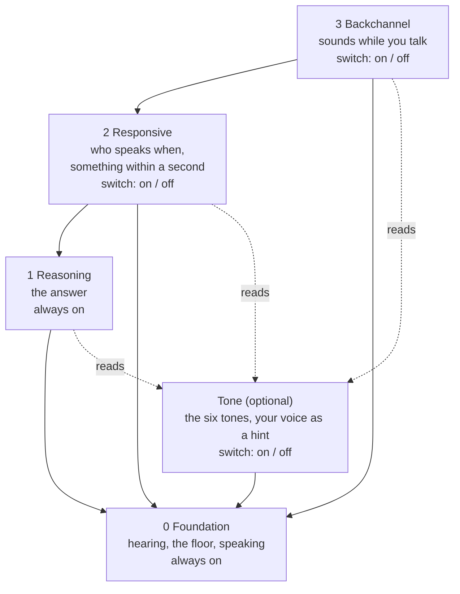
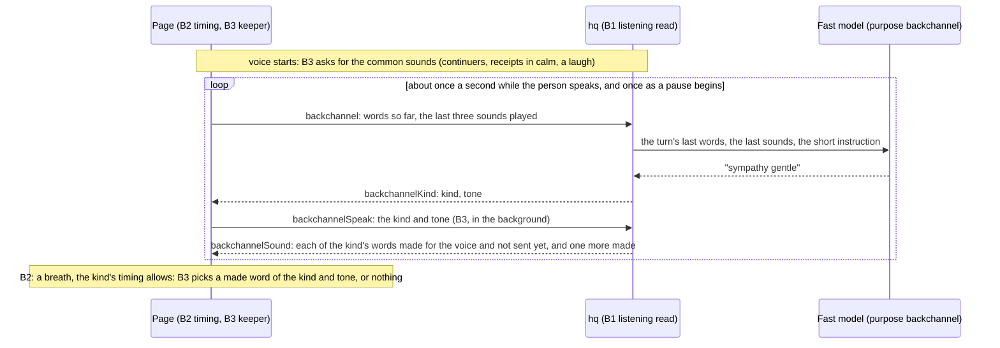

# Adaptive voice listening — spec

**Status:** Rewritten on 19 Nov 2026 around the architecture agreed with the owner that day, after the playtests of
17 to 19 Nov. The design it replaces, corrected lane by lane through those playtests, is kept as
[`spec-archive-1.md`](spec-archive-1.md); the plan's earlier Deviations rows refer to it. The decisions are
[ADR-0195](../../adr/adr-0195-a-light-model-listens-while-the-person-speaks-and-gates-the-conversation-model.md),
[ADR-0196](../../adr/adr-0196-adaptive-voice-switches-the-light-model.md) and
[ADR-0179](../../adr/adr-0179-a-reading-of-the-words-may-extend-a-turn-but-never-end-one-early.md).
[`docs/architecture/voice-listening.md`](../../architecture/voice-listening.md) describes the code as it is.

Every module below carries one of three marks:

- **Built**: on the branch, as described.
- **Agreed, not built**: decided with the owner; the code still does what the *Today* line says.
- **Deferred**: designed in outline, left for later on purpose.

**The v6 build** is the next build agreed with the owner on 19 Nov (*How it is built* lists it): each layer picks its
own tone, and, after its playtest, the hums come from a bigger library again, made on demand and kept per agent voice,
with the words picked by the code, never the model.

Numbers marked *first value* are settings, changed in the voice playground's Tuning.

## Why

Voice without this work feels predictable and a little deaf. Listening sounds play on timers, whatever the person
means; "let me look into that" comes only once the conversation's model starts writing, just before the answer; every
turn, even "Thanks.", waits for that model; and every silence gets the same treatment. A good listener does three
different things at once: makes small sounds that say *go on* while the person talks, knows when the person has
finished and says something at once, and then thinks out the answer. Adaptive voice gives each of those its own part.

**How responsiveness is judged.** People see their words appear on screen 1 to 1.5 s after they say them, and judge
the agent from that moment. Timings in this spec are measured from when the words appear, not from when the person
stopped.

## Why this shape

**The first design put most of the work in one light model.** A fast, cheap model was asked at every pause in the
person's words and at the end of their turn, and answered with one of six tools: keep listening, hum, acknowledge,
invite, close the turn or hand over. It listened, made the listening sounds, decided when the turn ended and what to
say, and later also set the listening style. Tone came in on top, one running tone for the conversation made from the
hum service's answers and the person's voice, read by everything that spoke.

**The playtests showed that this tangled the jobs.** One model doing several things did each of them less well, and
the features leaned on each other in ways nobody chose: the hums ran only with the light model on, because they
waited for its "not yet"; the tone was made inside the hum service, so turning hums off took the tone away too; the
running tone's rules (agree, override, flicker, reset, lock) grew to cover each other's faults. A feature could not be
switched off, or tuned, without reaching into another. The concrete lessons, from the playtests recorded in the plan's
Deviations and the design boards of 19 Nov:

1. **Hums split out of the light model.** Asked at every pause, it gave 68 *keep listening* and 50 superseded answers
   in 118 calls, with no line said, and a hum it chose came 1 to 1.5 s late, on the person's next words. What makes a
   moment right for a hum is sound and timing, which rules know at once; what makes a hum right for the words is
   meaning, which a small call can judge ahead. So the light model lost `hum` and the pause call, and the backchannel
   became its own module.
2. **A bigger hum library, made on demand.** A library of nine kinds in six tones, about 225 recordings per voice made
   at voice start, was built first; it was replaced on 19 Nov by sounds in the model's own words, made at the breath
   and kept per conversation. That day's playtest heard them late (0.7 to 0.9 s to make, so a reaction missed its
   breath or played 8 s later), out of place (a kept sound from another turn standing in), leaking echoes and comments
   ("Oh, her ankle.", "Hmm, good question.") and collapsing to "Mm-hm". So the library came back, bigger (about ten
   words a kind), made the first time a word is needed for an agent voice and kept on hq's disk for every later
   conversation; the read picks only the kind and tone, and the code picks the word.
3. **Tone made per layer.** A tone locked per turn hid how a story ended from the reply; one running tone for the
   conversation flickered on single voice readings and kept a plain question in the previous mood. Each layer already
   hears what it needs, so each picks the tone of its own speech, and the shared part is only the six tones, how each
   is spoken, the person's voice as a hint, and one switch.
4. **The listening style becomes an action in Reasoning.** "Stop humming" was recognised by the light model but
   switched the backchannel off: the turn-taking layer reaching into another layer. Switching a feature on or off is
   an action, and actions are Reasoning's.
5. **Backchannel made independent of Responsive.** The hum rules can run on the sound model's verdicts alone;
   Responsive's "not yet" is one more signal when it is on, never a requirement.

**The shape now.** Three services, an optional Tone layer and the foundation. Each module has one responsibility; each
service and Tone has its own switch; a layer may use the layers below it, never one above; and turning a layer off
never breaks the ones below it.

## The layers

| # | Module | Its one job | Status |
|---|---|---|---|
| F1 | Hearing | Turn the microphone into words; tell voice from silence and from the agent's own echo | Built |
| F2 | Sound model | Say whether the person sounds finished | Built |
| F3 | The floor | Know who is speaking and act on it: duck or stop the agent when the person talks over it | Built |
| F4 | Speaking | Turn text into the agent's voice and play it, one sound after another | Built |
| A1 | Reply | Write the answer to be spoken, and its tone | Built |
| A2 | Turn joining | Fold words added after the send into the reply being written | Built |
| A3 | Recap | Keep a short summary so long conversations stay coherent | Built |
| R1 | Turn decision | At each moment of quiet, choose one of five actions, its line and its tone | Built |
| R2 | Check schedule | Decide when to ask R1 again in a silence | Built |
| R3 | Finish wait | Decide when a pause is really the end | Built |
| R4 | Line guard | Make sure a line is never said over the person or about a pause that has ended | Built |
| B1 | Listening read | Judge, about once a second, what sound a listener would make now | Built |
| B2 | Hum timing | Decide whether a breath gets a sound | Built |
| B3 | Sound keeper | Have the sound ready: a word of the hum library, made on demand and kept per agent voice | Built |
| T1 | Tone language | The six tones and how each is spoken at each strength | Built |
| T2 | Voice hint | Turn the voice profile into a short hint for the layers that pick a tone | Built |
| T3 | Tone switch | Let tone be turned off everywhere at once | Built (in Tuning) |

**The playground is a tool, not a layer.** Its Log, Tuning and *Hear the sounds* watch every module and change their
numbers; it is never on the path a person's voice takes.

## Layer 0 · The foundation

Always on; used by everything above.

**F1 · Hearing** (built; browser `acoustic/`, `stt/`). Takes the microphone's audio; gives words as they grow, speaking
or silent, and the voice profile's readings. Speech to text is Inworld, told the person speaks English
(`tone.speechLanguage`, `en`; `any` lets it detect the language, for when more are supported), or AssemblyAI, which
gives no voice profile. The echo filter knows the words of every line and sound the agent plays, so they are never
written down as the person's.

**F2 · Sound model** (built; browser `semantics/`). Takes the end of the person's speech; gives `READY`, `UNCERTAIN` or
`KEEP_LISTENING`. 0.2 s into a silence the audio turn model scores the last 8 s; sure at 0.5 s, and at the latest the
3 s pause cap ends the turn. It never reads words.

**F3 · The floor** (built; browser `orchestration/floor`). Takes F1 and what is playing; gives *person speaking*,
*agent speaking*, *ducked*. The agent makes one sound at a time: a hum, a line, a stored phrase or the reply. When the
person talks over the reply it ducks, then stops on a stop word or enough words; "mm-hm" does not stop it. Hums and
`acknowledge` lines play 6 dB under a reply's level. **Two faults found in the playtest of 19 Nov, fixed:**

- *A reply that was talked over does not come back before the words arrive.* When the person's voice in the
  confirmation window adds up to more than 0.5 s (*first value*), a window that closes in silence with no words yet
  waits for the words, up to 1.5 s more (*first value*), instead of resuming the reply. A short sound, a cough or a
  short "mm", still resumes it. Both are Tuning settings (`bargeIn.wordsVoiceMs`, `bargeIn.wordsWaitMs`).
- *A finish heard while the reply is ducked is not lost.* A `READY` that comes while ducked is kept, and counts as soon
  as the reply has stopped and the person is still quiet, through the normal finish wait (R3), so the turn goes about
  the learned wait after they stopped rather than at the floor's timeout.

**F4 · Speaking** (built; hq's speech path, browser speaker). Takes text and its steering (T1); gives audio, played one
sound after another. Steering is sent only to a speech model that takes a direction (Inworld TTS-2); the words shown,
stored and timed are never steered.

## Layer 1 · Reasoning

Always on. On its own it is plain voice: the sound model ends the turn, nothing is said until the answer.

### The heavy model

**A1 · Reply** (built). The conversation's own agent and model. Takes the conversation (older parts folded by
compaction) and the person's words only, nothing the light model did this turn; gives the answer, written for the
ear. Called only on a `hand_over` or the fallback when Responsive is on, and on every turn when it is off. With the
flag on, its voice instructions say only how to speak: no opening line ("let me look into that" is Responsive's hold),
no judging whether the person finished, no `keep_listening` tool (the voice turn block). Its first word comes later
than without Responsive, by the light model's call; the hold covers the wait.

**Its tone** (built; hq `lead/toneTag`). With Tone on, the voice instructions ask for a `[tone: …]` tag, one of the six
tones (T1), at the start of a spoken reply. hq takes it out of the start of each model step's text as it streams, the
tag split across pieces included, before anything is spoken, shown in the chat or stored. A tag naming no tone hq knows
is still taken out, and is calm; a bare `[warm]` counts too. The reply is spoken with "a little" of its first tag's tone,
read before its first words; no tag means calm. With Tone off no tag is asked for and nothing is taken out.

**The listening style as an action** (built; `set_listening_style`, hq `coordinator/listeningStyle`). The person may
ask to be listened to differently: "stop humming", "fewer of those", "let me finish", "back to normal". Switching a
feature on or off is an action, so it is a Reasoning tool, offered with the flag on every turn that is offered tools
(so the cached tool list is the same for a typed and a spoken turn), and changing something only for the person who
holds voice; anyone else is refused. Responsive only hands the request over, as its instructions say for how the person
wants the agent to talk. hq sends the holder's page `listened` with the style, carrying the latest call's `seq`; such an
answer decides nothing else, and the page applies it whatever call is the latest. A few seconds to take effect is fine
for a preference. The effects are R1's *Listening style*.

### Turn joining

**A2 · Turn joining** (built; hq `voice/continue`). Takes words the person says after the turn was sent, before any of
the reply is heard; gives one reply to the whole of what they said: their words join the message and the reply is
written again. The light model, knowing it already played a hold, does not repeat one. Interrupting a reply that is
playing is the floor's (F3), and the person's new words then come here.

### The recap

**A3 · Recap** (built; hq `voice/listener/recap`, `listening/recapCall`). After each reply that completed, one small
separate call to the conversation's own model, with none of the agent's instructions or tools, writes a recap under
100 words (*first value*): where the conversation is, what the person wants, anything left open. It reads the previous
recap and this turn's two messages; the light model reads it. It runs while the reply plays, so nothing waits for it.
An interrupted or withdrawn reply, or a turn the light model closed alone, writes none; a failed call keeps the last.
It is not the compaction summary. It is a separate call because, offered as a tool inside the reply, the model called
it in only 14 to 33 of 50 replies.

## Layer 2 · Responsive

Who speaks when, and something said within a second. **Off:** plain voice; the sound model ends the turn and nothing
is said until the answer.

### The light model

**R1 · Turn decision** (built; hq `voice/listener/`, instructions version 17). A fast, cheap model that reads the
person as a good listener would. Takes the turn, recent exchanges and the moment; gives exactly one of five actions,
its line, and its tone. hq decides only **when** it is asked (R2, R3); the light model decides
**what**. Its words are its own each time, guided by examples in its instructions: no stored lists or templates.

#### What it reads, each call

- **The message so far**: everything said this turn.
- **What just happened**: they sound finished; quiet for how long after a "not yet"; the agent working for how long.
- **The recap** (A3), and **the last 6 messages** word for word (*first value*).
- **Its last 5 spoken lines** across turns (*first value*) and what it did this turn, so it does not repeat itself.
- **Its checks in this pause**: each choice since the person's words last changed, with the quiet at each, the last 6
  and a count of earlier ones; after an invitation, how long ago it came and whether the presence check is due.
- **The voice hint**, with Tone on: T2's word for how the person sounds ("sounds sad"), to weigh with the words.

Nothing else: not the agent's instructions, tools, tasks or knowledge.

#### The five tools

The answer is one JSON object (`{"action": "acknowledge", "say": "Right."}`), not provider tool calls: measured as safe,
about 1,100 fewer input tokens and 0.2 s quicker a call. Provider tool calls stay in the module as a second format.

| Action | When | Cap (words, *first value*) | What happens |
|---|---|---|---|
| `keep_listening` | Still talking or thinking; the default | — | Nothing plays; a "not yet" if it answers a finish |
| `acknowledge` | A short reply to something they told it, never a bare sound (that is Backchannel's); also a further hold line while the agent works | 6 | Plays at once |
| `close_turn` | Finished, and the reply needs nothing known, decided or done; and hq's own call at the "not yet" limit | 6 | Plays; the turn is over; the heavy model is not called |
| `hand_over` | Finished, and it needs thinking | 12 (the hold) | The hold plays; the message goes to the heavy model |
| `invite` | A silence that calls for it: its wording grows with the quiet; the one presence check at the last check before the limit | 6 | Plays at once |

`hand_over` has three parts, in order: `asked` (what they want, a few words), `answer` (the answer it would give, one
sentence of at most 15 words, cut to the cap, never spoken, discarded in the product as it arrives and shown only in
the playground and the tests), and `hold` (the line the person hears, with the context of what they asked).

A call that breaks a rule (two actions, text beside one, an unknown action, `close_turn` or `hand_over` outside a
*sounds finished* call or a re-check of a turn it kept open, a line over its cap, no words) is read as
`keep_listening`. An invitation never guesses what they were about to say and never claims that something went wrong.

**Its tone** (built; instructions version 18). The answer carries an optional `tone` on every choice that speaks, one
of the six (T1), calm when absent or anything else, and the instructions a line on choosing it. hq speaks the line with
"some" of it, calm with Tone off. A stored hold or closing phrase is calm.

#### What it may answer alone

`close_turn` only when the reply needs **nothing known, nothing decided and nothing done**; everything else, and
anything it is unsure of, is `hand_over`.

| They say | Action | Why |
|---|---|---|
| "Thanks." · "Hi." · "Okay, bye." | `close_turn` | Social |
| "Okay." · "Makes sense." | `close_turn` or `keep_listening` | A receipt; they may go on |
| "Stop talking." · "Hang on a second." | `close_turn` | About the conversation itself |
| "Yes." to "Shall I open the log?" · "Call me Sam." · "No, I meant Tuesday." | `hand_over` | Something to do, remember or correct |
| "What's the weather in Melbourne?" · "Remind me at nine." · "What do you think?" | `hand_over` | A fact, an action, an opinion |

#### Keeping it from answering

A fast model shown the conversation and told only to acknowledge kept answering. Four guards: the `answer` field gives
the urge to answer somewhere unspoken to go; its framing (it is the listener, with no tools and no facts; another part
answers; it speaks as the agent and never of handing over); the word caps; and the measurements (below). **A hold
never answers a fact**, gives advice or an opinion, or promises anything but how it listens.

#### Listening style

Set by Reasoning (A1, `set_listening_style`); the light model only recognises a request about how it listens and hands
it over (`hand_over`, as for how the person wants the agent to talk). A `style` it still sends is ignored. The styles:
`hums_off` ("stop humming"), `hums_fewer` ("fewer of those"), `patient` ("let me finish"), or `normal` to undo them.
hq sends it on `listened.style`; the browser keeps it for the conversation, in the page's memory only. Styles combine;
`hums_off` and `hums_fewer` replace each other; `normal` clears all. The effects:

- `hums_off`: no hums at all; `hums_fewer`: both hum spacings ×2 (`pacing.fewerTimes`).
- `patient`: 1.0 s more quiet before `READY` counts (`pacing.patientExtraMs`), under the pause cap; and no line until
  the turn has really ended (an `acknowledge` or `invite` in their turn, or a hold, is dropped as by R4).

### When it is asked

**R2 · Check schedule** (built; hq `voice/listening/schedule`). Takes the quiet time and whether the answer is being
worked on; gives the next moment to ask R1, sent as `listened.nextCheckSecs` and timed by the browser from the answer's
arrival.

- **Never while they talk.** A pause in their words asks nothing; listening sounds are Backchannel's.
- **They sound finished**: a fresh *sounds finished* call (R3 says when). Only this call, and a re-check of a turn it
  kept open, may end the turn.
- **A turn kept open** (a "not yet"): at 5, 15 and 30 s of quiet (*first values*), then the 60 s limit. The 30 s call
  says it is the last before the limit. New words restart the schedule and the bound from the next quiet.
- **The heavy model working**: at 4 s, then every 8 s (*first values*), until the reply's first sentence.
- **Not while the reply plays**; a pending check is cancelled when they speak again.

The light model no longer says when to come back: asked to, it checked every 2 to 3 s, then brought the presence check
unreliably. A `next_check` it still sends is ignored.

### When a turn ends

**R3 · Finish wait** (built; browser `orchestration/scheduler`, `pacing/`). Takes the person's breaths and the sound
model's verdict; gives "the turn is finished", which sends the *sounds finished* call. Its answer decides
([ADR-0179](../../adr/adr-0179-a-reading-of-the-words-may-extend-a-turn-but-never-end-one-early.md): meaning may extend
a turn, never end it early):

| Answer | What happens |
|---|---|
| `close_turn` | Its words play; the turn is over; the heavy model is not called |
| `hand_over` | The hold plays; the message goes to the heavy model |
| `keep_listening`, `acknowledge`, `invite` | "Not yet": the turn stays open, checked on R2's schedule |
| No usable answer within 2 s (*first value*) | **Fallback**: the message goes to the heavy model; a stored hold phrase plays (about 40, none of the last 8 again) |

- **"Not yet" is bounded.** At 60 s of quiet (*first value*), after an invitation nobody answered, hq closes the
  turn: one more call (moment `limit`, only `close_turn` allowed) for a closing line of its own that leaves the door
  open, and a stored closing line if that fails. Otherwise the message goes to the heavy model with a stored hold
  phrase.
- **False finishes.** The person speaking again within 1 s of a send is a false finish. Each one this turn adds 0.5 s
  to the quiet `READY` needs, from 0.5 s to 2.0 s at most (*first values*), never past the 3 s pause cap; counted afresh
  each turn. A `READY` before that much quiet waits, and the person going on cancels it.
- **Adaptive pacing.** A *breath* is a pause the person went on after, with no sound of the agent's in it but a hum.
  From the most recent 12, once there are 5 (*first values*), the finish wait is set just past 9 in 10 of them plus
  0.2 s, within 0.5 to 2.5 s, in every turn; false finishes step up from it. The latest a hum may start in a breath is
  8 in 10 of them, within 0.8 to 2.0 s, given to B2. Per conversation, in the page's memory only; a reload starts
  afresh. Its own Tuning switch; off, the fixed values hold.
- **A finish held by the wait counts as a breath**: Backchannel may hum in it.
- **A turn the light model closes alone is a real turn**: the message attached to a completed turn, its lines as the
  agent message, its cost in the ledger, the screens told.
- **A raised hand** keeps its own path: an invited agent's "go ahead" is handled before the light model.
- **No answer at all** for 15 s: the words go as a plain message and the session is plain voice.

### How its words are played

**R4 · Line guard** (built; browser `listener/trigger`, `adapters/linePlayer`). Takes a line and the person's voice
since its call was asked; gives *play* or *drop*.

- hq speaks each line on its own path, separate from the reply's, in the agent's ordinary voice, and streams it in
  parts, so it starts while the rest is made. One line at a time.
- **Nothing the light model says is interrupted** once it starts.
- **A line never starts over the person, nor about a pause that has ended.** An answer that comes after they spoke
  since its call, or while they speak, plays no line; a line that comes due while they speak is dropped. The decision
  stands (a `hand_over` still hands over). The browser sends `linePlayed` `skipped`, so the line is not stored as heard.
- **One decision plays its line once**, however often its answer or audio arrives.
- An answer to a call that is no longer the latest decides nothing; only its `acknowledge` may still play.
- The reply waits for a playing line or hum. Lines do not reset the 2-minute end of a silent voice session.

## Layer 3 · The backchannel

The small sounds of listening ("Mm-hm.", "Oh no.", "Ooh.") while the person talks, to encourage them to go on, of the
right kind for what was just said. **Off:** no listening sounds; everything else unchanged. Three modules meet only
when the person breathes: B1 knows what to say, B2 knows when, B3 has it ready.

### The listening read

**B1 · Listening read** (built as the hum service; hq `voice/humService/`, browser `backchannel/service`). Takes the
turn's words so far (the last 60), the last three sounds played (their words, so it can weigh what was just said back)
and, with Tone on, the voice hint (T2); gives a kind and a tone, or `none`. **It never picks the words**: the code does,
from the hum library (B3).

- **When asked**: while the person's voice is on and their words have grown, every 1 s (*first value*), and once more
  as each pause begins (`atPause`; hq adds "They have just paused."). One call at a time; an answer more than 2 s after
  its question is dropped. **Never in a long silence**, over the agent, or with Backchannel off.
- **Its model**: the resolver's purpose `backchannel`, its own branch and short list, DeepSeek Flash first; never the
  agent's model or a person's own subscription; costed under `backchannel`. No model reached: hq answers `off` and the
  page asks no more.
- **It reads the words as a live transcript**: punctuation unreliable, often none at the end. `none` only for a plainly
  cut-off ending or a question to the agent.
- **The answer** (instructions version 8): one line, `kind tone`; anything after the tone (words the model adds anyway)
  is ignored. A tone the kind does not take, does not know, or none given, is the kind's default (its first tone in
  the library). With Tone off, hq answers calm, which every kind but amusement takes.

| Part | Values | Decides |
|---|---|---|
| Kind (what it means) | continuer, receipt, agreement, thoughtful, realisation · news, sympathy, delight · amusement · or `none` | The timing class (B2): *listen*, *react*, *laugh*; and the list of words the sound is picked from (B3). The model keeps nine kinds; the code maps them to three, because the spike with three kinds labelled reactions worse |
| Tone (how it is said) | calm, warm, curious, thoughtful, gentle, bright (T1), as the kind takes it | The steering it is spoken with |

The read's instruction lists each kind with the tones it takes. Nothing it says is ever spoken: with free words, the
19 Nov playtest heard echoes and comments ("Oh, her ankle.", "Mm, Thursday.", "Hmm, good question.", "Take your
time."). An answer that is not the line at all is a failed call, never a sound by default. **A failed, late or
unreadable read** leaves the read before it standing.

**The hum library** (`backchannel/library`): about ten words a kind, each kind in the tones it can sensibly take (up to
four, calm among them, the first its default). Never a word of content, an opinion ("nice"), a question ("Really?") or
an invitation ("Go on"); amusement is a laugh only.

| Kind | Words | Tones (first = default) |
|---|---|---|
| continuer | Mm-hm. · Mhm. · Uh-huh. · Mm. · Yeah. · Mmm. · Yep. · Mm-hm, yeah. · Uh-huh, yeah. · Mm-hm, mm-hm. | calm, warm, curious, gentle |
| receipt | Okay. · Right. · I see. · Got it. · Mm, okay. · Okay, right. · Alright. · Mm, right. · Right, okay. · Okay, got it. | calm, warm, thoughtful |
| news | Oh. · Ah. · Oh, okay. · Oh, right. · Ah, okay. · Oh, yeah. · Oh, alright. · Ah, alright. · Oh, huh. · Oh, hm. | calm, curious, bright |
| realisation | Ahh. · Ah, I see. · Oh, I see. · Ah, right. · Oh, got it. · Aha. · I see now. · Ah, gotcha. · Oh, right, right. · Ohh. | calm, warm, curious |
| thoughtful | Hmm. · Hmmm… · Mm… · Huh. · Hm, okay. · Hmm, okay. · Hm. · Hmm, right. · Huh, okay. · Mm, hmm. | thoughtful, calm |
| agreement | Yeah. · Right, right. · True. · Yeah, yeah. · Mm, yeah. · Yeah, true. · Exactly. · Mm, true. · Yep, yep. · Right. | calm, warm, bright |
| sympathy | Oh no. · Aw. · Ouch. · Oh dear. · Oh, no… · Aww. · Oof. · Oh, man. · Oh, gosh. · Oh, ouch. | gentle, warm, calm |
| delight | Ooh. · Wow. · Oh! · Oh, wow. · Ooh, yeah. · Whoa. · Ooh, wow. · Oh, yay. · Ah! · Wow, okay. | bright, warm, calm |
| amusement | a laugh ("(laughs)", spoken as `[laughing]`) | bright (takes no steering) |

At most 241 sounds an agent voice, made only as they are needed.

### Hum timing

**B2 · Hum timing** (built; browser `backchannel/trigger`, `settings`, `reaction`). Takes the person's pauses, the sound
model's verdict and the latest read; gives *play now*, or why not (a near miss). A sound is due:

- **In a breath**: a pause of 0.4 s (*first value*) to the latest start (1.2 s, or the learned pace from R3), whose
  latest sound model verdict is `UNCERTAIN` or `KEEP_LISTENING`, or `READY` while the finish wait holds it; or
- **on the next tick after Responsive's "not yet" with nothing to say**, while they are still quiet (when Responsive
  is on).

And always, by the kind's timing class:

| Class | Kinds | Spacing (the person's speech since the agent's last sound) | Held |
|---|---|---|---|
| *listen* | continuer, receipt, agreement, thoughtful, realisation | 6 s (*first value*) | No |
| *react* | news, sympathy, delight | 3 s (*first value*) | 4 s over a plainer answer, or until it comes due; a `none` in the pause itself still wins |
| *laugh* | amusement, or a laugh heard in the person's voice (T2) | 3 s | As *react* |

**Reactions** belong to their moment: a reaction read is used at the breath it comes due, played or not, and never at a
later breath (the playtest heard "Oh no." 8 s after the ankle); and two never come in a row without a *listen* hum, or
8 s (*first value*) of the person's speech, between them (the playtest heard three in 16 s). All three spacings are
Tuning settings; the playground resets the values it kept from before to these once.

Also: at most one a pause; not when the words end on a question; never while any of the agent's audio plays; none once
the turn is handed over (until the reply plays) or closed (until they speak again); none under `hums_off`, spacings ×2
under `hums_fewer`. A pause with no sound says the one rule that held it back.

**Independent of Responsive** (built). With Responsive off, B2 goes by the sound model alone: `UNCERTAIN`
or `KEEP_LISTENING` may hum by the rules above; `READY` never hums (the turn goes to plain voice). Its own switch is
enough. In plain voice a send ends the backchannel's turn and forgets the listening read's answers, so none carries
into the next turn.

**The laugh** happens only here. Tone's voice hint informs ("laughing" at 0.6 or more, `tone.laughConfidence`);
Backchannel decides and plays. Responsive and Reasoning never laugh.

### The sound keeper

**B3 · Sound keeper** (built; browser `backchannel/keeper`, `library`, `sounds`; hq `voice/humService/store`, `sound`).
Takes each read's kind and tone; gives a made word of them at the breath, or nothing.

1. **Made on demand, kept per voice.** A word in a tone is made the first time it is needed for an agent voice, by hq,
   spoken with the tone's full steering (T1), and kept on hq's disk beside the voice previews and the stored phrases,
   for every later conversation in that voice. Its file is named by the speech model and exactly what was sent, so a
   changed steering is a new sound. A laugh is the bare tag `[laughing]`, made only on a speech model that takes a
   direction.
2. **Warmed as voice starts.** The page asks for the common sounds (the continuers and receipts in calm, a laugh): hq
   sends those made for the voice and makes the rest.
3. **Asked for as each read comes.** The page asks for the read's kind in its tone (`backchannelSpeak`, in the
   background): hq sends each of the kind's words made for the voice that it has not sent this voice session, with no
   speech call, and makes one more, so the set fills over a few conversations. hq speaks only the library's words,
   never words from the page or a model. A laugh heard in the person's voice asks for the laugh too.
4. **Play**, when B2 says a sound is due: a word of the due kind, picked at random among those on the page in its tone,
   never one of the last three played (a laugh excepted: there is one); else nothing, and why. Never a word of another
   kind or tone, never later than its breath, never over the person, and never while any of the agent's audio plays.
   A due sound that never starts gives back the speech it counted toward the spacing.

The page keeps the sounds hq sent for the voice session only; a new voice session is sent them again from hq's disk,
with no speech call. When the listening read is off or has not answered usably this turn, a calm continuer stands in,
picked as any other.

**A sound belongs to no turn.** It never starts, ends or keeps open a turn; it is never stored, shown in the chat, or
read by either model as something said. While it plays everything else waits; nothing cuts it off.

## Tone (optional)

The shared language of tone, and the person's voice as a hint. **Off:** everything spoken calm; every layer still
works. Each layer picks the tone of its own speech at the moment it speaks; nothing carries over unless the words do.

| Layer | Its speech | Picks its tone | Strength |
|---|---|---|---|
| Backchannel | sounds | B1, per sound | full |
| Responsive | holds, short lines | R1, a `tone` field in its answer | some |
| Reasoning | the reply | A1, a `[tone: …]` tag at its start | a little |

### The tone language and the switch

**T1 · Tone language** (built; hq `voice/toneSteering`, the sounds' in `backchannel/kinds`). Takes a layer's chosen
tone; gives the steering sent with the speech. **Calm is no direction at all**, for a sound, a line and the reply alike,
exactly as without Tone; no other tone's steering says calm, or a speed word (pace belongs to pacing, not tone: the
playtest's reply steered "unhurried" sounded slow and sad).

| Tone | Chosen when the person is… | A sound (full) | A line ("some") | The reply ("a little") |
|---|---|---|---|---|
| calm | telling something ordinary | nothing | nothing | nothing |
| warm | sharing something personal or effortful | `[warm, encouraging]` | `[warm]` | `[a little warm]` |
| curious | building up to something | `[curious, interested]` | `[interested]` | `[a little curious]` |
| thoughtful | weighing an idea or a choice | `[low voice, thinking]` | `[thoughtful]` | `[a little thoughtful]` |
| gentle | telling something bad or worrying | `[soft, sympathetic]` | `[soft, kind]` | `[a little softer]` |
| bright | telling good news or something funny | `[bright, pleased]` | `[pleased]` | `[a little pleased]` |

hq looks up a tone it knows, never a string from the page or the model.

**T2 · Voice hint** (built; browser `tone/voiceProfile`, `tone/voiceHint`; hq `toneSteering`). Takes Inworld's emotion
and vocal-style readings (top 3, each with a confidence, about one a second); gives a label: the vocal style first where
it is one hq offers (laughing, crying, whispering), else the emotion (happy, tender, sad, fearful, surprised), at the
confidence bar (`tone.voiceConfidence`). Calm, neutral, anger, disgust and the plain styles give none, so the agent never
mirrors anger. A reading taken while the agent's audio plays is ignored; a reading with no label at the bar clears it.
The page sends the label; hq puts it in its own words ("sounds sad", "sounds worried", "laughing"), never a string from
the page, and offers it to R1 and B1, which weigh it with the words. Only on Inworld; AssemblyAI and dictation never ask.
The heavy model is not offered it.

**T3 · Tone switch** (built; `tone.on`, in Tuning). Takes the setting; gives calm to every layer, whatever it picked: no
tag is asked of the reply, the light model's and the listening read's tones are spoken calm, the voice profile is not
asked for (from the next speech connection) and no hint is offered. The page tells hq the switch and the hint on the page
event `voiceTone`, as either changes and before a question to either model; until a page says, hq takes Tone as off, so
the mobile app's voice is calm, as before. By voice ("turn off tone") with the voice preferences, later.

The running tone of the earlier build (`tone/turnTone`, the *steers* choice and the *tone families* switch) is removed.

## The contract between Backchannel and Responsive

1. Backchannel owns the pauses that are not the end (the person's breaths); Responsive owns the end of the turn and the
   silences.
2. Responsive's "not yet" with nothing to say hands that pause to Backchannel.
3. A line from Responsive beats a sound; after a hand over, no more sounds.
4. A sound playing makes Responsive's line wait; the agent makes one sound at a time (F3).
5. A finish held by the finish wait (R3) counts as a breath: Backchannel may hum in it.
6. Backchannel's listening read is asked only while the person speaks and once as a pause begins; never in a long
   silence.

## Adaptive voice and the switches

One switch per service, and one for Tone, in the playground first; for a person, through *Settings › Adaptive voice* (below). Reasoning is always on.

| Responsive | Backchannel | Tone | What the person gets | Status |
|---|---|---|---|---|
| off | off | off | Plain voice: the sound model ends the turn, nothing until the answer | Built |
| on | off | off | Fast turn-taking, holds and short lines; no sounds while they talk | Built |
| on | on | off | Everything, spoken calm | Built |
| off | on | off | Plain voice that hums while they talk | Built, in the playground (`backchannelAlone`) |
| any | any | on | Whatever is on, each speaking in the tone it picked | Built |

**The product's settings** (owner, 19 Nov): *Settings › Adaptive voice* keeps its switch, the light model and the parent
of two more, shown disabled while it is off with their values kept: *Hums* (`voiceHums`, Backchannel: off, no listening
sounds and everything else stays) and *Expressive tone* (`voiceExpressiveTone`, Tone: off, every layer speaks with no
steering and no voice hint is used). Each defaults on, is the person's own and is read as voice starts, into the
session's `backchannel.on` and `tone.on`. The playground keeps its own Tuning switches.

**Today's settings.** The person's *Adaptive voice* is the light model
([ADR-0196](../../adr/adr-0196-adaptive-voice-switches-the-light-model.md)): off, or with no light model reached, hq
answers every `listen` with `keep_listening` and `off`, and the session is plain voice, with no backchannel, pacing,
style or tone. The playground also has the backchannel's switch (`backchannel.on`), the hum service's
(`backchannel.serviceOn`) and Tone's (`tone.on`). The backchannel
runs when `voiceListener && (adaptiveVoice || backchannelAlone) && backchannel.on`. `backchannelAlone` is off in the
product, so a person with *Adaptive voice* off hears no hums; the playground turns it on, so there the backchannel's
switch alone decides. A Responsive switch separate from *Adaptive voice* is not built (*Not decided yet*, 1).

**Unchanged by any switch**: speaking over the reply (F3), the 2-minute end of a silent voice session, *Voice sounds*.

**Flag off** (`voiceListener`, stage *experimental*): voice as before the flag, with the timed listening family, the
standard acknowledgement and the heavy model's own hold and opening line.

## The client protocol

Version **1.3** ([versioning](../../architecture/versioning.md)); 1.1 and 1.2 were never released (1.3 adds the Hums and Expressive tone settings to `UserSettingsView`). On the conversation's voice
socket (`core/src/client/voice.ts`):

| Event | From | What it says |
|---|---|---|
| `listen` | browser | `seq`, the moment (`soundsFinished`, `quiet`, `working`), the message so far, `quietMs`, `workingMs`, `keptOpen` |
| `listened` | hq | The answer to `seq`: the action, the words to say, `nextCheckSecs`, the optional `style`, `turn` when it ended, `off` when no light model listens |
| `line` | hq | A line's audio in parts: the light model's words, or a stored phrase |
| `linePlayed` | browser | A line played to its end, or `skipped` |

Deprecated and still answered: `turnHeld`, the `trailedOff` flag, the moment `quietAfterWords` and the action `hum`.
hq also asks the moment `limit` of itself.

**hq's own pages only** (`CONVERSATION_VOICE_PAGE_SOCKET`, no version): `backchannel` (the read's question, `atPause`
on a pause's, `recent` the last three sounds played), `backchannelKind` (its answer: a kind and a tone),
`backchannelSpeak` (the keeper asks for a kind's sounds in a tone, `warm` as voice starts), `backchannelSound` (a
sound of the library, its audio and whether it was made new or already made, or `failed`) and `voiceTone` (the
Tone switch and the voice hint's label; it replaced the running tone's `turnTone`). The
mobile app never hears a sound from Backchannel.

## What is stored

- **The person's message**: their words.
- **The agent message**: the light model's lines the person heard, in order, joined to the reply; a `skipped` line is
  taken out unless that leaves nothing. A turn closed alone stores its lines as the agent message.
- **The recap**, on the conversation, replaced each turn.
- **The hum library's sounds**, as audio files on hq's disk per agent voice, beside the voice previews and the stored
  phrases: no words of the person, and none of the conversation.
- **Never stored**: `answer`; the light model's and the listening read's answers; which sounds played; the pace;
  the style; the voice profile; any tone, the reply's tag included. Logs carry the choice and the timings, never the
  words of `answer`. What the light model and the listening read are sent goes to their vendor, which may differ from
  the conversation's own.

## Which light model, and its cost

- hq resolves the purpose `listener` with its own branch, within the organisation's model lists, never the agent's
  model or a person's own subscription: Inworld first when the organisation has it, then each provider's fast model
  (`routing/listener.ts`). The listening read has its own purpose, `backchannel`, alike. None reached: as off.
- Costs go in the usage ledger under `listener` (the recap with it) and `backchannel`.
- The light model: one call in flight at a time per voice session, a newer one aborting the older. The listening read:
  one at a time, a question skipped while one is in flight. A time limit of 2 s for each.
- The baseline for every model check is **DeepSeek Flash**, through OpenRouter.

## Measurements that still matter

On DeepSeek Flash, from the unit's model checks and playtests:

| What | Result |
|---|---|
| A line that answers, advises, claims or promises | None in 2,095 lines (instructions version 9) |
| Finished or not, where the words can tell | 93% |
| The light model's scripted set at the close | 13 of 14 |
| The check schedule, trailing off | An invitation by 15 s and the presence check at 30 s in 9 of 10 runs; its own closing line at the limit in every run |
| The light model's call | Median 0.9 to 1.0 s, 95th percentile 1.9 to 2.4 s (why the time limit is 2 s) |
| Holds | Median 2.78 s (was 4.18 s), first audio 0.58 s (was 1.17 s), once lines were spoken plainly and streamed |
| The hum service (version 5, live-transcript text) | Median 0.53 s, 90th percentile 0.90 s; kind right at 43 of 66 marked points, 13 near; `none` right at 12 of 21 |
| The listening read with words (spike, 27 points) | Words fit and stay short; median 0.69 s, 90th percentile 1.13 s; two questions slipped through (hence the guard); varied once told its last three sounds |
| The listening read as built (version 6, 28 points, one run) | Kind right at 19 of 28 (7 of 8 reactions, the laugh); median 0.57 s, 90th percentile 0.88 s; 6 sounds dropped by the guards (3 questions, 1 too long, 2 statements), each keeping its kind and tone; none unreadable |
| The listening read, `kind tone` only (version 8, 30 points, one run) | 30 of 30 readable, every answer a bare `kind tone` or `none` (no words added); kind as marked at 20 of 30; median 0.51 s, 90th percentile 0.86 s |
| The light model's tone (version 18, 10 messages, 2 runs) | A tone named in 20 of 20 answers, each one that fits (gentle for a death, bright for good news and a funny story, thoughtful for a choice); "stop humming" and "let me finish" handed over in 4 of 4, no style named |
| The reply's tone tag (8 messages with tools, 2 runs, streamed) | Every reply that wrote words opened with a tag (9 of 9), its tone fitting, the tag always split across stream pieces and never left in the text; after a tool round the next step's words opened with one too (6 of 6); `set_listening_style` called with the right style in 6 of 6, mostly with no words in that step, which the next step says |
| Spend for the whole unit | $1.63 on OpenRouter, against a $10 stop |

## How it is built

- **Pure cores with thin adapters.** The light model's instructions, actions, parser and rules are one module in hq
  that hq and the voice playground both run, so what is tried is what ships; the listening read likewise.
- **Behind the flag `voiceListener`** ([feature flags](../../architecture/feature-flags.md)), stage *experimental*.
- **Graduation, layer by layer** (proposed on the design boards, not yet decided): Reasoning is plain voice;
  Responsive next; Backchannel and Tone last, with quiet defaults. At graduation the timed listening family, the heavy model's hold and opening line, the trailed-off note and
  `turnHeld` are removed; the stored hold phrases stay as the fallback.
- **The v6 build**, agreed on 19 Nov, in two lanes, one after the other (lane 31 the hums, lane 32 the tone and the style), in order: the listening read's `kind tone | words` with its last
  three sounds, the question guard and the three timing classes; prefetch and the in-memory keeper, playing within the
  breath and the fallback to a kept sound; the library removed, the laugh kept as "(laughs)"; the light model's `tone`
  and the heavy model's `[tone: …]` tag; the running tone removed, one Tone switch, the voice hint as a word; the Log
  showing each sound's words, whether it was kept or spoken new, how late it played, and each line's and reply's tone.
  After its playtest (lane 33): the read back to `kind tone`, the hum library back with about ten words a kind, made on
  demand and kept per agent voice, the word picked by the code at the breath, reactions used at one breath only and
  never two in a row, the spacing at 6 s and 3 s, and calm as no direction at all.
- **The listening style as a Reasoning tool**: built with the v6 build, with the tone (lane 32).

## Decided for the v6 build

Settled by the lead on 19 Nov when the owner started the build, for the owner's review with it:

1. **The listening style.** The heavy model gets a voice tool, `set_listening_style`, with the same values as today.
   hq sends the browser the same `listened.style` event it sends now, so the client protocol does not change; only its
   source moves from the light model to the heavy model. The light model no longer sets a style.
2. **When the listening read is off, late or failed**, the read before it stands, or a calm continuer; B3 plays a made
   word of that kind and tone if the page has one, otherwise nothing. A breath with no sound is not a fault. (Corrected
   19 Nov: the words come from the hum library, made on demand and kept per agent voice, not from the read.)
3. **The voice profile has no switch of its own.** With Tone off, every layer speaks calm and the voice hint is not
   offered to any layer. The laugh is Backchannel's: an `amusement` read still laughs with Tone off.
4. **How late a hum may start** stays today's rule (the latest start, learned with the pace), not a new 2 s figure.

## Not decided yet

1. Whether Responsive gets a switch of its own, separate from *Adaptive voice* (today the light model's switch), and
   whether the product turns `backchannelAlone` on.

## Not in this spec

- **The voice preferences** (deferred): a few plain preferences the person changes by asking (hums, patience, tone,
  laughing, check-ins, reply length), per conversation first and remembered for the person later. Left until the
  features prove themselves.
- "Still with me?" during a long reply, and a bid to come in while the person talks.
- Moving a reply to background work; messages sent while a reply runs; several speakers; speech-to-speech models.
